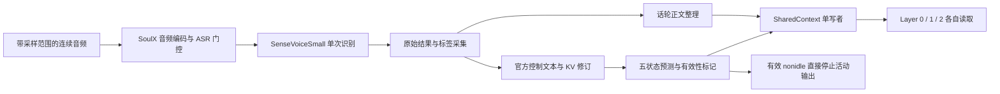

# ASR 前端：转写与 special token 写入 SharedContext

更新：2026-10-30。用户确认每处理一个 160ms 音频块，将最新话轮全文和本块状态一起覆盖写入 SharedContext；不保留历史正文版本，取消 320ms 定时发布方案。新合同详见[共享接口](shared_context_interface.md)与[联合更新说明](streaming_transcript_publication.md)。修订原因是简化存储和下游读取，使正文与状态按同一处理步交付。代码尚未按新合同改造。

以下内容保留旧事件协议的来源采集、窗口整理、实现及验收记录；其中立即分别发布、正文版本、patch、游标和历史读取不再作为新合同要求。音频账本、来源保全、缺口处理、远场过滤、reset 连续以及直接打断边界继续适用。旧实现见[报告](../../../reports/soulx/20261029-shared-context/README.md)，不代表新合同已实现。不新建 issue 或启动作业。

2026-10-29 实施补充：用户已授权前端实现与少量音频测试。官方 `reset()` 同时重建输入 PCM 缓冲，可能丢弃已收到的未处理音频；适配层因此仅在控制器内部 reset 时保留输入缓冲及其采样账本，继续重置官方模型 KV、ASR 窗口及状态。此变更保证连续接收合同，不改变状态预测和 ASR 门控规则。首版以冻结源码的 AST 变换插入采集回调，运行前校验完整文件摘要和插入位置，不修改共享上游目录。工作单仍仅按明确的建单指令建立。

音频调用前统一为float32：官方初始化缓存使用NumPy默认float64，拼接后会把原本float32输入提升为float64。适配器在保留原采样账本后，将同次ASR实参转为float32，匹配入口音频合同；不修改音频内容范围、窗口、阈值或模型权重。数据类型变化及其可能产生的识别数值差异在实施记录中披露。

实测还确认：控制器reset后，新ASR窗口可能从旧正文覆盖截止处重新开始，二者没有重叠，无法使用滑窗词锚点。对此增加严格相邻片段规则：仅当旧正文覆盖完整、新真实范围起点等于旧截止、旧正文已有明确空白／标点词句界时，保留旧片段并接入新片段，记录派生分隔空格；同起点后续结果只替换该新片段。若没有词句界，仍报缺口，避免把词内片段擅自加空格。滑窗曾失败后，允许在音频范围确实重叠且重新出现唯一词锚点时恢复，历史失败事件不删除。此补充修复连续话轮被控制器reset切断的问题，不新增ASR调用或猜测识别内容。

## 1. 此前事件协议的设计结论

采用**进程内采集、版本化正文、有类型事件、单写者提交**。在 SenseVoice 返回时取得原始识别结果，在 SoulX 内部取得五类状态，分别立即写入同一个 SharedContext。不能只读取官方服务最终返回包，也不能把 `asr_segment` 逐块拼接成用户全文。

“准确”首先要求搬运、修订、标识和因果顺序不失真，不代表 ASR 不会听错或控制器不会误判。“实时”要求已返回结果立即进入可读 Context，不等待整句、`user_complete`、下一个音频包或下游推理；首版仍有官方 ASR 门控及窗口计算延迟，不承诺每 160ms 都出现新文字。

首版保留官方音频编码、ASR 调用门控和控制模型的归一化／KV 修订路径。新增的正文整理层处理原始窗口，不替代控制模型的文本算法，不新增另一套 ASR，也不为补全文字自动增加周期性整轮识别。

## 2. 调研依据与缺口

源码锁定为 `a0b9063843df69619b087b95b74597b2176910b8`。本轮经 GitHub API 取得的 `service/model.py` SHA256 为 `85d9d049c47d42fda2797806024044d141e2703fd6a63ef2853cbd29887f2a52`，与[已部署源码摘要](../../../reports/soulx/20261029-frontend-deployment/evidence/source.sha256)一致。权重、环境和实际运行边界沿用[部署记录](deployment.md)，不依据上游 main 自动升级。

| 源码核查结果 | 设计含义 |
| --- | --- |
| 服务输出合并了五类状态；等待兜底也能返回 `speak` | 必须采集内部状态，不能从服务输出反推 complete |
| 内部状态预测会修正直接 argmax；外层还有远场过滤 | 保存预测原值、修正后状态和接纳结果 |
| 窗口转写经过归一化、历史裁剪和前块修订 | 原始正文不能从服务增量无损恢复 |
| 完成分支重新识别后会 reset | 采集不能放在 reset 或整个 `process()` 返回之后 |

以上事实依据[官方服务源码](https://github.com/Soul-AILab/SoulX-Duplug/blob/a0b9063843df69619b087b95b74597b2176910b8/service/model.py)。窗口音频范围以实参账本为准：官方在调用后裁剪音频缓存，不能把每次调用机械标成恰好最近 3.2 秒。

官方 ASR 封装每次使用独立 cache，执行富转写后处理及字符过滤，并将异常转换为空字符串。因此，只有封装返回的字符串不足以区分错误和空结果，也不能保全标签与纯数字输出。依据[官方 ASR 封装](https://github.com/Soul-AILab/SoulX-Duplug/blob/a0b9063843df69619b087b95b74597b2176910b8/model/asr.py)。

SenseVoice 富转写包含语言、情绪、声音事件及 ITN 标签；后处理会删除或转换这些信息。依据[FunASR 后处理源码](https://github.com/modelscope/FunASR/blob/main/funasr/utils/postprocess_utils.py)。本轮另下载并静态核对 [FunASR 1.2.6 发布包](https://pypi.org/project/funasr/1.2.6/)：wheel SHA256 为 `74f339fa92d252e17616758bc94666908d02356281690e1e242110ac6676800c`，其中 `postprocess_utils.py` 为 `199fb27009931c33e1b80bca8436a249b6ced43897854a3f910222be5c525d85`。该版本还会替换普通文字 `The.`，进一步说明正文应从原始输出分离标签。未安装或升级依赖；实施时仍须核对远端实际安装文件与标签表，不能用 main 替代冻结版本。

项目[现有 SharedContext](../../../scripts/runtime/textturn_context.py)是 TextTurn 的历史实现：来源仅接受 `nemotron`，要求前缀追加，依赖 `asr_prefix_version`，没有状态事件。不能直接用于本设计，也不应为 SoulX 改坏现有 TextTurn 消费者。

## 3. 数据流与采集位置

图中的两份文本是同次识别的不同视图。Context 中只有一个权威用户正文；控制视图只用于说明 SoulX 实际吃到了什么。

| 采集位置 | 必须取得的信息 | 发布边界 |
| --- | --- | --- |
| `SensevoiceASR.recognize()` 内，`generate()` 返回后、后处理前 | `raw_text`、调用 ID、实际音频实参范围、成功／异常、模型附带字段 | 原始结果立即提交；正文整理不等待状态前向 |
| `_asr()` 的归一化／差分位置 | 本次来源调用、当前控制文本、前块修订、实际 token 输入 | 保存 `control_revision`，与正文版本分别编号 |
| `_state_predict()` 内 | argmax ID／解码原值、规则调整后的 ID／状态、调整原因 | 为状态构造依据，不发布缓存中人为插入的状态 |
| `state_predict()` 中、远场接纳判定后、整轮识别或 reset 前 | 状态是否接纳、过滤原因、controller generation | 立即提交状态及直接打断，不等待整轮 ASR |
| 整轮 `recognize()` 调用与 `reset()` 前后 | 真实调用覆盖、较晚修订、重置原因和新 generation | 整轮结果按实际返回时间写入；reset 只记生命周期 |

首版在 ParaThink 自有适配层维护有限补丁或子类覆写，冻结上游文件摘要；不修改共用的上游目录和模型资产。仅 monkey patch `process()` 返回值不能获得所需信息，补丁必须进入上述采集位置。同步回调只能做有界 CPU 整理与短事务，不调用网络、LLM 或 TTS。

## 4. special token 的分类与编码

| 类别 | SharedContext 保存方式 | 消费规则 |
| --- | --- | --- |
| SoulX 五类用户状态 | 独立 `user_state` 事件，保留 token 字符串、源 ID 和词表 revision | 接纳的五类状态全部供 Layer 1 读取；不混入 ASR 正文 |
| SenseVoice 标签 | `asr_observation.tags` 中有序保存原标签、原始字符区间及来源调用 | 元数据可读；不转换成用户话轮状态，不默认作为 Layer 1 控制 token |
| 音频 token、任务／padding／句界／ASR 结束标记 | 前端内部；必要摘要进入诊断记录 | 不作为用户正文或话轮动作输入下游 |
| 控制器为了 KV 纠错而人为插入的状态嵌入 | 控制缓存诊断 | 不冒充新预测，不再次触发打断 |

SoulX 原生状态及源码配置的 ID 如下，依据[锁定配置](https://github.com/Soul-AILab/SoulX-Duplug/blob/a0b9063843df69619b087b95b74597b2176910b8/config/config.py)。启动仍必须对实际加载的 tokenizer 做单 token 编码、解码往返及配置一致性检查；不一致时停止接入，不默默沿用常量。

| 状态字符串 | SoulX 源 ID | 当前行为边界 |
| --- | ---: | --- |
| `<\|user_idle\|>` | 151680 | 供 Layer 1 读取，无输出运行时指令 |
| `<\|user_nonidle\|>` | 151681 | 供 Layer 1 读取；有效且存在活动输出时额外直接停止 |
| `<\|user_backchannel\|>` | 151677 | 供 Layer 1 读取，不直接停止或恢复播放 |
| `<\|user_complete\|>` | 151676 | Layer 1 读取对应 turn 的有效事件后，才可生成普通回答 |
| `<\|user_incomplete\|>` | 151678 | 供 Layer 1 读取，不能由等待兜底改成 complete |

表中反斜杠仅用于 Markdown 展示，实际字符串不含反斜杠。Context 使用语义字符串＋来源命名空间，源 ID 只供溯源。Layer 1 的 tokenizer 由其输入适配器重新编码；不能直接传入 SoulX 的数值 ID。只有目标词表已注册并通过检查，才可声明为目标模型的单个 special token；普通文本分词仅能算输入格式演示，不能宣称已完成状态 token 接入或模型训练。

SenseVoice 结果在后处理前保存 `raw_text`，按**冻结的已知标签表**提取标签和正文跨度。例如原结果含 `<|en|><|NEUTRAL|><|Speech|><|withitn|>` 时，标签分别保留，正文另存；不把整段原始串直接交给模型或 TTS。未知标记保留原文与位置并标为未解析，不用通用正则把所有 `<|...|>` 静默删掉。没有词级时间戳时，字符区间只表示原始串位置，不冒充词级音频时间。

ASR 正文即使含有类似状态 token 的文字，也只是用户数据；只有类型为 `user_state`、来源和 generation 校验通过的事件才具有状态含义。下游序列化须对普通正文中的控制分隔符做转义或按普通 token 编码，不能靠扫描正文触发控制行为。

## 5. 同一来源的三种文本视图

| 视图 | 内容与用途 |
| --- | --- |
| `raw_text` | 单次 SenseVoice 输出，标签、大小写、标点和顺序原样留存，可追溯 |
| `text` | 去除已识别标签后的话轮正文；保留识别得到的空格、数字、大小写、标点及附和词 |
| `control_text` | 官方去附和、归一化及差分后的派生文本，经 SoulX tokenizer 参与状态预测 |

正文不经过 SoulX 的去标点、去前导附和和中英文分词重组。英文缩写、撇号、纯数字与标点不因为控制模型不使用而丢失。相应适配变更是恢复来源信息，不改变控制模型当前吃到的文本；原封装字符过滤、富转写处理结果保留在控制视图及转换记录。

一次调用产生一个 `asr_observation`，一次正文变更才增加 `asr_version`，一次控制视图变更增加 `control_revision`。标签变化而正文相同仍有来源事件，但不重复创建 user 消息。来源成功但正文为空、门控未调用、调用失败分别为 `ok_empty`、`not_requested`、`error`；`pending` 表示调用未完成。这些情况均不能统一写成空文本覆盖当前话轮。

合成填充单独记录，完全没有真实用户音频的识别结果只进诊断。对真实静音误识别的 `Yeah.` 等文字，不靠关键词静默删除：按临时 ASR 假设保留来源及有效性信息。已有[部署检查](../../../reports/soulx/20261029-frontend-deployment/README.md)出现过该现象，写入正确性验收与识别质量验收必须分别报告。

## 6. 从窗口到话轮正文

### 6.1 音频账本与生命周期

前端以 16kHz 单声道采样序号作为主轴，范围采用半开区间 `[start, end)`。输入包、处理块、前瞻、实际识别窗口分别记账；重采样在入口统一执行，原输入时间到 16kHz 采样的映射也保留。`audio_observed_until` 包含算法实际读到的前瞻，另记处理块截止；不能用包序号或名义块长代替真实观察。

每个调用保存音频 `audio_spans`：真实会话范围、合成填充、历史回补及其排列。官方累计音频可能来自状态筛选后的多段拼接，不能只记一个首尾区间就声称连续整轮。`audio_observed_until` 是最晚真实观察边界，不代表中间没有缺口；同时保留 `coverage_complete`。

运行时分配稳定 `turn_id`，接收当前听取周期时先开空版本 0。ASR 观察和状态关联其采样范围所属的 turn；没有可归属用户话轮的预热结果只作会话诊断。输入包、控制器 reset、附和或重复 complete 都不分配新话轮。真正交接或会话关闭由运行时确认后再关闭记录。

### 6.2 首版正文整理算法

维护完整正文与一个**可修订尾部**，并为尾部保留原始字符跨度、调用 ID、音频覆盖和对齐记录。历史前缀保留到运行时关闭，不随 SoulX 窗口裁剪或 reset 丢弃。“保留前缀”只是当前拼接结果，不承诺其 ASR 内容永不出错。

1. **同起点扩展的窗口**：若调用覆盖从当前 turn 起点连续延伸，直接用其完整正文替换当前假设，允许缩短及末词修订。仅忽略已标记的合成前缀，不把跨 turn 的真实历史当成当前正文。
2. **滑动窗口**：在上一次尾部与新窗口之间寻找有序、连续的词锚点，英文匹配只对齐键忽略大小写，保留到原始字符跨度的映射。禁止用归一化后的字符串重建正文。
3. **唯一接缝才替换**：锚点必须从新窗口的第一个完整词开始，在旧尾部只有一个可接受位置，至少包含两个连续词；与原生对齐记录及窗口前进方向不得冲突。将旧正文从该位置到结尾替换为新窗口对应的原始后缀，锚点只出现一次。两词规则是保守的工程规则，须冻结并报告失败率，不作为已验证的识别质量阈值。
4. **修订按替换提交**：生成 `base_asr_version`、`replace_from`、`replacement`，校验替换可重建完整新快照后发布。字符索引采用 Unicode 码点；全量 `text` 为权威，patch 只是优化。若正文完全相同，不增加正文版本。
5. **无法唯一对齐**：无锚点、重复短语、多候选、词被左边界截断、跨话轮窗口、来源覆盖不清或字符映射失效时，不猜接缝。将原始窗口和候选正文立即写为 `unresolved` 观察，保留最后可重建快照，并标记 `assembly_status=gap` 及缺口依据。消费者能读到新观察与缺口，不能把旧快照当成覆盖最新音频的完整正文。

例如旧正文 `I want to book a flight to Paris`，新窗口为 `book a flight to London tomorrow`，唯一锚点允许从 `book` 起替换，得到 `I want to book a flight to London tomorrow`。若新窗口只有 `yes yes`，或开头词被切断，进入未对齐分支，不任取最长公共子序列拼接。缩写及词内变化在同起点窗口通过整体替换处理，滑窗接缝不凭猜测补空格或删词。

该算法保证的是操作可重建、来源不丢失以及歧义显式化；没有词级时间戳，唯一文本锚点也不能证明声学对齐绝对正确。长话轮反复缺少锚点是首版实测失败，不能靠等到 complete 后补全文来宣称持续转写通过。提高这类覆盖需要另行评估同来源的有界重识别或时间戳方案，不在首版悄悄增加 ASR 调用。

### 6.3 官方前块修订与整轮结果

控制模型沿用其前块纠正及 KV 检查点；适配器采集纠正前后文本和来源依据，不把重放中插入的 nonidle 发布为新状态。控制视图修订不等于正文修订，两者通过同一 `asr_call_id` 关联。

官方完成／等待兜底分支的识别结果也作为一次来源观察。只有音频账本确认连续覆盖本话轮、且结果在在线关闭前实际返回，才能全量替换当前正文并清除缺口。若只覆盖筛选后的片段，保存为部分结果，不能用它覆盖完整话轮。若最终识别失败，保留最后在线正文和错误信息。

运行时 close 只保留当时最后在线版本。排空及 EOF 后返回的结果使用 `delivery_phase=drain`，进入单独记录，不更新已关闭的主快照，不倒填可见时间；文件结束不生成 complete。

## 7. SharedContext 的事件与事务

### 7.1 公共封装

每个事件包括 `schema_version`、`event_id`、`kind`、`session_id`、`turn_id`、`source`、`producer_seq`、`asr_generation`、`controller_generation`、音频覆盖、`received_at`、`published_at` 及 `clock_id`。不适用的 generation 或 turn 明确置空。Context 为所有种类分配统一、单调递增的 `event_seq`，与正文版本分别计数。

时间使用同进程单调时钟；跨机时保留源时钟和本地接收时刻，只在同一时钟域计算延迟。重放同时保留媒体时间和真实到达时间，不能用录音采样结束时刻冒充结果已可见时刻。

| 事件 | 主要载荷 |
| --- | --- |
| `asr_observation` | `asr_call_id`、`call_kind`（窗口／整轮）、`raw_text`、有序 tags、原始字符映射、调用状态、音频账本、`delivery_phase` |
| `control_observation` | 同来源派生的 `control_text`、实际 token 输入、前块修订和 `control_revision`；不产生另一套 ASR 结果 |
| `user_transcript` | 原接口快照字段，加 `asr_version`、`base_asr_version`、patch、来源调用、`assembly_status`、`coverage_complete`、假设属性及转换版本 |
| `user_state` | 源预测 ID／字符串、有效 token ID／字符串、修正规则、`accepted`／原因、依据版本、处理块和观察范围 |
| `frontend_lifecycle` | turn open／close、controller reset、错误、缺口及排空；保留原因，不合成用户状态 |

状态依据用 `basis` 表达：`asr_call_ids`、`transcript_version`、`asr_version`、`control_revision`、`control_event_seq`、`basis_event_seq`、`audio_observed_until`。控制视图变更以 `control_observation` 提交，`control_event_seq` 指向该记录；无需修改正文版本。如果门控未调用 ASR，就引用当时实际沿用的版本并注明 `not_requested`；无正文版本时明确为空，不伪造新版本。只有缺口、覆盖或关闭信息变化时，增加快照 `version`，正文 `asr_version` 保持不变。

### 7.2 提交和顺序

单会话只有一个前端写入者；模型状态操作串行，Context 提交在短锁内完成，模型计算不持锁。一次来源结果的 observation、对应正文更新及其来源引用可以在同一事务提交；通知在事务提交后发送。通知可合并为唤醒信号，事件记录本身不因合并丢失。

提交状态时，其`basis`引用的记录必须已经存在；状态与旧版本的引用写入后不倒改，仅按明确保留水位回收。后到整轮修订只能在状态之后增加新事件，不改写已有状态所依据的文字。五状态事件不要求与每次正文变更配对，不能为了构造整齐的包而等待二者一起就绪。

示例：窗口正文 v3 提交于 seq=40，基于它的 complete 于 seq=41 可见；随后整轮识别将末词改正为 v4，于 seq=42 提交。Layer 1 在 41 读取的是 v3 与对应 complete，在 42 之后的输入边界才能读到 v4。不能把 41 的 `basis` 改成 v4，也不能把 v4 回填为早已可见。complete 不等待整轮重识别；已经生成或播放的历史保持原样。

`event_id` 在生成时确定，重试复用相同 ID；同 ID／同载荷返回原提交位置，同 ID／不同载荷报冲突。`producer_seq` 缺失或乱序时暂停该生产者的推进并有界请求补齐，不能把缺事件当作无变化；快照旧版本不覆盖新版本。状态值相同但源预测序号不同是不同观察，不能只按 token 字符串去重。

发生 Context 提交失败时，不继续推进依赖它的文本／状态游标；保留有界待提交事务并重试相同 ID，不再次执行已完成的模型前向，超限明确结束本次前端运行。内存 Context 提供进程存活期间的原子可见与幂等，不宣称重启后恰好一次；首版重启建立新会话／generation 并显式标缺口，不自动接续旧输出。

### 7.3 逻辑方法

| 方法 | 作用 |
| --- | --- |
| `commit_frontend_events(events)` | 有序原子提交、验证依赖与幂等、分配 seq、提交后唤醒 |
| `publish_user_transcript(snapshot)` | 原转写接口的受控包装；同样走统一事件事务 |
| `publish_user_state(event)` | 校验五状态、generation 和依据，走同一提交入口 |
| `get_user_turn(session_id, turn_id, at_event_seq=None)` | 一致读取正文、缺口、状态及最新提交位置；指定已回收历史时明确失败 |
| `read_frontend_updates(session_id, after_event_seq)` | 返回所有前端事件及水位，不只返回正文 |
| `read_user_transcript_updates(session_id, after_event_seq)` | 保留正文过滤视图，返回统一水位，不能替代状态读取 |

## 8. 下游读取与直接打断

Layer 0／1／2 各自保存游标，不能共享一个“已读”标志。消费者在输入边界以一个水位取得一致视图；正文用新版本替换同一逻辑用户话轮的视图，不把多个完整快照追加成多条 user 消息。正在执行的推理保留其已读事实，不能原地改写已有模型 KV；修订的输入封装由下游适配器在下一合法边界处理。

Layer 1 按事件顺序读取接纳的全部五类状态，记录 `read_event_seq`、实际正文版本及 `state_event_seq`。只有会话、当前 turn 及生产时合法的 generation 匹配的有效 complete，才满足普通回答的既定生成边界。这里校验的是记录中的 generation 归属：complete 发布后官方 reset 会增加控制器 generation，但不能因此使同 turn 已提交的 complete 失效；反之，reset 后迟到且此前未登记的旧 generation 预测不再接纳。它不创建独立 LLM 回答调用；其他四类状态不映射成 start／keep。后续用户重新发言时，早期 complete 不能作为后续输入永久有效的许可，消费视图须同时带后续状态及处理进度，由当前输入合同判断适用性。

被远场过滤或未知值产生的预测仍保留在诊断事件，`accepted=false`，不伪装成另一个原生 token，也不进入有效控制输入。`argmax` 与规则调整后的有效状态都保存；下游使用后者，不能只读取 logits 最大项。ASR 标签不替代用户状态。

有效 nonidle 在远场判定后立刻交给唯一输出执行点，携带 `event_id`、会话、turn、controller generation 及匹配的活动 `output_id`。Context 与直接停止使用同一事件标识；重复 nonidle 对同一输出只产生一次有效取消。停止不等待整轮 ASR、Layer 1 消费、磁盘日志或 CoT，也不增加多帧确认。正常情况下先短事务提交再直接投递；Context 故障时，已通过身份及输出匹配校验的停止仍先执行，并标记为待补记，不能把日志故障变成继续播放旧内容的理由。

Context 发布、模型读取、停止请求、实际停播／准备取消分别记录。只有非空且仍有效的活动输出才进入直接停止路径；其余状态不调用播放器。旧 `output_id` 的迟到事件不能取消后续新输出。

## 9. 有界运行和延迟观测

首版一个模型工作线程、一个会话单写者、最多一个在途 ASR 调用；音频接收与模型计算分离。沿用现有计划的待处理音频 800ms 上限作为过载保护，不当作质量承诺。不得通过静默丢块、只保留最新音频或并发调用同一有状态 TurnModel 来伪装跟上实时。

建议初始内存边界：事件环 4096 条且编码后载荷合计不超过 16MiB；单事件不超过 256KiB；最近话轮最多 128 个；活动正文不超过 64Ki Unicode 码点；前端 PCM 缓冲合计不超过 4MiB。达到边界显式记录错误并停止继续接收，不裁掉当前用户的前半句。已关闭话轮可以受控回收，消费者必须收到缺口并重新同步；原始观察、状态依据与版本索引使用相同保留水位，不留下看似有效的悬空引用。这些是待实测的工程上限，不是新增作业预算。

读游标过期时，返回 `cursor_gap` 和原子最新视图／水位，不假装连续读取。普通正文可从快照恢复；历史状态事件缺失不可仅凭“最新状态”补造 complete 或打断。消费者记录缺失区间，重新建立输入边界后才能继续，不能重放一个旧 complete 启动新回答。

至少分别记录以下时间：

| 指标 | 定义与边界 |
| --- | --- |
| ASR 调用耗时 | `asr_returned_at - asr_started_at`；不包括之前门控等待 |
| 来源发布耗时 | `observation_published_at - asr_returned_at` |
| 正文整理与发布耗时 | `transcript_published_at - asr_returned_at`；未对齐作为失败分母，不能剔除 |
| 状态发布耗时 | `state_published_at - state_resolved_at` |
| 消费者可用延迟 | `consumer_read_at - event_published_at` |
| 音频积压 | 实际收到的真实音频截止与模型已处理截止之差；另列计算墙钟落后 |

各项报告 P50／P95／最大值与失败覆盖。首字延迟、逐词正确率和词级识别延迟需要参考标注及可对齐时间，不能用窗口尾部时间冒充词出现时间，也不能把组件加载耗时当在线耗时。当前没有组合实测，绝对延迟门槛不在本文虚设。

## 10. 实现模块与最小验收

实现文件及其`docs`下同路径说明一一对应：

| 实现路径 | 类与核心方法 |
| --- | --- |
| `scripts/runtime/soulx_frontend.py` | `SoulXFrontend.feed_audio()`／`observe_asr()`／`observe_control()`／`observe_state()`／`close_turn()`；拥有音频账本、generation 和采集回调 |
| `scripts/runtime/sensevoice_transcript.py` | `SenseVoiceObservation.parse()` 保存原始串与标签；`TurnTranscriptAssembler.apply_window()`／`apply_turn_result()` 执行正文替换与歧义标记 |
| `scripts/runtime/shared_context.py` | 通用 `SharedContext`，实现第 7 节事件、事务、快照、游标和回收；历史 TextTurn 文件继续按其原合同工作 |
| `tests/test_soulx_frontend.py`、`tests/test_shared_context.py` | 少量参数化契约场景，不加载真实模型、不堆叠镜像实现的单元测试 |

实施顺序为来源采集与词表校验 → 正文整理与通用 Context → 状态关联及直接停止封装 → 远端受限回放。下游模型的状态词表适配、训练、完整播放器与 CoT 接入不因本文完成而视为已经实现。

| 验收场景 | 必须成立的结果 |
| --- | --- |
| 未说完已有两次窗口结果 | complete 前消费者已读到来源观察及可拼合的正文版本；不能只在 trace 中出现 |
| 同起点修词、滑窗前移、重复短语 | 修订可重建且不重复；歧义进入 gap，原始内容不丢失；失败计入覆盖 |
| 数字、缩写、标点、附和、已知／未知标签 | 正文与原始字符映射可追溯；标签不被后处理丢失或当成用户状态 |
| 五状态、规则调整、远场过滤、缓存重放 | 预测与有效状态可区分；无伪造状态、无缓存 token 再次触发 |
| 状态先于整轮修订、reset、重复／乱序投递 | 引用不倒改、turn 不误关；幂等重试或明确错误，不静默覆盖 |
| ASR 空值／异常、关闭、EOF、消费者落后、队列过载 | 不抹掉最后正文、不伪造 complete；排空隔离；缺口及资源触限可见 |
| 活动输出期间有效 nonidle | 测试替身即时收到一次匹配取消；不会取消后续新输出，也不等待 final ASR |

真实模型检查在远端共用 conda 的受限调度作业中执行，遵守[工程资源约定](../../engineering_implementation.md#4-环境资源与交付)，启动前另行冻结输入、资源和入口。先用既有开发音频验证采集与覆盖，不恢复旧 617 条测试或训练。每个 ASR 调用须核对来源观察写入、正文变更／未对齐记录、状态依据和消费者实际读取，分别报告完整性、识别质量、状态质量及延迟；不能把接口成功写成模型质量通过。

本轮已交付独立实现、契约测试和远端实时回放证据。写入／读取一致性通过，两个非静音视图关闭时仍有拼合缺口，低音量识别明显较差，backchannel实际预测未覆盖；详见报告。目标Layer 1状态token编码与利用效果、完整下游生成及播放仍未接入，不能把前端事件可读等同于模型已正确利用。
