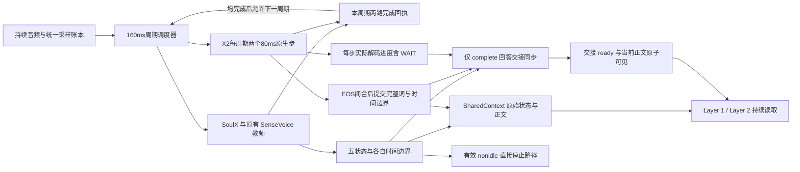
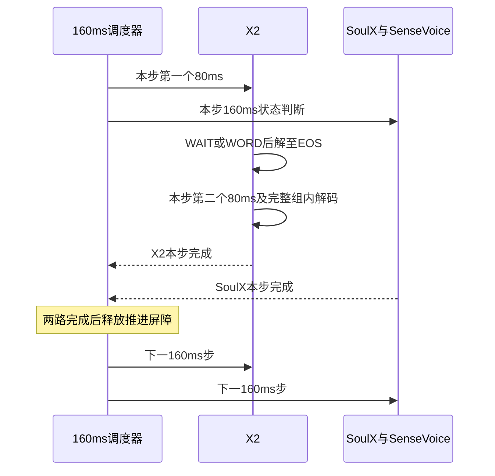

# SoulX 原生控制与独立流式转写

日期：2026-11-02。状态：NTF-015／016原生封装、同源PCM／160ms屏障及独立X2适配已完成本地实现与契约验收，见[交付记录](../../reports/soulx/20261102-native-independent-frontend/README.md)。NTF-017原子Context、NTF-020交接与NTF-018／019真实模型验证仍待实施；本设计同时描述这些后续目标。路线恢复依据见[恢复记录](../../reports/soulx/20261102-external-asr-plan-restore/README.md)。

## 1. 目标与设计原因

保留 SoulX-Duplug 的原生状态预测链路，另由独立原生流式 ASR 提供下游正文。控制器内部的窗口文字继续参与状态预测，不作为 SharedContext 的权威转写；外部流式正文不注入 SoulX 的 KV。

此前教师替换实验同时改变文字门控、提交节奏、缓存修订和 reset，未证明冻结权重能保持原协议的状态行为，见[归因](../../reports/soulx/20261101-ntf012-x2-teacher-fdb30/regression_analysis.md)。此前双 ASR 实验则等待两路覆盖配齐后才发布，且非静音、多长度预热不足，见[历史报告](../../../reports/soulx/20261031-dual-asr-publication/README.md)。本方案保留原生控制输入协议和各路结果即时发布；用户现增加第2.1节的160ms推进屏障，替代此前两路可独立向后计算的调度约束。

预热不足是有历史配置差异支持的优先假设；目前不能认定它解释了全部积压，也不能预先保证单卡通过。

## 2. 音频与两路职责

两路接收同一份规范化 PCM，16kHz、单声道，以真实采样编号定位。传输包不等于模型处理块；SoulX 保持原生160ms主块、960ms回看及40ms前瞻。输入转换、增益及启动 padding 的处理在运行 manifest 中冻结，不能因某一路更慢而减速送音、跳帧或偷用未来音频。

控制路径从官方子模块 `a0b9063843df69619b087b95b74597b2176910b8` 出发，保留原生文字门控、SenseVoice 窗口识别、归一化、KV修订、状态反馈、完成分支和内部 reset。原生五状态与外层 `idle/nonidle/speak/blank`、完成来源分别记录；完整话轮重识别仍属内部服务行为，结果只作诊断。不能为加速而默认删除该调用。

正文路径改用已锁定的 `x-square-robot/X2Streaming-ASR-4B-1009`，模型revision `4c8df16`，官方推理源码 `0aca80597bb1399c0be4002de5bc62c0a779c542`，BF16、英文language-tag。模型与源码摘要沿用[探针冻结配置](../../../configs/x2_streaming_probe.json)，执行前核验，不运行时升级或重新筛选ASR。此前X2作为SoulX教师的状态结果仍只是历史证据，不能代替本次独立正文验收。

X2按原生80ms音频步执行LISTEN／DECODE，复用音频与文本缓存；WAIT=32、WORD=33、EOS=2。WORD只表示开始发射，解码至EOS后该组才可提交；EOS结束发射组，不代表用户话轮结束。协议依据[锁定官方说明](https://github.com/X-Square-Robot/X2Streaming-ASR/blob/0aca80597bb1399c0be4002de5bc62c0a779c542/README.md)。首块与增量形状、200采样STFT观察前瞻沿用已核查合同；每个160ms调度步内执行两个原生80ms步，不把模型输入窗改为160ms，也不要求文字token逐个对应。

正文接入复用X2引擎的因果解码和官方组拼接规则，独立提供每个闭合组的完成通知；不能直接复用旧教师worker的“两帧合成一步”、发布释放屏障或给SoulX注入文字的封装。NTF-016已交付[独立适配器](../../scripts/runtime/independent_x2.md)，当前回调尚未接入NTF-017的原子Context，真实模型链路尚未验收。

### 2.1 每160ms音频步的推进屏障

2026-11-02用户补充：X2每80ms解码、SoulX每160ms判断；同一160ms调度步两路均完成后，才允许推进下一步。本合同将“下一个token”解释为下一音频步的模型推进；各模型内部的文字token与状态token并非一一对应。NTF-015／016已实现下述调度及采样合同，真实模型／实时性仍由后续远端作业验证。

| 当前调度步 | 必须完成的工作 |
| --- | --- |
| X2 | 顺序执行两个80ms LISTEN步；WAIT完成即算该步完成；WORD则在该80ms步内继续DECODE，直到真实EOS闭合及组拼接完成 |
| SoulX | 完成本次160ms原生控制调用，包括内部SenseVoice门控／识别、状态预测、规则反馈，以及本调用触发的完成服务／reset处理 |
| 调度器 | 收到两路本步完成回执并核对实际输入范围，释放屏障；随后才可启动X2第三个80ms步或SoulX下一次状态判断 |

两路在当前步内可由后端并发或串行调度，实际GPU排队必须计时；不要求GPU必然并发。先完成的一路不得越过屏障执行下一音频步。当前X2组内的多个子词必须允许连续解码，不能每生成一个文字token就等待另一模型，否则无法完成当前组；64 token上限与异常退出边界保留。没有WORD时不等待新词或下一个EOS，不强制发射。

160ms批次在16kHz下为2560个真实采样，调度器以统一源采样账本关联两路步骤。原生回看、前瞻、首块和reset padding继续分别记录，实际主块截止与观察上界不必相等；NTF-015／016实施前冻结启动／reset到源采样坐标的映射。不能仅凭“两个80ms等于一个160ms”就宣称真实输入范围或声学词尾已对齐，也不能改动原生padding凑齐计数。当前窗所需真实前瞻可先进入输入缓冲，不代表下一步模型已经获准计算。

完成回执只在本路当前步骤及设备计算实际结束、结果已可供发布后产生；收包、预取和任务入队不算完成。记录`step_id`、当前源采样批次、两路实际输入范围／完成时间、各路屏障等待及释放时间。控制器reset不重置全局step_id，关闭／异常取消屏障并拒绝旧回执，不能误释放下一步。

屏障约束计算推进，不延后当前结果发布：X2第一个80ms闭合组完成即可更新正文，当前SoulX状态就绪即可发布，有效nonidle即时停止，不等屏障另一侧、日志或消费者。complete的pending／ready仍依第4.1节独立判断，**推进屏障不以交接ready为释放条件**。若交接目标包含后续步才可处理的真实前瞻，两路按正常屏障推进后再检查ready，避免“等ready才推进、等推进才ready”的循环。

真实音频按固定时钟持续进入有界缓冲，不因屏障变慢而减速送音。屏障等待计入两路排队与未读PCM；原800ms、4MiB及资源停止线保持，触限失败而非丢帧或放宽限制。该机制保证调度进度受共同屏障约束，不保证本步一定有文字，也不消除X2等到后续音频才发射一个词的算法延迟。

### 2.2 NTF-015／016采样映射与实现冻结

本次实现使用独立的原生控制封装、PCM账本和X2适配器，不调用旧`SoulXFrontend`或教师worker。输入只接受已完成外部转换的16kHz单声道float32 PCM，增益为1；拒绝非有限值及幅度越界，不在两路内部重新采样、裁剪或归一化。传输包可变长，按连续采样编号入账，两路引用同一字节摘要。

官方startup／reset的`buffer`为15360＋640个随机合成采样，保持数值、dtype及随机数消耗不变。因此初次送入2560个真实采样时，主块是640个合成采样＋真实`[0,1920)`，前瞻为真实`[1920,2560)`，并非主块真实`[0,2560)`。没有reset时后续真实主块连续推进2560；reset清除内部KV、回看和padding，外部从上次真实主块截止重新供给未消费PCM，不回写旧model.buffer。每次reset可能再产生640采样的控制进度滞后，必须真实记录并受800ms上限约束，不更改padding以追齐X2。回看、主块和前瞻独立记录含摘要的span；全局160ms批次号不重置，也不宣称两路实际观察范围相同。

X2启动仅用合成2600采样预填充；第i个80ms真实步使用`[i×1280−200,(i+1)×1280＋200)`的1680采样，负坐标仅为显式左padding。整步处理截止为`(i+1)×1280`，观察截止多200采样，EOF按真实长度截断并单列右padding。EOF允许最后一个不足160ms的终止批次，只运行实际存在的80ms帧，返回明确终止回执；缺失、失败或取消的回执不能释放屏障。不额外drain、不补EOS，控制侧未处理尾部与X2开放组保留诊断。

闭合正文和80ms进度分别通过同步、短时的回调交付；调用者不得在回调中等待模型、网络、日志或消费者。NTF-017再接入原子Context。两路可串行或在各自单worker内计算，本次协调器默认单调度worker，固定到达时钟由独立生产者持续调用`append_pcm`，不在推进屏障中暂停送音。模型入口应在执行期间允许生产者继续入账，触限立即取消本代并拒绝迟到发布；设备同步之后才出具完成回执。

## 3. 异步发布与当前值

ASR完成一个EOS闭合发射组就立即按完整词追加正文，SoulX原始五状态立即记录，idle、nonidle、backchannel、incomplete立即供下游读取。模型推进执行第2.1节的160ms屏障；各路结果发布不等待另一侧，不恢复 `PairedPublisher` 或固定正文发布周期。只有complete用于开始正式回答时另经过第4.1节交接同步。

生成中的BPE／子词token只留在ASR有界临时缓冲，遇到EOS后按官方 `join_emit_texts` 规则一次提交。Context只保存已提交正文，不暴露半词草稿；正文前缀不可回改。一个闭合组可能包含多个完整词，允许同一快照一起可见，不伪造组内各词的独立可用时间，也不要求“一词一个快照”。“按词提交”不改变下游LLM自己的tokenizer分词。

例如一组内部先生成 `inter`、再生成后续子词并最终闭合成 `international`，Context只在闭合后看到完整词。WORD、空ASR步、任意空格或停顿计数均不能代替EOS。EOS和逐组追加保证提交协议，不能保证识别必然正确；验收需记录未闭合尾部及跨组尾词续写／改写异常。

SharedContext仍只保存每个逻辑话轮一份当前全文与当前原始状态，不增加历史正文、版本查询或patch。本次为complete同步新增至多一个当前交接记录，明确替代此前完全不保留complete的约束；记录用于等待、取消和去重，不建立历史事件队列。每次提交只修改所属字段，在短锁中与其他最新值合并，读取返回完整快照副本；不能用工作线程先前读取的整份旧快照回写覆盖另一路的新结果。模型推理、网络等待和磁盘写入均不持有Context锁。

| 字段组 | 内容与约束 |
| --- | --- |
| 身份与生命周期 | 稳定的 `session_id`、`turn_id`、`status`；同一话轮正文来源固定为X2Streaming-ASR |
| 正文 | 当前EOS闭合组累计 `text`、来源 `x2_streaming_asr`、`text_observed_until`、`text_available_at`、`text_published_at`；不含开放组子词，不经SoulX窗口拼合器 |
| 状态 | `state_token`、`state_accepted`、`controller_generation`、`state_processed_until`、`state_observed_until`、`state_available_at`、`state_published_at` |
| 解码进度 | `asr_processed_until`、`asr_observed_until`、`asr_progress_available_at`、开放组状态；每个80ms步处理结束均推进，WAIT无新字也上报，不刷新正文时间 |
| complete交接 | 当前 `completion_id`、`completion_status`（none／pending／ready／cancelled／timed_out）、原始来源与固定音频目标、deadline、ready时间、对应正文提交组数及取消／超时原因 |
| 完整性 | 分别标记传输／整理缺口和后端明确提供的尾部状态；缺乏可靠尾词信号时记录unknown，不自行宣告final |

`*_until`均为真实采样位置，合成padding另记；`*_at`使用同一可比较的单调时钟，跨进程时明确时钟来源。旧 `processed_until` 若保留，只兼容表示SoulX主块截止，不能兼任正文进度或阻止仅正文更新。仅文字变化不更新状态时间，仅状态变化不更新正文时间；空文字结果不清空已有正文。

原子快照表示一次一致读取，不表示两路观察到同一时刻，更不表示文字与主块逐词对齐。ASR观察到某一采样位置不保证之前的所有词已经发射；无新增token不等于静音、词结束或句子完成。

正文的available时间取实际EOS闭合并完成组拼接的时刻，published时间取写入Context的时刻，不回填为该组第一个子词出现时间。组内decode延迟、闭合到发布等待和词声学延迟分别记录；没有可靠词级声学时标时不能用组闭合时间冒充逐词声学对齐。

## 4. reset、关闭与下游边界

SoulX内部reset不结束X2Streaming-ASR，不清空共享正文，也不创建新逻辑话轮。外部输入账本保留已到达未处理PCM，内部回看、padding和语义KV按原生reset管理；不能复用旧适配器将整个旧 `model.buffer` 写回的行为。主块、回看、前瞻分别计账，验证连续输入与原生reset兼容；如需改变原生行为，先修订设计并说明原因。

`user_complete`仅是控制器的语义判断，不作为ASR结束指令或转写final标志。原始complete立即记录，但只有完成下述交接同步的complete才可作为Layer 1普通正式回答的生成边界。此处检查计算与提交就绪，不增加语义判断模型，不改变SoulX内部反馈或reset。

活动输出期间有效nonidle直接提交既有唯一停止执行点，不等待ASR、Context消费者或日志。完成来源、停止请求与物理停播分别记录，本轮只验证回调探针，不接真实播放。

只有运行时显式关闭才结束逻辑话轮；关闭后拒绝迟到回调。EOF不补造complete或EOS，不强制提交未闭合尾词，不把排空文字回填成在线已见结果；在线已闭合全文、开放组token、未处理真实采样及显式drain诊断分别保存。两路任一失败均显式终止该验证样本并保留证据，不静默丢弃慢路或降级成另一来源。

### 4.1 仅 complete 的回答交接同步

| 输入 | 交付规则 |
| --- | --- |
| idle／nonidle／backchannel／incomplete | 立即记录和交付；有效nonidle直接停止不等X2 |
| 原始complete | 立即记录预测与可用时间，建立pending交接；不能直接许可正式回答 |
| X2闭合正文与解码进度 | 各自立即更新；待交接complete不阻止后续音频、解码或正文发布 |
| ready的complete | 和当时最新已闭合正文原子可见，Layer 1实际读取后才可在当前turn开始正式回答 |

1. 接受一次原生complete后，固定其session／turn、原始控制代次、采样目标 `C = state_observed_until` 和原始可用时间，创建唯一completion_id。目标取实际观察截止，不只取160ms主块截止；后续已到达音频不把C变成移动目标。同一pending期间重复complete只审计，不重置目标或延长截止时间。
2. X2每步音频编码、LISTEN及可能的DECODE结束后发布真实进度，只有整步完成才能推进asr_processed_until；不能用已收包或特征预取位置冒充。推进覆盖C的X2步所需真实前瞻按原生协议到达并处理，开放DECODE须等模型实际EOS闭合；不按两路步号相等判断，也不因为WAIT没有新字而永远不推进。
3. 放行条件为：X2实际处理范围覆盖C、当前没有仍在进行的DECODE／开放组、截至这次进度的所有闭合组已写入Context，且候选未被取消、关闭或超时。若X2已经领先且满足条件，可立即ready，不要求complete之后必须新增文字或再出现一个EOS。
4. 在同一短锁内复核候选、最新进度与已提交正文，置completion_status=ready并记录ready_at和对应已提交组数。正文仍只有当前值，不复制历史正文。Layer 1输入编码仅将ready的complete携正文作为可回答状态交付，pending原始complete留在诊断字段，不能仅凭state_token或state_accepted开始回答。即使最新原始状态已变为idle，尚有效的ready记录仍可读取；同一completion_id最多开始一次正式回答，不新增独立LLM回答调用。
5. 等待／尚未使用ready期间，后到有效nonidle立即取消旧候选并照常执行打断；有效incomplete同样撤销旧交接，避免模型已判断继续等待却放行旧complete。idle和backchannel只更新原始状态，不自动否定语义完成。控制器内部reset不取消候选，显式话轮关闭和解码错误终结候选。ready作为单个当前交接标记保留到被撤销、新合法交接替代或话轮关闭；不增加历史队列和消费ack。取消与ready检查须串行化，迟到ASR回调不能复活旧候选。
6. 等待为非阻塞、单调时钟计时，首轮 `completion_wait_timeout_ms=800`，沿用既有过载保护，不作为质量目标。deadline取“原始complete可用时刻＋800ms”和“原始complete主块截止对应实时到达时刻＋既有800ms总延迟停止线”的较早者；额外等待不重新获得一份独立800ms预算。到期未就绪则timed_out，不强制ready、不提交半词；验证样本明确失败并留证，按原合同清理。

X2追齐C且处于LISTEN仍不能证明此前所有词已经发射；发射组EOS也不是整轮final。因此首轮使用上述明确的计算／提交同步条件，不添加“几个空步”“再等固定160／320ms”或“必须等下一个EOS”的尾词启发式。已开始DECODE的尾部必须真实闭合；尚未发射的尾词保留unknown，记录ready之后才到达的文字并在NTF-019评估。如果需要更强的转写完整性保证，先验证后端明确支持的尾部完成信号，再修订协议，不能将ready命名或解释为全文必齐。

EOF时如果目标所需的真实前瞻不足、步骤未完成或开放组未闭合，则交接保持未完成并记录原因，不用合成尾部满足在线ready。原始预测时刻、交接等待、ready交付和Layer 1读取时刻分别记录，以区分状态质量、同步延迟及尾词覆盖。

每160ms推进屏障完成也不能直接将complete置ready：仍核对固定观察目标和正文提交；交接pending不阻止已具备两路完成回执的推进屏障释放。EOF不足160ms批次或仅一侧完成时记录未完成屏障，不用合成音频伪造在线完成。

## 5. 完整预热与积压归因

预热在正式音频到达时钟启动之前完成，使用同一常驻模型、后端和并发拓扑。覆盖音频tokenizer、状态前向、真实语音触发的文字门控与SenseVoice、多种窗口／整轮长度、文本修订、完成分支，以及X2首块／增量编码、LISTEN等待、DECODE多token与EOS闭合组提交。仅模型加载、静音前向或一次短窗识别不能作为完整就绪条件。

先冻结预热输入、长度清单和覆盖项，再执行两轮相同完整预热；两轮均产生有效转写并完成清理，逐项记录耗时及未覆盖分支。两轮是有限执行合同，不代表已经达到性能稳定；未覆盖项需在正式回放前报告处理，不靠反复尝试直至好看。

预热会话与正式会话隔离，清理KV、PCM、文字、计数和回调，保留常驻权重及运行时已建立的内核缓存。正式会话按相同合同重置随机数状态，避免不同预热次数改变原生reset的随机padding。就绪屏障等待所有预热异步计算及工作线程完成，不能让预热结果进入正式Context。加载耗时、预热耗时和在线延迟分别报告。

远端先比较相同SoulX＋X2配置的控制支路有限预热与完整预热，两臂X2均保留相同的两次真实语音预热；除了控制支路预热输入和覆盖，不改变波形、规则、线程及送音时钟。分别使用新进程，再以完整预热的SoulX单路作资源争用参考。该对照验证当前配置，不能将更换ASR后的结果作为旧Nemotron实验的单变量复现。完整矩阵、输入顺序与次数执行前冻结，有限预热臂只作诊断。

分别记录送音调度迟到、两路未读PCM时长、输入可用到计算开始的排队、各组件计算、结果可用到发布的等待、首帧／后续帧P50/P95/max及积压时间曲线。正式回放每条样本重新启动到达时钟，模型保持常驻；样本间只清理会话状态，不重载权重或针对失败样本补预热。由时间曲线区分首遇路径长尾与持续吞吐不足，不用单个中位数认定原因。

双路预热和正式回放使用同一160ms推进屏障，额外记录X2两个80ms步、SoulX整步、先完成侧等待、屏障释放及EOF半步。有限／完整预热两臂保持相同屏障策略；单路参考只记录本路周期，不伪造另一侧完成。相同160ms输入步的墙钟执行时间可能超过160ms，必须按真实到达时钟报告积压。

## 6. 当前工作单与验收设计

| 顺序 | 工作单 | 交付 |
| --- | --- | --- |
| 1 | [NTF-015](../../issue/NTF-015.md) | 原生控制封装、reset和状态来源审计 |
| 2 | [NTF-016](../../issue/NTF-016.md) | 同源音频分发与独立原生流式正文 |
| 3 | [NTF-017](../../issue/NTF-017.md) | 无配对等待的Context更新与生命周期 |
| 4 | [NTF-020](../../issue/NTF-020.md) | 仅complete的交接同步、取消、去重与超时 |
| 5 | [NTF-018](../../issue/NTF-018.md) | 全链路预热、远端积压对照与实时门槛 |
| 6 | [NTF-019](../../issue/NTF-019.md) | 固定FDB30的状态、正文与交接验收 |

远端使用conda，单并发作业、1×4090、4CPU、32GiB RAM、batch=1；显存停止线22GiB，每路模型worker各1、CPU线程各至多2，不新增无界worker池。每路未读真实PCM≤800ms，送音调度迟到及各路在线发布延迟超过800ms即停止样本并记录失败，物理PCM总量≤4MiB；800ms是过载保护，不是交互质量目标。各路发布延迟以其真实主块／解码覆盖及完整观察边界分别计算，不能只统计结果就绪后的短等待。

每作业≤1800秒、输出≤128MiB；NTF-018最多2个串行作业，NTF-019最多2个串行作业，累计GPU预算≤2小时，新增结果≤512MiB。启动空闲磁盘≥10GiB，只读复用模型、环境与数据，不复制权重。触限保留失败，不自动扩容、重跑、换卡或放宽800ms。

验收分别回答协议是否保持、文本是否持续可读、异步更新是否无丢失、完整预热能否消除首遇路径长尾、同卡持续运行是否跟得上，以及三轴状态和在线转写质量。固定30条要求30/30完整、退出0、无过载触发才通过实时完整性；状态质量如实报告，不以工程通过代替质量收益。

以上六单已按用户指令恢复为active，均待实施；原资源额度恢复为本路线的计划上限，实施前冻结具体矩阵和输入，不挪用教师调研已用额度。进度按[工作单索引](../../issue/README.md)管理，本次不启动推理／训练、不切换现役Agent、不接LLM、CoT或TTS。
