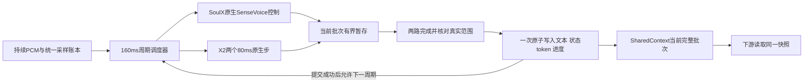
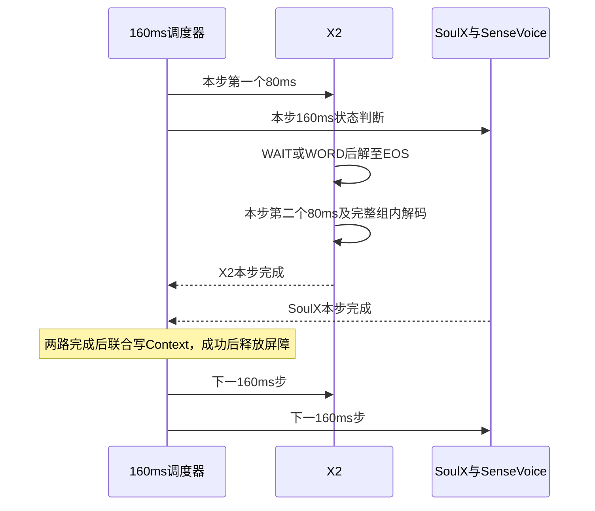

# SoulX 原生控制与独立流式转写

更新：2026-11-03。状态：NTF-015／016原生封装、同源PCM／160ms屏障及独立X2适配已完成本地实现与契约验收，见[交付记录](../../reports/soulx/20261102-native-independent-frontend/README.md)。NTF-017已完成每160ms双路完成后联合提交的本地实现与契约验收，并移除前端专用停止旁路，见[交付](../../reports/soulx/20261102-ntf017-joint-publication/README.md)；NTF-020交接等待已取消并归档，NTF-018已启动、本地152项通过，远端连接超时，019等待018通过，见[启动记录](../../reports/soulx/20261103-ntf018-warmup/README.md)。路线恢复依据见[恢复记录](../../reports/soulx/20261102-external-asr-plan-restore/README.md)。

## 1. 目标与设计原因

保留 SoulX-Duplug 的原生状态预测链路，另由独立原生流式 ASR 提供下游正文。控制器内部的窗口文字继续参与状态预测，不作为 SharedContext 的权威转写；外部流式正文不注入 SoulX 的 KV。

此前教师替换实验同时改变文字门控、提交节奏、缓存修订和 reset，未证明冻结权重能保持原协议的状态行为，见[归因](../../reports/soulx/20261101-ntf012-x2-teacher-fdb30/regression_analysis.md)。此前双 ASR 实验则等待两路覆盖配齐后才发布，且非静音、多长度预热不足，见[历史报告](../../../reports/soulx/20261031-dual-asr-publication/README.md)。本方案保留原生控制输入协议。用户最新要求将第2.1节160ms屏障同时作为Context提交边界：两路完成当前批次后，正文和状态token一次写入；不再保留结果提前发布或nonidle专用停止钩子。

预热不足是有历史配置差异支持的优先假设；目前不能认定它解释了全部积压，也不能预先保证单卡通过。

## 2. 音频与两路职责

两路接收同一份规范化 PCM，16kHz、单声道，以真实采样编号定位。传输包不等于模型处理块；SoulX 保持原生160ms主块、960ms回看及40ms前瞻。输入转换、增益及启动 padding 的处理在运行 manifest 中冻结，不能因某一路更慢而减速送音、跳帧或偷用未来音频。

控制路径从官方子模块 `a0b9063843df69619b087b95b74597b2176910b8` 出发，保留原生文字门控、SenseVoice 窗口识别、归一化、KV修订、状态反馈、完成分支和内部 reset。原生五状态与外层 `idle/nonidle/speak/blank`、完成来源分别记录；完整话轮重识别仍属内部服务行为，结果只作诊断。不能为加速而默认删除该调用。

正文路径改用已锁定的 `x-square-robot/X2Streaming-ASR-4B-1009`，模型revision `4c8df16`，官方推理源码 `0aca80597bb1399c0be4002de5bc62c0a779c542`，BF16、英文language-tag。模型与源码摘要沿用[探针冻结配置](../../../configs/x2_streaming_probe.json)，执行前核验，不运行时升级或重新筛选ASR。此前X2作为SoulX教师的状态结果仍只是历史证据，不能代替本次独立正文验收。

X2按原生80ms音频步执行LISTEN／DECODE，复用音频与文本缓存；WAIT=32、WORD=33、EOS=2。WORD只表示开始发射，解码至EOS后该组才可提交；EOS结束发射组，不代表用户话轮结束。协议依据[锁定官方说明](https://github.com/X-Square-Robot/X2Streaming-ASR/blob/0aca80597bb1399c0be4002de5bc62c0a779c542/README.md)。首块与增量形状、200采样STFT观察前瞻沿用已核查合同；每个160ms调度步内执行两个原生80ms步，不把模型输入窗改为160ms，也不要求文字token逐个对应。

正文接入复用X2引擎的因果解码和官方组拼接规则，在内部记录每个闭合组的完成通知并暂存到当前160ms批次；不能直接复用旧教师worker的“两帧合成一步”、发布释放屏障或给SoulX注入文字的封装。NTF-016已交付[独立适配器](../../scripts/runtime/independent_x2.md)，回调已由NTF-017迁移为批次暂存／联合Context提交，真实模型链路尚未验收。

### 2.1 每160ms音频步的推进屏障

2026-11-02用户补充：X2每80ms解码、SoulX每160ms判断；同一160ms调度步两路均完成后，才允许推进下一步。本合同将“下一个token”解释为下一音频步的模型推进；各模型内部的文字token与状态token并非一一对应。NTF-015／016已实现计算推进及采样基础；NTF-017已实现联合写入并移除停止旁路，真实模型／实时性由后续远端作业验证。

| 当前调度步 | 必须完成的工作 |
| --- | --- |
| X2 | 顺序执行两个80ms LISTEN步；WAIT完成即算该步完成；WORD则在该80ms步内继续DECODE，直到真实EOS闭合及组拼接完成 |
| SoulX | 完成本次160ms原生控制调用，包括内部SenseVoice门控／识别、状态预测、规则反馈，以及本调用触发的完成服务／reset处理 |
| 调度器 | 收到两路本步完成回执并核对实际输入范围，一次提交文本、状态及进度；提交成功后释放屏障，才可启动下一音频周期 |

两路在当前步内可由后端并发或串行调度，实际GPU排队必须计时；不要求GPU必然并发。先完成的一路不得越过屏障执行下一音频步。当前X2组内的多个子词必须允许连续解码，不能每生成一个文字token就等待另一模型，否则无法完成当前组；64 token上限与异常退出边界保留。没有WORD时不等待新词或下一个EOS，不强制发射。

160ms批次在16kHz下为2560个真实采样，调度器以统一源采样账本关联两路步骤。原生回看、前瞻、首块和reset padding继续分别记录，实际主块截止与观察上界不必相等；NTF-015／016实施前冻结启动／reset到源采样坐标的映射。不能仅凭“两个80ms等于一个160ms”就宣称真实输入范围或声学词尾已对齐，也不能改动原生padding凑齐计数。当前窗所需真实前瞻可先进入输入缓冲，不代表下一步模型已经获准计算。

完成回执只在本路当前步骤及设备计算实际结束、结果已可供发布后产生；收包、预取和任务入队不算完成。记录`step_id`、当前源采样批次、两路实际输入范围／完成时间、各路屏障等待及释放时间。控制器reset不重置全局step_id，关闭／异常取消屏障并拒绝旧回执，不能误释放下一步。

屏障同时约束计算推进和Context提交：X2第一帧闭合组与SoulX状态先暂存，本批次两路完成后一次写入文本、状态token及进度。前端不再单独执行nonidle停止钩子，下游统一消费已提交快照。提交成功后即可推进，不等待日志或消费者；complete不再增加独立的ready等待。

真实音频按固定时钟持续进入有界缓冲，不因屏障变慢而减速送音。屏障等待计入两路排队与未读PCM；原800ms、4MiB及资源停止线保持，触限失败而非丢帧或放宽限制。该机制保证调度进度受共同屏障约束，不保证本步一定有文字，也不消除X2等到后续音频才发射一个词的算法延迟。

### 2.2 NTF-015／016采样映射与实现冻结

本次实现使用独立的原生控制封装、PCM账本和X2适配器，不调用旧`SoulXFrontend`或教师worker。输入只接受已完成外部转换的16kHz单声道float32 PCM，增益为1；拒绝非有限值及幅度越界，不在两路内部重新采样、裁剪或归一化。传输包可变长，按连续采样编号入账，两路引用同一字节摘要。

官方startup／reset的`buffer`为15360＋640个随机合成采样，保持数值、dtype及随机数消耗不变。因此初次送入2560个真实采样时，主块是640个合成采样＋真实`[0,1920)`，前瞻为真实`[1920,2560)`，并非主块真实`[0,2560)`。没有reset时后续真实主块连续推进2560；reset清除内部KV、回看和padding，外部从上次真实主块截止重新供给未消费PCM，不回写旧model.buffer。每次reset可能再产生640采样的控制进度滞后，必须真实记录并受800ms上限约束，不更改padding以追齐X2。回看、主块和前瞻独立记录含摘要的span；全局160ms批次号不重置，也不宣称两路实际观察范围相同。

X2启动仅用合成2600采样预填充；第i个80ms真实步使用`[i×1280−200,(i+1)×1280＋200)`的1680采样，负坐标仅为显式左padding。整步处理截止为`(i+1)×1280`，观察截止多200采样，EOF按真实长度截断并单列右padding。EOF允许最后一个不足160ms的终止批次，只运行实际存在的80ms帧，返回明确终止回执；缺失、失败或取消的回执不能释放屏障。不额外drain、不补EOS，控制侧未处理尾部与X2开放组保留诊断。

015／016闭合正文、80ms进度和控制回调已由NTF-017接入本批次有界暂存器；这些回调不能直接更新Context或执行停止。两路完成后短锁联合提交，不在锁内等待模型、网络、日志或消费者。两路可串行或在各自单worker内计算，本次协调器默认单调度worker，固定到达时钟由独立生产者持续调用`append_pcm`，不在推进屏障中暂停送音。模型入口应在执行期间允许生产者继续入账，触限立即取消本代并拒绝迟到发布；设备同步之后才出具完成回执。

## 3. 联合发布与当前值

每个160ms批次内，X2真实EOS闭合组和SoulX原始状态分别记录实际可用时间，先完成侧只暂存；本批次两路实际结束后，累计闭合正文、状态token和真实进度一次性写入SharedContext。第一帧文字不提前发布，nonidle不绕过此门槛。无新字WAIT仍提交本批次完整快照。已提交的有效complete携当前正文直接供下游使用，见第4.1节；本次不写原始PCM。

生成中的BPE／子词token只留在ASR有界临时缓冲，遇到EOS后按官方 `join_emit_texts` 规则闭合，随所属160ms批次联合提交。Context只保存已提交正文，不暴露半词草稿；正文前缀不可回改。一个闭合组可能包含多个完整词，允许同一快照一起可见，不伪造组内各词的独立可用时间，也不要求“一词一个快照”。“按词提交”不改变下游LLM自己的tokenizer分词。

例如一组内部先生成 `inter`、再生成后续子词并最终闭合成 `international`，Context只在闭合后看到完整词。WORD、空ASR步、任意空格或停顿计数均不能代替EOS。EOS和逐组追加保证提交协议，不能保证识别必然正确；验收需记录未闭合尾部及跨组尾词续写／改写异常。

SharedContext仍只保存每个逻辑话轮一份当前全文与当前原始状态，不增加历史正文、版本查询或patch。017曾预留至多一条当前交接元数据；020取消后该接口保持未接入，不要求等待、取消或ready状态机，也不建立历史事件队列。每个批次通过唯一入口，在短锁中一次替换文本／状态／进度，并合并最新生命周期与既有保留元数据；读取返回完整快照副本，不暴露单侧计算中间态，也不能回写旧整帧覆盖较新记录。模型推理、网络等待和磁盘写入均不持有Context锁。

| 字段组 | 内容与约束 |
| --- | --- |
| 身份与生命周期 | 稳定的 `session_id`、`turn_id`、`status`，已提交`step_id`和`batch_published_at`；同一话轮正文来源固定为X2Streaming-ASR，不保存PCM |
| 正文 | 当前EOS闭合组累计 `text`、来源 `x2_streaming_asr`、`text_observed_until`、`text_available_at`、`text_published_at`；不含开放组子词，不经SoulX窗口拼合器 |
| 状态 | `state_token`、`state_accepted`、`controller_generation`、`state_processed_until`、`state_observed_until`、`state_available_at`、`state_published_at` |
| 解码进度 | `asr_processed_until`、`asr_observed_until`、`asr_progress_available_at`、开放组状态；每个80ms步内部记录，批次结束提交最后实际进度；WAIT无新字也推进，不刷新正文时间 |
| 兼容保留 | 017的completion_*占位和比较更新接口当前未接入，不作为complete回答条件；本次不修改运行代码 |
| 完整性 | 分别标记传输／整理缺口和后端明确提供的尾部状态；缺乏可靠尾词信号时记录unknown，不自行宣告final |

`*_until`均为真实采样位置，合成padding另记；`*_at`使用同一可比较的单调时钟，跨进程时明确时钟来源。旧 `processed_until` 若保留，只兼容表示SoulX主块截止，不能兼任正文进度。每批次状态与进度随联合提交更新；正文无变化时保留此前文字时间和观察范围，空文字结果不清空已有正文。有新正文时text_published_at与本批次state_published_at同取batch_published_at，原始available_at分别保留。

原子快照表示一次一致读取，不表示两路观察到同一时刻，更不表示文字与主块逐词对齐。ASR观察到某一采样位置不保证之前的所有词已经发射；无新增token不等于静音、词结束或句子完成。

正文的available时间取实际EOS闭合并完成组拼接的时刻，published时间取写入Context的时刻，不回填为该组第一个子词出现时间。组内decode延迟、闭合到发布等待和词声学延迟分别记录；没有可靠词级声学时标时不能用组闭合时间冒充逐词声学对齐。

## 4. reset、关闭与下游边界

SoulX内部reset不结束X2Streaming-ASR，不清空共享正文，也不创建新逻辑话轮。外部输入账本保留已到达未处理PCM，内部回看、padding和语义KV按原生reset管理；不能复用旧适配器将整个旧 `model.buffer` 写回的行为。主块、回看、前瞻分别计账，验证连续输入与原生reset兼容；如需改变原生行为，先修订设计并说明原因。

`user_complete`仅是控制器的语义判断，不作为ASR结束指令或转写final标志。原始complete在内部记录实际可用时间，与本批次正文／进度联合写入；已联合提交的有效complete携该快照正文可作为Layer 1当前turn的普通回答输入边界；不再增加交接等待，不改变SoulX内部反馈或reset。

前端不再为nonidle设置专用停止钩子。所有状态在两路完成后与正文共同进入Context，下游读取同一快照后按既有输出生命周期处理；唯一输出执行点、幂等和实际停播确认保留。本单只验证共同快照消费，不接真实播放。

只有运行时显式关闭才结束逻辑话轮；关闭后拒绝迟到回调。EOF不补造complete或EOS，不强制提交未闭合尾词，不把排空文字回填成在线已见结果；在线已闭合全文、开放组token、未处理真实采样及显式drain诊断分别保存。两路任一失败均显式终止该验证样本并保留证据，不静默丢弃慢路或降级成另一来源。

### 4.1 complete统一消费边界

2026-11-03用户确认归档NTF-020。NTF-017已保证本批次两路实际完成、已开始的X2 DECODE至真实EOS及正文／状态原子提交，因此撤销原先额外的pending→ready、固定交接目标追齐和专用超时，详见[归档记录](../../reports/soulx/20261103-ntf020-handoff-retirement/README.md)。

当前冻结采样映射下，SoulX观察截止不晚于X2本批次实际处理截止；startup／reset的合成padding使控制主块可能滞后，真实范围须分别记账，018／019继续逐批核对。联合提交前的原始状态或开放组不能供下游提前使用；提交后的有效complete携当前闭合正文直接供Layer 1在正常输入边界消费。

消费去重、慢消费者可能漏读短暂complete和实际输出生命周期仍需后续下游接入设计，本次不宣称已经解决，也不新增历史队列或ack。017预留的completion_*和update_completion保持未接入，不是回答条件。

X2已处理某段音频仍不保证此前所有词均已发射；EOS只闭合发射组。complete联合发布后新增文字、开放尾组及EOF未处理真实PCM继续记录并在019评价，不增加固定等待或强制EOS，不能用合成padding宣称全文齐备。原800ms／4MiB过载保护保持，取消的是重复的交接等待层。

## 5. 完整预热与积压归因

预热在正式音频到达时钟启动之前完成，使用同一常驻模型、后端和并发拓扑。覆盖音频tokenizer、状态前向、真实语音触发的文字门控与SenseVoice、多种窗口／整轮长度、文本修订、完成分支，以及X2首块／增量编码、LISTEN等待、DECODE多token与EOS闭合组提交。仅模型加载、静音前向或一次短窗识别不能作为完整就绪条件。

先冻结预热输入、长度清单和覆盖项，再执行两轮相同完整预热；两轮均产生有效转写并完成清理，逐项记录耗时及未覆盖分支。两轮是有限执行合同，不代表已经达到性能稳定；未覆盖项需在正式回放前报告处理，不靠反复尝试直至好看。

预热会话与正式会话隔离，清理KV、PCM、文字、计数和回调，保留常驻权重及运行时已建立的内核缓存。正式会话按相同合同重置随机数状态，避免不同预热次数改变原生reset的随机padding。就绪屏障等待所有预热异步计算及工作线程完成，不能让预热结果进入正式Context。加载耗时、预热耗时和在线延迟分别报告。

远端先比较相同SoulX＋X2配置的控制支路有限预热与完整预热，两臂X2均保留相同的两次真实语音预热；除了控制支路预热输入和覆盖，不改变波形、规则、线程及送音时钟。分别使用新进程，再以完整预热的SoulX单路作资源争用参考。该对照验证当前配置，不能将更换ASR后的结果作为旧Nemotron实验的单变量复现。完整矩阵、输入顺序与次数执行前冻结，有限预热臂只作诊断。

分别记录送音调度迟到、两路未读PCM时长、输入可用到计算开始的排队、各组件计算、结果可用到发布的等待、首帧／后续帧P50/P95/max及积压时间曲线。正式回放每条样本重新启动到达时钟，模型保持常驻；样本间只清理会话状态，不重载权重或针对失败样本补预热。由时间曲线区分首遇路径长尾与持续吞吐不足，不用单个中位数认定原因。

双路预热和正式回放使用同一160ms推进屏障，额外记录X2两个80ms步、SoulX整步、先完成侧等待、屏障释放及EOF半步。有限／完整预热两臂保持相同屏障策略；单路参考只记录本路周期，不伪造另一侧完成。相同160ms输入步的墙钟执行时间可能超过160ms，必须按真实到达时钟报告积压。

## 6. 当前工作单与验收设计

| 顺序 | 工作单 | 交付 |
| --- | --- | --- |
| 1 | [NTF-015](../../reports/soulx/20261102-native-independent-frontend/README.md) | 已完成原生控制封装；旧停止接入由017迁移 |
| 2 | [NTF-016](../../reports/soulx/20261102-native-independent-frontend/README.md) | 已完成同源账本及X2适配；旧提前发布由017迁移 |
| 3 | [NTF-017](../../reports/soulx/20261102-ntf017-joint-publication/README.md) | 已完成本地联合提交、生命周期与图源同步 |
| 4 | [NTF-018](../../issue/NTF-018.md) | 全链路预热、远端积压对照与实时门槛 |
| 5 | [NTF-019](../../issue/NTF-019.md) | 固定FDB30的状态、联合发布与正文验收 |

远端使用conda，单并发作业、1×4090、4CPU、32GiB RAM、batch=1；显存停止线22GiB，每路模型worker各1、CPU线程各至多2，不新增无界worker池。每路未读真实PCM≤800ms，送音调度迟到及各路在线发布延迟超过800ms即停止样本并记录失败，物理PCM总量≤4MiB；800ms是过载保护，不是交互质量目标。各路发布延迟以其真实主块／解码覆盖及完整观察边界分别计算，不能只统计结果就绪后的短等待。

每作业≤1800秒、输出≤128MiB；NTF-018最多2个串行作业，NTF-019最多2个串行作业，累计GPU预算≤2小时，新增结果≤512MiB。启动空闲磁盘≥10GiB，只读复用模型、环境与数据，不复制权重。触限保留失败，不自动扩容、重跑、换卡或放宽800ms。

验收分别回答协议是否保持、文本是否持续可读、联合提交是否完整且无半帧、完整预热能否消除首遇路径长尾、同卡持续运行是否跟得上，以及三轴状态和在线转写质量。固定30条要求30/30完整、退出0、无过载触发才通过实时完整性；状态质量如实报告，不以工程通过代替质量收益。

015／016／017已完成本地验收并归档，020未实施取消并归档，018实施中、019等待018验收通过；原资源额度保持为本路线的计划上限，实施前冻结具体矩阵和输入，不挪用教师调研已用额度。进度按[工作单索引](../../issue/README.md)管理，本次已授权018及通过后的019，但远端SSH超时、尚未提交作业；不训练、不切换现役Agent、不接LLM、CoT或TTS。
