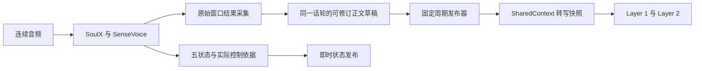

# SoulX＋SenseVoice 流式转写与固定周期发布调研

2026-10-30，按用户要求调研；用户已明确采用官方 SoulX＋SenseVoice 组合。本文是候选实现方案，不修改运行代码、不启动远端推理、不创建 issue，也不切换现役前端。

## 1. 结论与范围

**方案可行，建议复用现有 SenseVoice 原始结果采集和话轮整理，在正文写入 SharedContext 之前增加固定周期发布层。** SoulX 原生音频编码、SenseVoice 调用门控、文字 teacher forcing 和五状态预测维持自身节奏；发布周期只决定下游何时看到新的用户转写快照。

建议先用可配置的 `publish_interval_ms=320`，后续按下游读取需求比较 160／320／480ms，不宣称 320ms 是质量最优值。周期内保留最新可修订假设，到点仅在正文或覆盖状态变化时发布。无变化时不创建重复用户消息。

这里“固定周期写入”专指供 Layer 1／2 读取的 `user_transcript`。用于追溯控制依据的 ASR 来源观察、控制观察和五状态仍及时提交，因此原始诊断事件可能包含尚未进入周期正文的文本；下游正文须读取转写接口，而不是拼接诊断事件。若要求 SharedContext 中所有包含文字的诊断事件也完全延迟，需另外拆分诊断存储和状态依赖协议，超出本方案的最小改造范围。

## 2. 官方输出与已有实现

冻结官方 revision 为 `a0b9063843df69619b087b95b74597b2176910b8`。

- 官方 README 指定英文使用 `model_name: sensevoice`、`language: en`，双语可用 `auto`。本轮沿用项目已确认的英文范围。
- 公开服务提供 `asr_segment`、`asr_buffer`，完成分支另有 `text`。只有完成分支的 `text` 不足以持续提供中间转写。
- `_asr()` 按模型门控识别音频窗口，计算文本差分与前块校正；服务返回的 `asr_segment` 不是可以直接追加的无损正文。控制文本还经过归一化、去标点及去附和。
- SenseVoice 的窗口调用每次使用独立 `cache={}`。组合对外可持续输出中间假设，但不等于识别器在单次调用内逐 token 回调，也不保证每 160ms 都有新文字。

本项目已经在 [SoulXFrontend._recognize()](../../../scripts/runtime/soulx_frontend.py) 采集原始返回串，再由 [SenseVoiceObservation 与 TurnTranscriptAssembler](../../../scripts/runtime/sensevoice_transcript.py) 保留正文、解析标签、处理窗口修订，立即发布到 [SharedContext](../../../scripts/runtime/shared_context.py)。

因此需要改变的是发布策略，而非重新接入 ASR。旧六视图检查已有 134 个非空在线正文快照；未完成的 3.2 秒视图也有 13 次中间更新。但 5 个非静音视图中仍有 2 个在关闭时存在拼合 gap，见[已有实测](../../../reports/soulx/20261029-shared-context/README.md)。已有写入链路不等于正文覆盖已经达标。

## 3. 推荐的数据流

发布器只读取已返回、已整理的草稿，不调用 ASR，不改变 SoulX 内部消费的文字，不参与完成判断。若没有新识别结果，本周期可以没有正文更新；固定写入节奏不能消除门控、推理或窗口拼合导致的无输出区间。

### 3.1 原始正文与控制文字

继续在富转写后处理、控制归一化之前取得原始结果。正文保留数字、空格、大小写、标点及附和；语言、情绪等标签另存，不拼入正文。用于 SoulX 状态预测的归一化文字独立记录，并关联同一次 SenseVoice 调用。

不直接累计 `asr_segment`，也不把每次窗口全文都追加到 Context。SenseVoice 可能把前次文字修正；同一话轮应发布更高版本的完整快照，必要时附带替换 patch。

### 3.2 周期合并与版本

发布层需要区分内部草稿与已发布快照：

| 记录 | 用途 |
| --- | --- |
| `draft_revision` | 每次草稿内容或覆盖状态变化时推进，仅用于内部调度 |
| 来源调用 ID、控制 revision | 标识识别与 SoulX 实际消费的文字，不受正文周期合并影响 |
| `version` | SharedContext 的连续快照版本，含覆盖状态及关闭更新 |
| `asr_version` | 已发布正文实际改变时加一；不能沿用被合并掉的内部版本号 |
| `replace_from`、`replacement` | 相对上次已发布正文生成 patch，不相对上次未发布草稿 |

例如同一周期内经历 A → B → C，只向正文发布 C；A／B 仍可在来源诊断中追溯。若经历 A → B → A，且覆盖状态也恢复原样，则不必新增正文快照。合并不是确认稳定，`hypothesis=true` 继续保留。

现有 `SharedContext._validate_transcript()` 要求版本连续，因此不能先构造原有全部正文事件、随后丢弃其中几条。正文事件的 ID 与生产者序号必须在实际提交时分配，否则还会造成 producer 序号缺口。

### 3.3 调度与并发

采用单调时钟和会话起点固定的截止序列 `t0 + k × interval`。发布器独立于音频包到达运行，防止停顿时没有新包就无法发布最后一批文字。错过周期时记录超时并合并至下一实际提交，不密集补发过期快照，也不在每次发布后重新睡一个完整周期造成累计漂移。

可用一个会话发布协调器统一分配 Context 事件序号，ASR／状态采集和定时器通过短锁协调；定时器不调用模型、不等待 GPU 计算锁，不并发操作同一 TurnModel。读取草稿得到不可变快照，提交成功只确认对应的草稿 revision，提交期间产生的新修订仍保留为待发布。

状态构造依据与正文提交也要在同一协调规则下串行化，避免状态构造后定时器先更新正文，触发现有 Context 的 basis 版本不一致检查。保持现有 PCM／事件／正文上限，不能无界缓存中间假设。

## 4. 状态与周期正文的时序

**固定周期正文可以落后于状态预测实际使用的文字。** 当前状态的 `basis.asr_version` 与已发布正文关联，实施时应明确区分：

- `published_asr_version`：状态发布时，SharedContext 已经可读的正文版本。
- 来源调用 ID、实际控制 revision／源进度：SoulX 为本次判断真正消费的识别结果。
- `draft_revision`：前端已有但尚未提交正文的整理结果，仅是内部进度，不伪装成可读取版本。

可复用现有 `control_observation` 保存实际输入，不能简单把草稿版本写成正文版本，或倒改过去状态使其关联未来的正文。

有效 nonidle 的即时停止路径不经过定时器。若 complete 在某次 tick 之前到达，普通正式回答须同时满足：当前 turn 的有效完成判断成立，且该判断依赖的正文已经在后续周期发布并可重建；若正文有 gap，则明确记录不可用，不能以旧全文冒充齐备输入。后续新发声也必须参与判断，不能把较早 complete 当作永久许可。

若希望 complete 时立刻发布待提交正文，也可以作为“周期发布＋完成强制刷新”的变体，但它不满足严格固定周期。建议首版按固定周期完成正文发布，再交给 Layer 1 正常输入边界读取，不额外创建一次回答调用。

这些等待仅解决“状态已到、正文尚未发布”的一致性，不能解决 SoulX 自身的句中 complete 误判。二者需分别验收。

## 5. reset、尾部与关闭

内部 controller reset 不清空话轮正文草稿、发布定时器或 `turn_id`。每个已完成的 ASR 调用须在 reset 前采集；controller generation 与逻辑用户话轮分别管理。

逻辑关闭时先停止接纳该轮新的在线草稿，记录明确截止水位；在下一个发布周期提交该水位之前最后的待发布正文，然后提交 closed 生命周期。现有 Context 要求关闭事件保持正文不变，因此最终正文与关闭需要有序的两个更新，可以在同一事务中提交。

不得在下一个 tick 到达前释放缓存或直接复制旧快照关闭。新话轮不能接收旧轮未发布尾部。EOF 之后才产生的识别结果保持排空诊断身份，不能放进在线快照冒充较早已知。

若最后的真实音频不足完整处理块，或者 SenseVoice 未返回尾词，发布器不会凭空产生它们。需要显式报告待处理采样和尾部缺失；额外尾部识别或有界补齐属于单独的识别收尾设计。

## 6. 延迟、稳定性与已有轨迹估计

周期新增的是“草稿就绪 → 下一个发布截止点”的等待。调度正常时小于一个周期，实际还含定时抖动及提交耗时；它不代表从词说出开始的总延迟。320ms 周期在到达相位均匀时平均增加约 160ms，但真实到达受 160ms 控制块影响，不能把这个均值作为实测承诺。

本轮用旧 r5 六视图原始事件作本地离线周期合并估计：每条以空话轮快照的发布时间为起点，将在线 open 正文按下一 tick 分组，每组保留最新的正文、拼合状态与覆盖标志；比较上次发布值，只计变化，末桶也计入。结果为：

| 周期 | 原有在线正文更新 | 合并后估计更新 |
| --- | ---: | ---: |
| 160ms | 134 | 131 |
| 320ms | 134 | 98 |
| 480ms | 134 | 75 |

该估计只涉及正文事件，不减少即时来源与状态事件；使用旧轨迹的可见时间，没有模拟线程调度、下游推理或关闭竞争，也没有运行新模型。它说明可以控制快照发布频率，不能证明转写更准确或整体延迟更低。

周期合并不等于连续多次一致确认，也不保证完整词。建议首版先发布可修订假设，不叠加固定一秒等待或三次一致门。若后续需要稳定视图，应另行权衡尾词交付、修订与等待，不能用“周期到了”判断识别稳定。

## 7. 实施与验证边界

候选改动包括：新增一个有界的周期发布组件；将 `SoulXFrontend.observe_asr()` 的草稿推进与正文提交拆开；调整 `close_turn()` 的刷新顺序；明确状态实际消费来源与已发布正文版本；补充少量覆盖关键竞争与修订的契约检查。实现时为每个变更文件同步维护 `docs` 对应路径说明。

现有[共享接口](shared_context_interface.md)与[前端设计](asr_frontend_design.md)规定结果立即发布。若进入实施，需先将其改为已确认的周期正文策略，并检查研究方案与架构中的实时发布、状态输入合同；本次仅调研，不提前改变这些已确认合同。

本地重点验证：周期内多次修订、没有新音频包仍能发布、无变化不重复写、版本与 patch 连续、发布期间新草稿不丢失、reset 不丢正文、末次正文先于关闭、状态依据可追溯。真实音频在远端 conda 受限作业内检查中间文本、词尾覆盖、窗口拼合、周期抖动、状态时序、积压与资源；复用既有单卡、单活动作业和 800ms 输入积压上限，不自行启动新作业。

应先保留并量化既有 assembler 的 gap。若原始识别已返回文字但拼合失败，报告应展示原始片段及缺口，不能因周期发布正常就判定流式正文完整。

## 8. 依据

- [官方 README](https://github.com/Soul-AILab/SoulX-Duplug/blob/a0b9063843df69619b087b95b74597b2176910b8/README.md)：ASR 配置及服务输出字段。
- [官方服务实现](https://github.com/Soul-AILab/SoulX-Duplug/blob/a0b9063843df69619b087b95b74597b2176910b8/service/model.py)：ASR 门控、差分、修订、归一化及 reset。
- [官方 ASR 封装](https://github.com/Soul-AILab/SoulX-Duplug/blob/a0b9063843df69619b087b95b74597b2176910b8/model/asr.py)：SenseVoice 调用及后处理。
- 项目已有源码与[六视图实测报告](../../../reports/soulx/20261029-shared-context/README.md)；离线周期估计读取其 r5 `replay/*.events.jsonl`，使用本地 `interclarify-dev` conda 环境，不修改原始产物。
