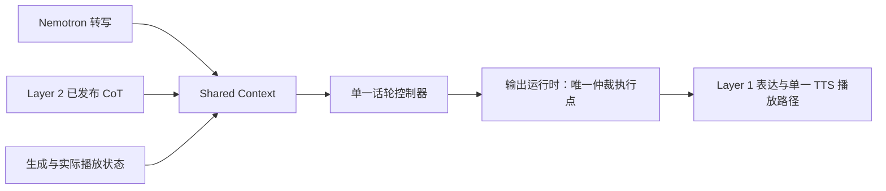

# 小话轮控制器的可行性与低延迟接入

2026-10-26。按用户要求整理方案讨论，结合当前TT-010训练诊断和[数据管线审计](dataset_pipeline_review.md)。本文是设计判断，不表示方案已经实施或模型已经可用；沿用TT-010的分析范围，不新增issue，不启动训练，也不改变[研究范围](../../research_design.md)及[架构职责](../../research_design/architecture.md)。

## 1. 结论与适用边界

建议保留Nemotron EN160＋Qwen3-0.6B控制器路线，先验证优化修复和语义监督，再判断模型容量。保持160ms观察节奏，同时使用累计前缀和历史；普通控制稳定后，再训练Layer 2 CoT条件化决策。当前四臂诊断均未产生可放行模型，不能将可行性判断写成效果保证。

当前存在两种不同的问题：训练后全keep，以及恢复start／stop后误动作过多。诊断已经实测到正例累积组受到强烈裁剪；取消裁剪可恢复正例，但没有满足负例约束。与此同时，pilot仅4来源、16个start及8个stop，正式数据存在分支元数据暴露、语义闭环缺失与时序简化。现有失败不足以单独证明0.6B容量不足。原始分母和优化证据见[诊断报告](../../../reports/textturn/20261026-training-diagnostics/README.md)。

纯文本路径存在信息边界。相同的“我周五去北京”既可能已经结束，也可能在停顿后继续补充。当前可见历史相同时，模型不能确定尚未发生的续说。尤其no-voice表示没有新增ASR文字，并非独立测得的真实静音。提高查询频率不能恢复缺失的声学或未来信息，陈述句与疑问句都应报告误抢话和延迟的折中。

## 2. 决策周期与上下文分开设计

160ms是观察与调度节奏，不是模型只能读取160ms内容。现有快照已经包含累计用户前缀、历史、助手生成状态和Listen／Speak状态。应先检查语义边界、来源覆盖及更新机制，不能把窗口短直接等同于上下文不足。

扩大到480ms会增加聚合等待，未必改善语义区分。建议继续短周期观察，保留空观察带来的时间信息，并在新增CoT可见时触发判断；不要求ASR和CoT同步到齐。改变现有逐解码观察或空窗调度合同前，需要单独明确实验协议。

控制器在Listen比较keep／start，在Speak比较keep／stop；当前合法动作logits已经实现这种状态条件选择。换成两个分类头并不能自动修好数据或优化，合法动作CE诊断也尚未显示可用的正负例折中。

## 3. 接入结构与动作所有权

图中只展示本次讨论的控制路径。Layer 0仍只负责系统附和时机；Layer 1负责思考请求与表达；Layer 2只发布任务分析CoT，不增加动作建议、开口就绪字段或独立语义否决模块。CoT到达不直接启动播放，也不直接停止输出。不增加Layer 3。

普通接话和用户打断必须能在没有新CoT时工作。控制器读取当时已经发布的CoT、其观察截止点和最新对话，不等待整项推理完成。分析过期时不能假装它已考虑新增条件。CoT输入长度需要明确预算，不能每拍无限拼接，也不能静默截断；首版不为此新增摘要器。

start经唯一执行点接受后建立新输出，真实开播再更新播放状态；stop绕过文本FIFO，由同一运行时撤销旧输出资格、请求停播并阻止迟到音频播放。正常结束由真实生成及播放生命周期产生finish，不预测为stop。已听到的内容不可撤销。

沿用单个在途控制请求和有界待处理快照，保留累计增量，防止无限排队；动作返回后核对输入依据、状态版本和output_id。生命周期变化后，旧动作不能直接执行。输出标识供运行时关联使用，不能包含normal／interrupt等预设场景信息后再序列化给模型。

## 4. 延迟应怎样测量与减少

历史候选控制耗时P95为55.64ms，包含客户端排队和HTTP，见[原始记录](../../../reports/textturn/20261025-tt-004-results/README.md)。这只是特定硬件、输入及负载下的控制段数据，不是完整语音链路成绩，也不证明未来与Layer 1/2共卡后仍有相同延迟。

| 时段 | 记录边界与用途 |
| --- | --- |
| 输入依据可见 | 音频事件到实际ASR文字发布，区分识别延迟与控制等待 |
| 控制调度 | 依据首次可见、窗口就绪、请求开始分别计时，暴露聚合和排队 |
| 模型与仲裁 | 请求开始到动作返回、再到执行点接受，报告P50／P95／P99 |
| 输出准备 | 动作接受到首个可播放音频；提前完成的任务分析不重复计费 |
| 实际播放 | 首次可听及打断后最后残余音频时间，不能以动作返回代替 |

优先减少额外聚合、积压和不必要的重复计算。当前`action_logits`一次前向直接读取动作分数，没有自回归生成长推理，但每次使用`use_cache=False`重算输入。需要在真实并发负载下先测量，再决定是否做缓存；JSON开头的状态或历史变化时，不能直接沿用上一拍全部KV。缓存只对确实相同的token前缀成立。

Layer 2边听边分析，可以减少交接后仍需完成的任务工作。Layer 1及TTS后续准备耗时仍需实测，不能把CoT异步化等同于零开口延迟。本次不新增投机播放、固定等待、阈值策略或ASR延迟补偿。

## 5. 分阶段训练建议

1. **先检查优化链路。** 用少量审核过的完整轨迹验证正例及相邻负例；在原冻结pilot上比较完整normal／interrupt组内合并三类损失后统一裁剪。保留全部窗口、正权重、梯度有限检查和实际更新日志，重算更新数及学习率日程。该方案尚未验证，不将取消裁剪直接作为正式设置。
2. **再修数据监督。** 优先移除模型输入中的预设分支信息，解耦打断位置和模板选择，补打断后接话与附和转接管闭环。语义标注依据当前可见信息，保留歧义keep；对照数据与优化改动分开验证。具体问题见[管线审计](dataset_pipeline_review.md)。
3. **按来源和独立机会组织覆盖。** 同源改写、normal／interrupt重复及连续keep不算独立来源。保持完整轨迹监督和既有数量上限；通过语义完整的短轨迹改善覆盖，不能删拍、截断旧回答后伪造finish，也不能自行扩大训练预算。
4. **按完整事件验收。** 分开报告疑问接话、陈述接话、句中停顿、附和、打断和恢复；比较相同误抢话率下的延迟。当前1%开发下限只排除零能力，不是研究质量线。后续若研究分状态分数校准，应另行冻结开发协议，不使用外部测试选阈值，不以调阈值掩盖错误排序。
5. **最后加入CoT条件化。** 相同用户前缀下，覆盖关键条件缺失、用户正在自行补充、问题已消解、CoT迟到／过期／无关等对照。控制动作独立审核，不从Layer 2建议字段复制；输入CoT屏蔽预测损失。普通打断仍不得等待CoT。

完整逐拍数据不意味着训练跨窗保留了模型隐状态；当前各快照独立前向。完整时序用于保证因果输入和监督连续性，不能据此要求优化器连续执行大量仅keep更新。具体待验证更新方案见[重训方案](retraining_plan.md)。

## 6. 现成候选与后备路线

| 候选 | 已有依据与本项目限制 |
| --- | --- |
| [LiveKit文本检测器](https://huggingface.co/livekit/turn-detector/blob/main/README.md) | 使用Qwen2.5-0.5B并由7B教师蒸馏，主要判断语义结束，配合VAD工作；不是覆盖全部动作与CoT的现成替换 |
| [实时VAP](https://arxiv.org/abs/2401.04868) | 连续预测未来双方语音活动，有CPU实时运行研究；声学预测不替代任务分析和主动澄清价值判断 |
| [Prompt-Guided VAP](https://arxiv.org/abs/2506.21191) | 文本prompt可影响话轮预测；未验证本项目CoT驱动介入合同 |
| [VoxTurn](https://arxiv.org/abs/2610.21150) | 2026-10-15发布的0.8B语音模型技术报告，一次前向处理多项话轮问题；需独立验证句式、输入合同、硬件延迟及CoT适配 |

若审核监督、优化和真实ASR分布后，纯文本模型仍不能在可接受误抢话率下满足延迟，优先评估增加声学证据。可让音频预测分数与转写、CoT共同进入单一控制策略，最终仍由唯一运行时执行；VAD不独立决定抢话或停播。该方向改变当前不增加VAD／声学输入的约束，属于待确认的后备方案，不在本次实施。

[TurnBench](https://www.sesame.com/journal/turnbench)将结束／句中停顿、打断／附和及检测延迟分别评估，可借鉴其事件口径；外部榜单或论文结果均不能代替本项目独立验证。
