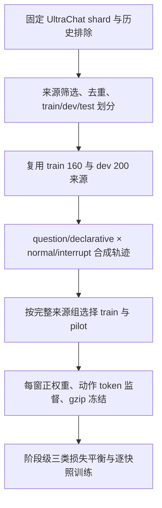

# TextTurn训练数据管线审计

2026-10-26。按用户要求审查当前构造管线，沿用TT-010，只读核查代码及冻结数据。结论是：**数据存在预设分支信息进入模型输入、模板不可达、语义闭环不足及分布混杂，应该在下一版训练前处理；尚不能据此断言这些问题各自造成了多少模型错误。** 本次不修改生成器、冻结集、训练配置或研究范围，不新增issue，也不提交训练。

审计对象为当前`tt-010-fulltraj-r1`，不能把旧TT-001抽样集或`duplex160-r2`的保留窗口数当作当前训练分母。整体路线判断见[控制器方案](controller_feasibility.md)，旧版审核见[data_review.md](data_review.md)，优化问题见[训练诊断](../../../reports/textturn/20261026-training-diagnostics/README.md)。

## 1. 当前实际管线

| 入口或对象 | 功能、设计与核心方法 |
| --- | --- |
| `freeze_textturn_dataset.py` | `select_sources`筛选英文问句首轮及陈述第三轮；`deduplicate`排除相同turn和高重叠文本，再划分来源；当前管线继承其来源清单 |
| `build_textturn_dataset.py` | `ControlTokenizer.chunks`按token字符跨度切文字；`strip_terminal`去用户末尾句读；`prompt_for`将整个visible对象序列化给模型 |
| `build_textturn_duplex_dataset.py` | `DuplexTrace`维护单个模拟执行域；`user_segment`发布用户块和空窗；`speaking_step`插入附和并推进输出；`step`保存决策前快照后接受动作；`scenario`决定整条分支 |
| `freeze_textturn_full_trajectories.py` | `select_whole_sources`按固定顺序选择完整来源组；`freeze`沿用原ordinal重建全部窗口，分配权重并冻结，不使用中间版本的删拍快照作为当前训练集 |
| `textturn_loss.py`、`train_textturn.py` | keep按轨迹／状态／类别限制基础权重质量，再进行阶段级动作质量平衡；各快照独立前向，累计梯度后裁剪和更新 |

上述实现均位于`scripts/training/`。本次同时检查了`tests/test_textturn_duplex_dataset.py`、两个数据审计入口及当前回放输入构造；测试中的边界不能自动算入正式训练覆盖。

## 2. 冻结数据计数与完整性

| 项目 | pilot | train | dev |
| --- | --- | --- | --- |
| 独立来源 | 4 | 21 | 200 |
| 完整轨迹 | 16 | 84 | 800 |
| 总窗口 | 1894 | 9977 | 88947 |
| keep／start／stop | 1870／16／8 | 9851／84／42 | 87747／800／400 |
| 不同start正文 | 8 | 42 | 400 |
| 不同stop可见前缀 | 4 | 10 | 10 |

逐窗共检查100818条记录，含与train重叠的pilot；唯一train＋dev窗口为98924。动作合法、标签仅监督唯一末尾动作、输入／标签等长且不超过2048、权重为正、prompt与visible序列化一致；相同完整prompt没有冲突动作。上述检查没有运行模型，也没有重新执行tokenizer或权重保存重载验证。

当前manifest列出的全部文件摘要、生成器／冻结器摘要以及上游manifest链均匹配。继承的train／dev／test来源组无交叉，test只读取分组清单，没有读取正文用于分析构造。该结论仅覆盖现有来源与词面去重合同，不证明全历史语义去重，也不代表行为模板隔离。

## 3. 优先处理：预设分支信息进入模型输入

`scenario`把来源、句式和变体写入identity，`accept_start`再将其作为output_id前缀。例如标识中包含`question:interrupt:output-1`。`step`把output_id放进visible，`prompt_for`序列化整个visible；终态、运行事件和历史中也会继续出现这个标识。

| 含预设分支标识的可见快照 | pilot | train | dev |
| --- | --- | --- | --- |
| keep | 1016 | 5237 | 44762 |
| stop | 8 | 42 | 400 |

这不是输入了未来用户正文，但泄露了构造器提前选好的normal／interrupt分支，也暴露句式与来源标识。所有stop输入都含该信息，分支信息还在部分打断发生前的Speak窗口中可见。因此，单靠“不把annotation字段放进visible”不足以证明输入没有构造信息泄露。

下一版应分开模型语义输入与运行时关联元数据；确需给模型保留的ID使用无场景含义、保持引用一致的不透明标识。重命名后应检查输入和动作分数是否稳定。当前仅确认暴露事实，没有模型重命名对照，不能声称模型已利用这一捷径，也不能拿它单独解释全keep。

## 4. 优先处理：8个模板实际只有5个可达

`scenario`先用`ordinal % 4`选择打断阶段；阶段0／2固定使用`UPDATES[0]`，阶段1／3才使用`UPDATES[ordinal % 8]`。两次取模共享ordinal，使合法索引永远只有0、1、3、5、7。

以下3个模板在当前正式生成路径中不可达：`I meant a different situation.`、`Change the topic to the next step.`、`Instead, focus on the cost.`。这由代码分支直接决定，不是有限抽样偶然没有选到。

| 实际完整打断模板 | train轨迹数 | dev轨迹数 |
| --- | --- | --- |
| Add a practical example | 18 | 200 |
| Use a simpler explanation | 4 | 50 |
| Could you explain the last part | 6 | 50 |
| Please stop speaking | 6 | 50 |
| That should include the risks | 8 | 50 |

下一版应解耦模板和阶段的选择，再按完整轨迹核对交叉覆盖。仅扩大模板常量列表不能修复索引不可达，测试也需要检查最终选择路径，而非只看列表长度。

## 5. 优先处理：动作闭环与语义边界不充分

**打断后没有重新接话。** train的84条轨迹每条都只有一个start和一个输出；42条打断轨迹全部在stop后继续keep，没有第二个start。452个打断后等待窗包括完整的“补例子”“简单解释”“解释上一段”“补充风险”等请求。明确停止可以持续keep，但不能仅凭interrupt变体就把所有后续请求统一标keep。

`scenario`在打断用户段结束后直接调用`drain`并进入`post_output_wait`，没有依据后续请求构造新回复。这是监督闭环缺口；不能机械把452窗全部改start，需要逐例审核当时语义和是否仍在持轮。

**所有start都被构造成整段结束后的首个空窗。** pilot的16、train的84、dev的800个start均在前一拍相同完整正文的keep之后160ms发生，并且空窗计数恰为1。源文本未结束时，所有发布窗、固定块间空窗及额外随机停顿均keep，尚无逐例独立语义审核。

这不等于“相同输入对应相反动作”：observation、版本与空窗计数确实变化。问题是标签主要由生成器知道的段落位置决定，无法据此证明模型学会了真实让轮。合理keep与可能已能让轮的前缀需要按可见信息审核；不能将所有句中停顿改成start，也不能强制所有完整子句都继续keep。

**附和与接管缺少语境对照。** 正式backchannel来自6个固定短语，用户段在模板队列结束时自动关闭并递增turn。train的backchannel可见前缀与stop前缀没有交集；未系统覆盖同一短回应在不同语境中的不同作用，以及同一用户轮“先附和、再新增要求”触发stop。`I`到`I meant`的单元测试和多输出诊断证明组件可以表达边界，不能证明正式训练覆盖了边界。

## 6. 分布混杂与低延迟泛化风险

| 问题 | 已确认事实 | 影响与限制 |
| --- | --- | --- |
| 句式与历史位置绑定 | 所有question的start历史长度为0；所有declarative为2，train分别42／42、dev分别400／400 | 陈述占比50%不等于在相同上下文位置验证了句式鲁棒性 |
| 来源预算被长轨迹挤占 | 10000窗内只选21来源，pilot只选4；同源normal／interrupt重复初始请求 | 权重不能创造独立语义机会；目前没有按阶段／模板保证pilot覆盖 |
| pilot缺少部分边界 | pilot的8个stop中，助手正文为空为0；train为4/42，dev为100/400 | 组件支持“首段正文前打断”，不代表pilot对该边界提供学习机会 |
| 时序高度规则 | 普通用户每块1—2 token，非末尾块后固定2个160ms空窗，再以0.2概率加1—5空窗 | 用户更新间隔只落在480、640、800、960、1120、1280ms，缺少真实ASR突发与停滞分布 |
| 通道节奏不同 | 普通用户块基本每480ms或更慢到达；附和队列每160ms发布一块 | 文字类型与到达节奏相关，尚未测量模型是否依赖这一相关性 |
| 播放模型简化 | 每拍把上一拍生成正文视为已播放，正常完成统一等待6个尾窗；接受start即模拟开播 | 不能代表真实TTS速率、首包等待、缓冲及停播延迟；finish只证明模拟合同 |
| train／dev共享行为生成器 | 来源隔离，但两边共享模板、索引规则、句式位置和时序 | dev成绩可检验新来源内容，不足以证明未见交互模式泛化 |

“固定2窗＋随机1—5窗”中的随机停顿是额外空窗，不能把全部块间空观察时长写成只有160—800ms。当前这种安排是已冻结的合成合同，本次不将其擅自改为真实ASR采样，也不据文本空窗反推真实静音。

用户进一步指出空拍设计后，重新沿`user_segment`核对：无额外停顿时，文字发布序列为“文字、空、空、文字”，两次文字间隔480ms；随机抽中停顿时继续在两拍之后叠加1—5空拍。最后文字块不插入这一组空拍，而是下一拍直接start。该安排把基础ASR发布间隙、额外停顿和段末监督绑定到不同的生成分支，无法据此证明真实停顿判别有效。修复时应分别配置文字速率、发布间隔与停顿，避免删掉两拍后无意将无额外停顿区段的文字速率提高3倍；具体选择见[配置讨论](dataset_repair_configuration.md)，尚未确认或实施。

正式train中确有72个backchannel窗口、263个playback_tail窗口及16个生成完成后stop，不能误写成这些类型完全没有覆盖。重复旧轮、过期回调、异常和截断主要由诊断样例检查；正式ignored_asr为1次纯空白，dev为3次纯空白，并非充分的重复／旧版本输入训练。

## 7. 与优化问题的关系

数据覆盖不足不能替代优化诊断。此前已经确认三类阶段级损失系数正确平衡，但正例更新组被强烈裁剪；取消裁剪后恢复正例并出现大量误动作。两方面需要分别对照，不能声称发现某一数据问题后已经证明全keep根因。

建议先在旧冻结pilot验证逻辑组内合并三类损失、统一裁剪的优化组织；再比较审核后的数据版本。新版优先处理模型可见标识、模板可达性、打断恢复和语义边界，再改善句式／历史位置与节奏的交叉覆盖。来源和快照上限保持，所有选中轨迹逐窗正权重监督，不删keep，不复制正例，不截断回答伪造finish。

## 8. 审核范围与复现证据

本次在本地已有conda环境`interclarify-dev`执行标准库流式只读审计：单线程、地址空间2GiB、外层timeout300秒、脚本内240秒截止；不加载GPU模型、不调用外部服务、不重建训练集。原始统计与临时分析程序保存在`artifacts/analysis/textturn/pipeline-review-20261026/summary.json`及同目录`audit.py`，不提交样本正文到Git。

输入manifest SHA256为`21357f70fb2d382c1ed79741d094aaee9378ec609c5215c7db1afc096b477989`；最终审计摘要SHA256为`fb2506ebbc0863c21a4d8d0d3ee69ba1cfab3c2445c904be938b51eb5f28b23d`，分析程序SHA256为`acdc153d82e29d67c907909385cce96d70c4dfe706f5a4d904d61f671e3b540a`，执行8.886秒。方法为逐行检查动作／损失与prompt，按scenario聚合start／stop／后续窗口，再扫描完整timelines统计事件及最终模板，并检查manifest链和原切分组交集。

主要证据入口：`build_textturn_duplex_dataset.py`中的`accept_start`、`step`、`user_segment`和`scenario`；`freeze_textturn_full_trajectories.py`中的`select_whole_sources`；冻结集的`manifest.json`、`selection.json`、`train/pilot/dev.jsonl.gz`与`timelines.jsonl`。没有执行新模型实验，元数据重命名、语义逐例重标及真实ASR泛化均仍待验证。
