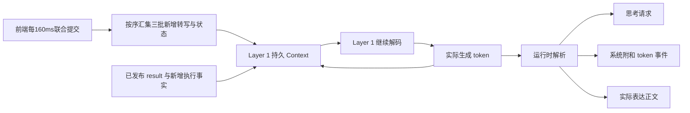

# Layer 1 持久 Context、周期输入与 token 输出协议

日期：2026-11-07。工作单：DCT-010；三拍周期：DCT-011；单 token 系统附和：DCT-012；首音前后取消：DCT-014。状态：设计，尚未接入 tokenizer、训练或运行时。

依据：[总体架构](../../research_design/architecture.md)与 [Layer 2 协议](../layer2/protocol.md)。Layer 1 保留一份持续推进的模型 Context：前端输入新增转写与新发布状态，模型继续解码，并把实际生成的 token 写回同一 Context。思考请求与系统附和使用各自专用的 special token。

## 1. Context 如何推进

一次逻辑周期为：在合法输入边界写入外部输入块，基于已有 Context 生成一段 token，保存实际生成内容，再进入下一边界。输出是一条含行为标记和正文的 token 流，不另外要求模型生成动作、文本、思考请求三份独立字段。

生成 token 已进入模型解码状态时，历史账本记录同一段内容，不在下周期再复制成第二份助手消息。周期结束不清空会话；输入到达后也不取消重算当前片段，新增信息进入下一边界。后端的会话与缓存适配须验证，不能假定普通推理 API 自动支持交错输入输出。

前端 160ms 表示音频批次步长。Layer 1 首轮常规周期设为三拍 480ms；前端继续推进，不等待 Layer 1 解码。没有新增文字也可以有新状态输入；有待生成表达时在周期内继续解码，无新观察且无待生成内容时等待，不要求空转。

### 1.1 首轮采用三拍周期

首轮取 `Layer 1 周期 = 480ms`。每次先在合法输入边界读入整组三个输入块，再生成一个有界 token 片段。录入输入缓冲与实际写入模型 Context 的时刻分别记录。

| 拍数 | 周期 | 理想解码边界频率 | 前端块到组末的平均／最大等待 | 首轮用途 |
| --- | --- | --- | --- | --- |
| 1 | 160ms | 6.25 次／秒 | 0／0ms | 调度最频繁的细粒度对照 |
| 2 | 320ms | 约 3.13 次／秒 | 80／160ms | 后续低时延对照 |
| 3 | 480ms | 约 2.08 次／秒 | 160／320ms | 首轮默认，平衡边界频率和更新等待 |
| 4 | 640ms | 约 1.56 次／秒 | 240／480ms | 较粗周期对照，观察更新更慢 |

[DuplexOmni 第 3.1.2 节](https://arxiv.org/html/2606.09186v1)也采用 480ms 时间片，可作为结构参考。

输入组保留三个批次的文本／状态交错顺序，不合并成“全部新文本＋最后一个状态”。组内短暂 complete 及后续状态变化都可追溯，已经失效的 complete 不能因历史保留而取得回答资格。输入结束时不足三批的已提交尾组显式处理并记录实际范围。

同一会话按组串行推进。实际解码超出周期时记录落后和有界缓冲占用，不并发运行同一 Context 或静默丢批。

## 2. 前端每周期提供什么

| 内容 | 写入规则 |
| --- | --- |
| 新增用户转写 | 从 X2 已闭合组累计正文中，取尚未消费的新增部分；不反复追加累计全文 |
| SoulX 新发布状态 | 使用同一 160ms 批次联合提交的状态及有效性；同值状态若来自新批次仍是新发布，按批次身份只注入一次 |

运行时将每个 160ms 批次的二者作为一个有来源边界的输入块，三块按顺序进入同一次 Layer 1 周期；使用 Layer 1 tokenizer 编码，不直接拼接 X2 或 SoulX 的原生 token ID。当前 X2 正文遵循闭合组追加合同；若出现非前缀修订，不能用普通追加冒充新发言或静默改写旧 KV，须按输入合同显式报错，修订支持另行设计。

SharedContext 当前实现保存最新联合快照；Layer 1 Context 保存实际输入输出的 token 历史。后续接入需要从联合发布处交付逐批输入，设置有界缓冲与消费位置，防止慢读漏掉短暂 complete；仅轮询最新快照不能视为已实现逐批交付。缓冲和 Context 容量须在实施前冻结，溢出显式失败，不静默丢批或截断历史。本单不修改现有 SharedContext 实现。

## 3. Layer 1 生成什么

下表名称仅表示语义，实际 special token 字符串、ID 与序列位置在 tokenizer 接入时冻结。

| 生成内容 | 语义与处理 |
| --- | --- |
| `THINK_REQUEST` 专用 token | 请求异步思考；运行时启动或合并 Layer 2 任务，不需要同时说话 |
| `SYSTEM_BACKCHANNEL` 专用 token | 一个独立的系统附和事件，不附带具体内容，仅保留 token 及其发生位置 |
| 普通表达文本 | 回答、补充或必要纠正等实际要说的正文，按合法生成边界输出 |

实际生成的标记与正文写回 Layer 1 Context，保留与外部输入不同的来源；首音前取消时，本次回答按第 5.1 节移除。用户附和状态来自 SoulX，系统附和 token 由 Layer 1 生成，二者方向、编码和监督分开。

运行时解析 token 流：思考请求送任务调度器；系统附和仅记录 token 事件；普通表达正文经 Text FIFO、TTS 和播放器输出。系统附和 token 本身就是完整事件，不打开等待正文的片段，也不需要附和专用闭合标记。当前不定义其短语或音频映射，两个 special token 均不作为 TTS 文本。普通表达的片段结束与等待编码仍待实现确定。

## 4. 其他信息如何进入 Context

Layer 2 正常结束时发布的 `result` 在下一合法输入边界作为外部结果块写入，保留任务来源、版本和实际对话依据。中间 `analysis` 和 `progress` 不进入 Layer 1，结果也不冒充助手自己生成的文本。

取消、停播确认及是否实际播放等必要执行事实，由运行时按新增事件写入，不每周期重抄完整账本。生成、取消与播放分别记录；模型 Context 按第 5.1 节区分首音前删除回答和首音后保留回答，原始生成与取消记录留在独立审计账本。

Layer 2 读取对话的文本视图：最新用户正文取自已联合提交的前端快照，助手文本取自 Layer 1 整理后仍保留的生成历史，不直接读取整份 token Context，也不从审计账本补回首音前已删除的回答。运行时去掉状态、思考请求、系统附和 token、结果封装和输出事实，不为附和事件补造助手发言。Layer 2 读取新用户正文不等待 Layer 1 消费积压批次。

## 5. 生成与执行边界

普通回答须在 Layer 1 实际读到当前话轮有效 `user_complete` 后生成。此前可以请求思考或在适当机会产生系统附和，不能借附和标记提前输出普通回答。重复或已失效 complete 不得重新开启同一回答；消费记录和输出生命周期由运行时关联。

有效用户打断从每个 160ms 已联合提交观察消费后，由唯一输出执行点处理，不等待三拍分组、Layer 1 停止 token 或当前解码结束。Layer 1 的常规 Context 更新仍按三拍进行；输出关闭后按以下规则整理上下文，播放器停止不等待整理完成。

结果到达不自动取得话轮，也不中断当前解码或播放。主动澄清的独立生成边界仍待设计，不由本次两类 special token 定义替代。

### 5.1 首音前与首音后取消

有效 `user_nonidle` 触发取消时，以播放器确认的实际已播采样判断首音是否发生。仅已生成、合成完成、音频入队或登记播放开始都不算实际播放；首帧与取消并发时，以最终取消／停播确认记录为准。

| 本次输出的实际播放事实 | Layer 1 Context | 用户消息分组 |
| --- | --- | --- |
| `played_samples = 0`，首音尚未播放 | 删除本次已取消回答的全部生成正文及对应回答边界，不保留该助手回答 | 将 complete 前的用户正文与续说按实际顺序合成同一条用户消息，已消费文字不重复追加 |
| `played_samples > 0`，首音已经播放 | 保留本次回答已生成的全部文本，包括尚未播放的部分；实际已听范围另记 | 保留此前用户与助手消息，续说作为新的用户片段，按正常打断恢复 |

首音前删除须同步到模型 token 序列与 KV／解码状态，后续基于合并后的用户输入继续。后端不能直接移除时，重建等价上下文；只改显示文本或聊天消息、让旧回答继续留在 KV 中不算完成删除。整理保留其他输入、状态、独立思考请求和已发布结果，按各自来源恢复，不因删除回答而重复执行思考请求。原 complete 已被续说作废，普通回答须等待合并后片段的下一次有效 complete。

两类取消均关闭旧输出资格，迟到生成不再写入当前模型 Context，旧文本与音频不自动续播。首音前的原回答可留在审计账本，不能再作为后续对话输入；首音后的已生成文本也不能被等同于全部已听到。具体缓存接口在运行时接入时实现，本次仅确认协议。

## 6. 训练与验证

Layer 1 训练监督思考请求 token、单个系统附和 token 及普通表达正文；系统附和只监督是否生成该 token 及其时机，不生成或监督附和内容。新增专用 token 时，训练须覆盖相应词表及输出参数。外部转写、状态、`result` 和执行事实为条件输入，屏蔽其预测损失；历史不重复监督或重复注入。

监督轨迹按三拍分组和实际输入／解码顺序展开，每组保留三个前端子块，覆盖纯思考请求、单 token 附和、无需附和、普通回答、重复状态和取消恢复。周期对照须说明训练切片与推理周期是否匹配，不能把未验证的跨周期泛化视为已有能力。基座与训练范围见[总体架构](../../research_design/architecture.md#6-训练范围与待定事项)，详细训练方案留待后续讨论；Layer 2 保持冻结。

验证须检查三批分组及状态顺序、真实生成回写、两类 special token 的解析与隔离，以及新增 token 的可学习性。取消恢复须覆盖零已播时删除回答及合并用户、首音后保留全部生成文本、首帧与取消并发、缓存重建与迟到生成隔离。远端分别记录增量 prefill、解码、实际注入等待、积压、首音与停播时延，并检查是否能持续供给表达。

## 7. 三个相邻周期的示意

| Layer 1 周期／前端批次 | 本组三批的新输入摘要 | 本周期生成并保留在 Context 的内容 | 运行时处理 |
| --- | --- | --- | --- |
| 1／批次 1—3 | 新文字合为“比较两种方案，A 固定费一百元”，组末仍未说完 | `THINK_REQUEST` | 启动思考，无可播正文 |
| 2／批次 4—6 | 新文字合为“A 每件一元，B 每件三元”，组末仍未说完且存在合适附和机会 | 仅 `SYSTEM_BACKCHANNEL` | 保留并记录该 token，不生成附和内容或发声 |
| 3／批次 7—9 | 新文字合为“B 没有固定费，要买二十件，哪种便宜？”，组末有效 complete | 普通回答片段，例如“选 B 更便宜。” | 按普通回答登记与播放 |

表格只概述每组新文字和关键状态，实际输入仍保留组三个子块及各自状态，不只保留组末状态。上一组输入、标记和实际生成文本已在 Context 中。第三周期允许 Layer 1 自行求解：A 为 120 元，B 为 60 元；详细费用可以在后续周期继续表达，不要求一个周期输出完整答案，也不能假定尚未发布的 Layer 2 结果已可见。机会和状态为说明性条件，不表示未说完就必须附和，也不表示模型已在 480ms 内完成该行输出。
