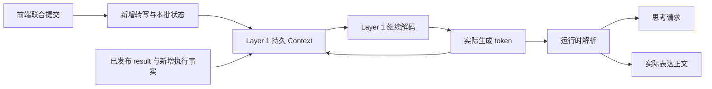

# Layer 1 持久 Context、周期输入与 token 输出协议

日期：2026-11-07。工作单：DCT-010。状态：设计，尚未接入 tokenizer、训练或运行时。

依据：[总体架构](../../research_design/architecture.md)、[训练设计](../../research_design/layer1_training.md)与 [Layer 2 协议](../layer2/protocol.md)。Layer 1 保留一份持续推进的模型 Context：前端输入新增转写与新发布状态，模型继续解码，并把实际生成的 token 写回同一 Context。思考请求与系统附和使用各自专用的 special token。

## 1. Context 如何推进

一次逻辑周期为：在合法输入边界写入外部输入块，基于已有 Context 生成一段 token，保存实际生成内容，再进入下一边界。输出是一条含行为标记和正文的 token 流，不另外要求模型生成动作、文本、思考请求三份独立字段。

生成 token 已进入模型解码状态时，历史账本记录同一段内容，不在下周期再复制成第二份助手消息。周期结束不清空会话；输入到达后也不取消重算当前片段，新增信息进入下一边界。后端的会话与缓存适配须验证，不能假定普通推理 API 自动支持交错输入输出。

前端 160ms 表示音频批次步长，不是 Layer 1 推理耗时承诺。前端继续推进，不等待 Layer 1 解码；没有新增文字也可以有新状态输入。有待生成表达时可以继续解码，无新观察且无待生成内容时等待，不要求空转。

## 2. 前端每周期提供什么

| 内容 | 写入规则 |
| --- | --- |
| 新增用户转写 | 从 X2 已闭合组累计正文中，取尚未消费的新增部分；不反复追加累计全文 |
| SoulX 新发布状态 | 使用同一 160ms 批次联合提交的状态及有效性；同值状态若来自新批次仍是新发布，按批次身份只注入一次 |

运行时将二者作为同一个有来源边界的输入块，使用 Layer 1 的 tokenizer 编码，不直接拼接 X2 或 SoulX 的原生 token ID。当前 X2 正文遵循闭合组追加合同；若出现非前缀修订，不能用普通追加冒充新发言或静默改写旧 KV，须按输入合同显式报错，修订支持另行设计。

SharedContext 当前实现保存最新联合快照；Layer 1 Context 保存实际输入输出的 token 历史。后续接入需要从联合发布处交付逐批输入，设置有界缓冲与消费位置，防止慢读漏掉短暂 complete；仅轮询最新快照不能视为已实现逐批交付。缓冲和 Context 容量须在实施前冻结，溢出显式失败，不静默丢批或截断历史。本单不修改现有 SharedContext 实现。

## 3. Layer 1 生成什么

下表名称仅表示语义，实际 special token 字符串、ID 与序列位置在 tokenizer 接入时冻结。

| 生成内容 | 语义与处理 |
| --- | --- |
| `THINK_REQUEST` 专用 token | 请求异步思考；运行时启动或合并 Layer 2 任务，不需要同时说话 |
| `SYSTEM_BACKCHANNEL` 专用 token | 标记随后表达片段为系统附和，具体措辞仍由 Layer 1 生成 |
| 普通表达文本 | 回答、补充或必要纠正等实际要说的正文，按合法生成边界输出 |

所有实际生成的标记与正文均写回 Layer 1 Context，保留与外部输入不同的来源。用户附和状态来自 SoulX，系统附和 token 由 Layer 1 生成，二者方向、编码和监督分开。

运行时解析 token 流：思考请求送任务调度器；系统附和标记设定表达用途；实际正文经同一 Text FIFO、TTS 和播放器输出。两个 special token 本身不送入 TTS。附和片段须有明确结束边界，不能让其标记无界延续到后续普通回答；结束和等待的具体编码仍待实现确定。

## 4. 其他信息如何进入 Context

Layer 2 正常结束时发布的 `result` 在下一合法输入边界作为外部结果块写入，保留任务来源、版本和实际对话依据。中间 `analysis` 和 `progress` 不进入 Layer 1，结果也不冒充助手自己生成的文本。

取消、停播确认及是否实际播放等必要执行事实，由运行时按新增事件写入，不每周期重抄完整账本。生成、取消与播放分别记录；输出取消不删除已经生成的 token，Layer 1 据真实已听内容组织接续或纠正。

Layer 2 读取对话的文本视图：最新用户正文取自已联合提交的前端快照，助手实际文本取自 Layer 1 生成历史，不直接读取整份 Layer 1 token Context。运行时去掉状态、思考请求、附和行为标记、结果封装和输出事实；助手实际生成的附和正文仍属于对话文本。Layer 2 读取新用户正文不等待 Layer 1 消费积压批次。

## 5. 生成与执行边界

普通回答须在 Layer 1 实际读到当前话轮有效 `user_complete` 后生成。此前可以请求思考或在适当机会产生系统附和，不能借附和标记提前输出普通回答。重复或已失效 complete 不得重新开启同一回答；消费记录和输出生命周期由运行时关联。

有效用户打断从已联合提交观察消费后，由唯一输出执行点处理，不等待 Layer 1 先生成停止 token，也不等待当前解码片段结束。Layer 1 的输入推进与播放器停止分别进行，保留真实生成历史和单一播放所有权。

结果到达不自动取得话轮，也不中断当前解码或播放。主动澄清的独立生成边界仍待设计，不由本次两类 special token 定义替代。

## 6. 训练与验证

Layer 1 训练监督实际生成的思考请求 token、系统附和 token 和表达正文。新增专用 token 时，训练须覆盖相应词表及输出参数。外部转写、状态、`result` 和执行事实为条件输入，屏蔽其预测损失；在训练样本中重放历史，不重复监督或重复注入同一次生成。

监督轨迹按实际输入与解码顺序展开，覆盖纯思考请求、附和及其正文、无需附和、普通回答、重复状态和取消恢复。首轮基座与训练步骤仍见训练设计，Layer 2 保持冻结。

验证须分别检查增量正文去重、状态批次消费、真实生成回写、两类 special token 的解析与隔离，以及新增 token 的可学习性和输出格式。端到端时延、缓存、容量与并发行为在远端验证；本协议不代表已达到实时性或模型效果。

## 7. 三个相邻周期的示意

| 周期 | 新输入 | 本周期生成并保留在 Context 的内容 | 运行时处理 |
| --- | --- | --- | --- |
| 1 | “比较两种方案，A 固定费一百元”，状态为未说完 | `THINK_REQUEST` | 启动思考，无可播正文 |
| 2 | “A 每件一元，B 每件三元”，仍未说完且存在合适附和机会 | `SYSTEM_BACKCHANNEL`，随后为“嗯，我在听。”及片段结束边界 | 仅将附和正文送同一播放链路 |
| 3 | “B 没有固定费，要买二十件，哪种便宜？”，有效 complete | “二十件时，A 一百二十元，B 六十元，选 B 更便宜。” | 按普通回答登记与播放 |

每周期只追加本行新增文字与新状态；上一行的输入、标记和实际生成文本已在 Context 中。第三周期允许 Layer 1 自行求解，不能假定尚未发布的 Layer 2 结果已可见。表中机会和状态为说明性条件，不表示未说完就必须附和，也不表示已运行真实模型。
