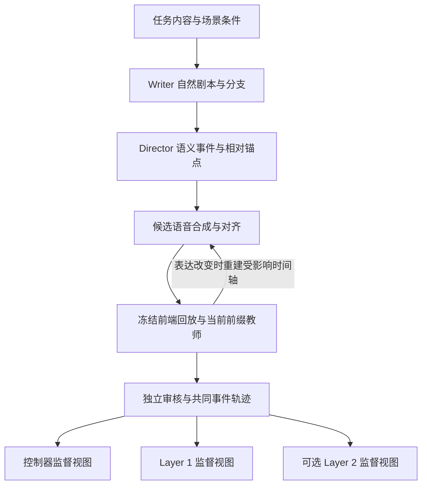

# 话轮控制器与 Layer 1 训练数据构造设计

日期：2026-11-07。状态：设计讨论稿；五场景文本试造、三模块视图及远端一致性校验已完成（DCT-002—004）。设计工作单：DCT-001。

本文将基于 [DuplexOmni 阅读报告](DuplexOmni_reference.md) 的讨论整理为数据构造方案，说明如何从任务和交互剧本得到话轮控制器、Layer 1 及可选 Layer 2 的训练数据，并用具体轨迹解释监督边界。研究目标与运行合同分别以[研究方案](../../research_design.md)、[架构设计](../../research_design/architecture.md)和 [Layer 1 训练设计](../../research_design/layer1_training.md)为准。

本文交付设计。2026-11-07 用户明确授权在 `datagen` 与远端试造 3—5 条场景，先由五个独立来源生成文本及模拟时序监督视图，具体范围见[试造说明](../../datagen/README.md)。这一步验证字段与因果边界；未合成音频、回放冻结前端、实施 CoT 注入或开展训练，不能替代第 9 节的完整试标验收。数据字段、动作名称和示例时间仍未冻结为运行接口。

2026-11-07 后续设计明确了 [Layer 2 周期输入与发布协议](../layer2/protocol.md)：每周期只读对话与上一轮 `analysis`，助手文本不附输出状态；输出增量 `analysis` 与三值 `progress`，结束时另生成 `result`。两个下游只读取同一份结果，中间分析留在 Layer 2。本文下游可见的 CoT／外部分析均指 `result`。现有 pilot v1 仍含独立资料和状态输入，采用旧分析目标及发布方式，尚未适配本协议，本次不改写已验证产物。

## 1. 目标与基本分工

核心方案是：构造一份按因果顺序展开的共同交互轨迹，再依据各模块实际可见的信息，分别导出监督样本。完整剧本用于安排环境；训练目标必须依据决策时刻的可见前缀生成，不能直接从完整剧本截取答案。

| 对象 | 需要学习的能力 | 数据构造中的边界 |
| --- | --- | --- |
| 话轮控制器 SoulX-Duplug | 用户状态判断；后续扩展为利用音频、转写与已发布分析进行主动介入判断 | 初期冻结原模型以采集真实状态轨迹；后续控制标签独立审核，不把原模型预测当作金标 |
| Layer 1 | 等待、系统附和、正式表达、思考请求，以及取消后的表达恢复 | 读取外部状态并组织自身行为，不重复预测用户状态；普通回答仍须实际读到对应有效 complete |
| Layer 2 | 周期增量分析、信息缺口、依赖与求解，以及结束时形成独立结果 | 可先冻结；仅发布 `result`，中间 `analysis` 留在自身，不生成话轮指令或候选表达 |
| 输出运行时 | 执行实际输出的入队、取消、播放与停止 | 提供真实执行事实；不是通过 Layer 1 正文重新学习的执行器 |

系统附和和主动澄清分别标注。前者由 Layer 1 判断时机与措辞，后者还依赖后续控制器的 CoT 条件化能力及独立生成边界；不能把主动澄清标签塞入现有五状态后声称协议已经具备该能力。

## 2. 对 DuplexOmni 的借鉴与调整

DuplexOmni 的 Writer 根据场景和内容生成自然剧本，Director 再添加时间控制标记；公开管线在两者之间安排清洗与修复，之后进行语音合成、对齐和训练数据转换。我们借鉴职责划分，不直接复制其全部标记与调度。

| 参考方法 | 本项目的处理 |
| --- | --- |
| Scenario Seed 与任务内容组合 | 保留，并独立变化交互事件、任务难度及分析返回时序 |
| Writer 编写自然剧本 | 保留；剧本中的助手回答先作为候选，不能绕过前缀审核 |
| Director 编排重叠、停止及思考事件 | 保留语义事件与相对位置；实际时间需经语音对齐与回放确定 |
| 按固定音频周期组织样本 | 改为遵循当前前端发布与各模块输入边界，不照搬 480ms |
| 根据助手回答反推 S2 内容 | 可用于产生候选；必须再验证能否仅从当前前缀独立得到 |
| 用 `[WAIT]` 暂停并重置 S2 | 不直接沿用；本项目活动 Layer 2 在短推理边界纳入新观察 |

作者 Director 提示词明确包含根据 Agent 回答反向生成 S2 内容的要求；论文附录中的 `[WAIT]` 会暂停并重置思考，恢复需要新的 `[THINK]`。这些是参考实现的做法，不是本项目已经采用的合同。依据见[作者数据管线](https://github.com/MuyeHuang/DuplexOmni/tree/main/data_pipeline)、[Director 提示词](https://github.com/MuyeHuang/DuplexOmni/blob/main/data_pipeline/02_writer_director/voiceagent_text_pipeline.py)与[论文附录 A](https://arxiv.org/html/2606.09186v1#A1)。

离线数据可以使用结构化格式存储；在线模型可以采用紧凑标记。两者分别选型，是否输出 JSON 不由模型参数量直接决定。

## 3. 共同轨迹的组织

### 3.1 来源、场景与分支

先按来源划分试标、训练、开发与测试分区，再在各分区内部生成任务变体及对话分支。场景至少包含三类可独立组合的条件：

- **任务内容**：问题、当时可用资料、约束、可核验答案或要求清单。
- **交互事件**：正常交接、停顿、附和、打断、补充条件、改口及取消恢复。
- **分析过程**：无需思考、分步分析、结果迟到、依据过期、失败或超时。

任务来源中的资料只有实际写入当时可见对话，才能成为 Layer 2 输入；场景元数据和隐藏答案不通过独立资料字段提供给模型。

同一任务可以对应不同交互轨迹，同一交互事件也应分布在不同任务内容中，避免模型只凭题型或固定措辞选择动作。各条件需检查兼容性，不要求穷举所有组合。

同一场景可以形成共享前缀的多个续说分支。区别尚未出现之前，这些分支提供相同的信息与可接受动作集合；不能因未来分支不同而给当前前缀相互冲突的监督。

### 3.2 事件与时间

每条轨迹保留来源、场景、对话、分支和事件标识，记录用户音频、转写增量、外部状态、思考任务、分析发布及真实表达。共同轨迹是离线生成与审计产物，不要求在线 Context 保存所有诊断历史。

同时保留教师模型与提示词版本、前端权重与配置、语音合成及对齐来源，以及调度属于实测还是模拟。原始预测、教师目标与人工审核的来源分别标记，便于追溯数据偏差。

| 信息 | 需要区分的记录 | 用途 |
| --- | --- | --- |
| 用户输入 | 音频范围、实际观察上界、识别结果及版本 | 说明信息来自哪一段输入，包括真实前瞻 |
| 前端结果 | 处理完成、联合发布和模型实际读取的时刻 | 防止把音频中已发生的信息当作模型已经看见 |
| Layer 2 分析与结果 | 请求、任务标识、每周期对话与前次分析、增量分析和进度，以及最终结果的发布与注入顺序 | 区分内部分析已计算、最终结果已发布和已被消费 |
| 助手表达 | 真实生成、提交、合成、播放与取消 | 区分模型生成内容和用户实际听到的内容 |
| 用户打断 | 对应快照、活动输出标识、取消事件与停播确认 | 训练恢复表达并审核取消是否生效 |

回放使用统一时间基准，音频观察范围另记。当前每 160ms 的双路联合提交不表示 Layer 1 每 160ms 都必须生成；Layer 1 和控制器只在各自合法输入边界读取已经可用的信息。

某次推理的可见信息以**实际构造的输入**为准。输入构造后到达的分析，即使在本次生成结束前已经发布，也不能追记为本次推理的条件。模拟延迟必须标明来源，不能将其作为真实性能或 thinking 收益证据。

### 3.3 原始观察、监督目标与隐藏审核材料

三类信息分开保存：

- 原始观察：实际转写、SoulX 原始预测、已发布分析和运行事件。
- 监督目标：经过当前前缀教师与审核确认的动作、正文及控制标签。
- 隐藏审核材料：完整剧本、未来续说、参考答案与全量对齐结果。

前缀教师只读取对应模块可见的观察。完整答案可供离线核验使用，不得作为隐藏提示提供给教师。控制器前缀审核可以检查当时可见的音频，但不能利用之后的续说确定当前停顿必然是结束还是继续；无法判断的情况保留不确定标记。

## 4. 构造流程与各环节职责

### 4.1 任务与 Writer

选择有可核验目标的任务，再以场景条件生成口语剧本。Writer 负责语义连贯与自然交互，给出候选用户表达、助手表达和续说分支，不负责冻结模型 token、真实延迟或控制器金标。

普通任务和无需额外思考的对话必须保留。不能让每个样本都触发思考、插话或改口，否则模型容易把这些行为当作完成任务的固定流程。

### 4.2 Director

Director 把剧本转为语义事件和相对锚点，例如“用户在助手说到某个词时开始补充条件”。同时标出共享前缀、候选思考请求、表达用途，以及哪些内容依赖分析结果。

这些安排需要经过后续回放与审核。Director 不能直接从最终结局反推唯一正确的早期动作，也不能把“适合介入的窗口”转换为理想的分析完成时间。

### 4.3 语音合成与对齐

分别合成用户与助手语音，保留说话人轨道和字词时间戳，再按事件锚点形成停顿、重叠与截断。控制标记不参与口播，未播放的内容也不能混入用户实际听到的记录。

优先使用有明确对齐来源的时间信息；对齐误差需要抽检。训练可以合成或采集音频，关键案例需覆盖自然停顿、语速及声学变化。多个音色或语速版本属于同一来源的派生轨迹，不作为新的独立场景。

### 4.4 冻结前端回放与因果生成

核心交互语料经过冻结的 SoulX＋X2，记录真实整词提交、状态变化和实际观察范围。干净文本模拟可先用于协议验证，后续以真实轨迹校准，不能用模拟切窗替代全部含噪交互训练。

回放按因果顺序推进：构造当前输入，生成当前分析或表达，记录发布和播放，再消费后续输入。Layer 2 的每次短推理记录实际读取的前缀；缓冲区已经有新信息，不代表进行中的推理已经使用它。

初始剧本可以预先渲染以确定候选时间轴，但最终教师表达若发生改变，必须重新合成、对齐并回放受影响的后续事件。尤其是按助手词语触发的打断，不能继续引用旧回答中的位置。最终目标、音频和时间轴必须相互对应。

### 4.5 前缀教师、审核与导出

依据每个模块的真实输入生成目标，审核内容正确性、控制合理性、时序和来源，再导出模块样本。两个教师可以共享任务来源，不能共享对方不可见的输入。

对计算、约束和答案依赖尽量做可核验检查；开放任务采用要求清单与分层人工抽检。抽检同时覆盖通过、拒绝和不确定样本，记录错误类型及分歧。生成模型与审核模型一致不等于已经核验。

最终分模块开展监督训练，再用训练分区内的模型回放失败案例补充恢复样本。数据审核不增加在线语义否决器、第二个仲裁器或新的播放路径。

## 5. 模块样本与损失边界

| 数据视图 | 输入 | 监督目标 | 不作为目标的内容 |
| --- | --- | --- | --- |
| 控制器 | 实际可见音频、相应转写、运行状态；后续增加已经注入的分析 | 经独立审核的用户状态和后续介入语义标签 | Layer 2 的动作建议、未来状态、原 SoulX 预测的机械复制 |
| Layer 1 | 当前转写、外部状态、必要历史、取消与播放事实、已注入分析 | 自身行为边界、思考请求与表达正文 | 用户输入、外部状态和分析块的预测损失 |
| Layer 2，若训练 | 当时可见对话与同一任务上一轮 `analysis`；无独立资料或更早分析，助手文本不附状态 | 每周期增量 `analysis` 与三值 `progress`；结束周期另有 `result` | 话轮动作、候选问句、表达草稿与隐藏答案 |

Layer 1 数据应同时保留真实含噪状态输入与审核信息，防止训练时只见理想状态、运行时却消费真实预测。控制器训练目标独立生成；对仅凭当前输入无法确定的样本，采用不确定标注、减少相应监督或暂不纳入确定标签训练，具体方式待试标。

共同轨迹及 Layer 1 视图保留真实生成但未播出的内容，并标明其身份；不能把它伪装成已说内容。Layer 2 视图只保留实际生成文本与角色，不带入取消／播放状态，也不据此判断用户已听内容。Director 设想但模型从未生成的“幽灵文本”不作为真实生成历史。恢复样本只监督合理的后续表达，先前错误可以作为上下文，但错误 token 不纳入正确正文的正向监督。

### 5.1 一个 Layer 1 样本的概念结构

以下是字段组织示意，不是 tokenizer 格式或已实现接口：

| 区域 | 示例内容 | 训练处理 |
| --- | --- | --- |
| 可见用户输入 | “改成周六，内容还是提醒大家开会。” | 条件输入，屏蔽预测损失 |
| 外部状态 | 当前话轮有效 `user_complete` | 条件输入，屏蔽预测损失 |
| 真实历史 | 旧表达已生成但未开播；旧输出已取消 | 条件输入，屏蔽预测损失 |
| 当前结果 | 无，或实际已注入的相关 `result`；不含中间 `analysis` | 条件输入，屏蔽预测损失 |
| 目标行为 | 生成新的普通回答 | 自身行为监督，编码待定 |
| 目标正文 | “提醒大家，会议安排在周六。” | 正文监督 |
| 离线追溯 | 来源、分支、输入快照与审核信息 | 不因便于审计就全部拼入模型输入 |

同一轨迹导出的控制器样本使用控制器自己的输入快照与独立标签，不能把上表中的“生成新的普通回答”当作用户状态标签。

## 6. 数据覆盖与决策采样

| 能力 | 正向或恢复案例 | 必须保留的对照 |
| --- | --- | --- |
| 普通交接 | 已读到有效 complete 后回答 | 尚未读到 complete、同一状态重复出现但已经回答 |
| 取消恢复 | 续说、条件修改、首音前及已播后取消 | 用户未打断，或只是非打断性的附和 |
| 系统附和 | 有效事件窗口内的简短听者回应 | 不宜回应、刚附和过、即将交接、可能形成错误赞同 |
| 思考请求 | 任务存在分析需求或关键缺口 | 简单任务、已有活动任务、无需新增请求 |
| 主动澄清 | 缺口影响后续理解且存在合理介入机会 | 用户自行补充、缺口已消解、资料仍然相关、已有澄清 |
| 异步分析利用 | 利用已到达结果补充或纠正表达 | 结果未到、结果过期、无新增价值、失败或超时 |
| 回答递进 | 先交付有依据的有效部分，再补充关键结果 | 可以直接答对、无需延长推理、无需修正 |

采样重点为新增关键信息、状态变化、分析注入、输出冲突与恢复等决策位置，另抽样保留稳定等待段。附和机会使用事件窗口而非人为指定的唯一毫秒点；“适合但可不发”不强制变成必须发声的标签。

机会存在与教师选择的实际行为分别记录。监督微调可以采用经审核的一个合理表达；若当前 Layer 1 输入不足以区分机会，不用教师额外可见的声学信息强制产生相反标签。窗口数量与采样权重在试标中检查，避免模型只学会等待或过度开口。

## 7. 行为标记与 Layer 2 训练策略

### 7.1 标记语义

表达等待、请求思考、任务继续、正常结束及失败分别记语义，不把它们合并成一个 `[WAIT]`。现阶段沿用一个活动思考任务的合同：新增观察进入其后续短推理边界，重复请求合并，不按每个窗口重启。

本文不新增暂停或取消思考任务的模型动作。若后续确有需要，应先修改任务生命周期合同，再确定相应监督与编码。普通停止播放仍由唯一输出运行时执行，不依赖模型先生成某个停止词。

外部分析需有明确来源边界，并记录任务、版本与实际观察截止点。边界可以用现有角色／分隔序列表达，是否增加专用 token 待验证；这不改变当前尚未实现 CoT 注入及返回编码的状态。分析块在 Layer 1 与控制器训练中屏蔽预测损失；新增词表 token 时，相应词表参数须纳入训练。

### 7.2 是否训练 Layer 2

建议首轮冻结 Layer 2，验证协议和结果利用；从第一批轨迹起保留可用于后续适配的输入与输出。冻结是试验起点，不是正式研究必须采用的结论。

如果失败主要发生在 Layer 1 不利用正确结果，优先解决结果利用；如果 Layer 2 忽略新条件、重复分析或发布话轮建议，再构造适配数据。每周期依据对话与上一轮分析监督新增推导和三值 `progress`；正常结束时另监督独立 `result`，中间分析不注入下游。三值进度只区分续算、等待对话和正常完成，不转换成话轮动作。

新增条件后的分析样本只包含当前对话与上一轮分析，监督本轮新增推导、验证或修正；结果包含必要结论与依据，不能依赖下游重放增量链。更早分析仅供审计，教师也不得额外读取；旧中间结论不可见时须重新推导。无需思考、等待对话、任务完成及失败分别保留，结束和失败不能当作用户让轮标签。

## 8. 示例：从事件轨迹到监督目标

以下均为人工构造的教学示例。时间为同一回放时钟下的假设值，不是模型实测速度；所示转写和状态是假设的已提交结果，不声称真实前端一定如此输出。主动澄清中的“适合介入”等表述是离线语义标注，尚不是现有五状态或可执行 token。

### 8.1 正常交接与重复 complete

用户请求：“把‘谢谢’翻译成英文。”

| 假设时刻 | 事件或模型可见输入 | Layer 1 的合理目标 |
| --- | --- | --- |
| 1.10s | 前端联合发布“把谢谢翻译成”，状态为 `user_nonidle` | 下一读取边界继续听，不生成普通回答 |
| 1.24s | 用户已经说完“英文”，但其识别结果尚未提交 | 不能因为音频已经发生就提前使用尾词 |
| 1.38s | 联合发布完整正文及有效 `user_complete` | 尚需在 Layer 1 的正常输入边界读取 |
| 1.42s | Layer 1 实际读到完整正文与有效 complete | 在当前 turn 生成“Thank you.”，无需额外思考 |
| 1.62s | 再次读到同一话轮 complete，回答已经生成 | 不重复回答；等待后续输入或完成既有输出 |

控制器标签需要依据它当时可见的音频与文本独立审核。Layer 1 样本保留原始外部状态和消费事实；去重的具体运行接口仍待下游设计，不能把每次 complete 都变成新的回答调用。

### 8.2 短暂 complete 后改口：首音前与已播后取消

用户先说：“帮我写一条周五开会的提醒。”系统读到有效 complete，生成候选正文：“提醒大家，会议安排在周五。”随后用户补充：“改成周六，内容还是提醒大家开会。”

| 阶段 | 首音前取消分支 | 已播后取消分支 |
| --- | --- | --- |
| 原回答开始 | 已生成并准备合成，尚未播放 | 用户已经听到“会议安排在周五” |
| 新观察可见 | 共同快照中的有效用户打断被消费 | 同左，已听事实另行保留 |
| 运行时执行 | 撤销旧输出资格，记录取消与停止事实 | 停止后续播放，已播内容保留；停播前继续播放的部分也需记录 |
| 用户仍在补充 | Layer 1 读取新条件，但不生成新的普通回答 | 同左 |
| 新话轮有效 complete 可见 | “提醒大家，会议安排在周六。” | “改为周六：提醒大家，会议安排在周六。” |

两条轨迹分别训练未播生成的恢复和已播内容的衔接。周五是用户原先给定的条件，不能把原回答事后标成预知改口的错误；也无需强行道歉。新回答不自动续播旧输出的尾句。

### 8.3 用户附和与系统附和不是同一种事件

| 场景 | 应保留的标注 | 对应监督 |
| --- | --- | --- |
| 系统解释时，用户说“嗯，对，你继续”，音频与语义支持非打断性附和 | 用户附和，保留实际外部状态 | 控制器学习与有效打断区分；Layer 1 可继续表达 |
| 系统解释时，用户说“等等，日期改成周六” | 有效用户打断，关联活动输出 | 运行时执行取消；Layer 1 等待新的普通回答边界并恢复 |
| 用户持续叙述，出现适合听者回应的边界 | 系统附和机会，允许不发声 | Layer 1 可选择“嗯，我在听”，也可合理等待 |
| 用户没有结束表达，但系统刚刚附和过 | 不宜重复附和 | Layer 1 继续听，避免重复短回应 |

上述判断不能退化为固定关键词规则，需结合当时信息审核。用户的 `user_backchannel` 不自动要求系统也附和；持续 `user_nonidle` 也不能机械视作对系统附和的新打断。附和生命周期内的有效取消条件仍需在接入前明确。

### 8.4 共享前缀下的主动澄清与合理等待

共同前缀：“帮我看看这个复试要求。我把通知念给你，这里分学术学位和专业学位，我先从学术学位部分开始……”

当前可发布的分析示意：“用户报考类别尚未明确；两类专属条款不同，类别会影响后续内容的适用性。”分析中不包含候选问句、用户未来类别或介入指令。

| 后续实际到达的分支 | 更新后的判断 | 后续控制与 Layer 1 表达目标 |
| --- | --- | --- |
| “不过我报的是专硕，我直接念后面的部分。” | 类别与阅读方向已经明确 | 继续听，不重复确认类别 |
| “这部分有十几条，我把考核、材料和成绩计算都念一下。” | 类别仍未知，长篇展开可能依赖类别 | 在存在合理语音边界、经审核值得介入时，控制器形成相应判断，Layer 1 可问“先确认一下，你报的是学硕还是专硕？” |
| “学硕部分就这一句，下面马上是专硕要求。” | 即将自然转入下一部分，提前介入增益有限 | 继续听，在后续输入中重新判断 |
| “我报的类别是……我看一下报名信息。” | 用户正在自行查找缺失信息 | 暂时等待，不能利用未来答案判断当前已经消解 |

这些目标只适用于区别已经实际可见之后。分支出现前使用相同的可见信息和判断规则，不把未来是“专硕”的结局写入共同前缀标签。具体任务依据见[倾听设计的共享前缀案例](../../research_design/listening.md#42-案例一)。

主动澄清采用后续待设计的独立生成边界，不把它当作 complete 前的普通回答。该示例说明未来训练目标，不表示现有 SoulX 五状态已经支持上述介入。

### 8.5 晚到分析不能覆盖最新用户输入

沿用上一示例，Layer 2 开始分析时用户类别未知；分析进行中，用户已经说明类别。

| 假设时刻 | 事件 | 可见性与监督含义 |
| --- | --- | --- |
| 0.10s | Layer 2 读取前缀 p10，类别未知 | 本次分析只能声称依据 p10 |
| 0.35s | 用户自行说明“我报的是专硕”，前端随后发布 p11 | 进入新观察缓冲区，不表示进行中的分析已读到 |
| 0.48s | Layer 1 构造本次输入，包含 p11，尚无新结果 | 本次目标不得依赖之后才形成的结果 |
| 0.50s | Layer 2 返回基于 p10 的分析、done 与候选 result | 运行时发现 p11 未读，候选结果不发布，不把本次计算冒充已考虑 p11 |
| 后续短推理边界 | 同一任务读取 p11 与上一轮 analysis | 更新类别依据，不读取更早分析或新增并行任务 |
| 正常结束 | 返回“已明确报考专硕，类别缺口消解；后续适用条款应按专硕区分”的 result | 两个下游在各自后续边界读取同一结果，不能再按类别未知重复询问 |

若用户补充是在旧结果真正发布并结束任务后才到达，则旧结果保留原依据；下游结合最新正文识别“类别未知”已过期，而两类条款不同这一事实仍可能有效。后续更新由 Layer 1 新请求启动任务，不等待更新结果才处理用户或有效打断。

### 8.6 边说边想：先交付有效部分，再补充结果

用户完整任务：“箱子最多装 20kg，预算 100 元。A 每件 6kg、25 元，B 每件 8kg、30 元，两种都至少一件，怎样装件数最多？”所有条件在开口前已经给出，之后没有新增用户信息。

| 阶段 | 计算过程与实际可见条件 | 合理表达 |
| --- | --- | --- |
| 任务交接 | 有效 complete 与完整任务已被读取 | 可请求分析，不以空泛进展话术作为必要开场 |
| Layer 1 自行分析对话，Layer 2 同时分步求解 | Layer 1 可以自行推得每件至少重 6kg，四件超过容量；Layer 2 的中间分析不可见 | 有可靠依据时可先表达“最多三件，因为四件至少重二十四公斤” |
| 上述内容开始播放后，Layer 2 继续分析 | Layer 2 读取对话与上一轮分析，检查三件混合组合与预算 | Layer 1 可完成自己的可靠内容，不能引用未发布的中间分析 |
| Layer 2 正常结束，result 在后续边界注入 | 最多三件，2A＋1B 重 20kg、花费 80 元，满足两种各至少一件 | “选两件 A 和一件 B，正好二十公斤、八十元，能达到三件的上限。” |

该简化题用于说明信息依赖，不要求所有简单算术都调用 Layer 2；Layer 1 若能自行可靠求解，可以直接回答，数据需保留这种对照。正式轨迹必须确认后续分析确实在表达开始后继续发生，并影响后续可核验内容。预先算好完整答案再按时投放，只能标为模拟训练调度，不能作为边说边想的机制证据。

### 8.7 自我修正：错误只作恢复上下文

另一个轨迹中，系统自然发生计算错误，用户已经听到：“一件 A 加一件 B，共十六公斤。”后续实际完成的检查确认总重为 14kg。

恢复目标可以是：“刚才的合计应是十四公斤，不是十六公斤。”同时保留原错误已经播放的事实。原错误 token 在恢复样本中作为历史条件屏蔽，不作为正确正文训练目标；主训练轨迹仍保留直接正确的表达。

若错误只生成但尚未播放，不强制模型声称用户已经听过错误。若人为固定错误前缀用于压力训练，应单独标记来源和配比，不能混入自主产生错误的统计或主 benchmark。

## 9. 试标、验收与扩量

首轮沿用约 300—500 个独立来源的试标规模，对部分来源增加共享前缀分支和不同调度版本。该规模用于确认数据可学与审核可靠，不是大规模训练总量目标，也不将旧方案的配比和吞吐估计当作当前配置。

试标交付应包含：来源及分区清单、候选剧本、音频与对齐来源、实际前端轨迹、各模块输入与目标、审核记录、独立来源及派生轨迹统计。重点检查以下问题：

1. 教师是否读取未来输入、隐藏答案或尚未注入的分析。
2. 普通回答是否遵守 complete 可见边界，是否出现重复回答或过度等待。
3. 控制器目标是否独立审核，是否混淆原始状态与金标。
4. 取消前后是否保留真实生成和已听事实，是否错误续播。
5. 附和、澄清与恢复目标是否合理，是否出现不必要调用、填充或人为改口。
6. 分析、表达、合成音频和时间轴是否一致，模拟与实测是否明确区分。

训练、开发和正式测试按来源、共享前缀、模板及派生任务家族分组隔离；同一题换数字、音色、语速或措辞不跨分区。FDB、SoulX-Eval 及其改写不参与训练、教师筛选或阈值选择。独立场景、对话、分支、决策样本、音频时长和 token 分别计数。

先按协议、含噪状态与恢复、系统附和、thinking 利用推进 Layer 1 训练；控制器的 CoT 条件化适配另行实施，主动澄清的闭环验收需两者及运行边界配合。各阶段保留可比较检查点和普通回答数据，依据开发集表现及学习曲线决定扩量，而不是先固定很大的切片条数。

## 10. 待确定事项与实施边界

| 待确定项 | 决策依据 |
| --- | --- |
| 控制器主动澄清的输出编码及合法生成边界 | 与现有状态、普通回答和运行时合同保持清晰分工 |
| 等待、表达用途、请求与分析边界的序列格式 | tokenizer、chat template 和协议适配试验 |
| 数据配比、稳定等待采样与不确定样本的处理 | 试标分歧、错误分布与开发集行为 |
| 教师模型、分析粒度及 Layer 2 是否适配 | 当前前缀下的正确性、更新能力和结果利用失败归因 |
| TTS、对齐方式与真实前端覆盖规模 | 合成质量、时序误差和实际回放成本 |
| 时延分布、上下文及计算预算 | 真实部署轨迹与远端资源预检 |

后续数据生成、模型训练和集群测试需要明确工作单，并在远端 conda 环境下执行。实施前规定最大并发工作数、CPU／GPU 内存、磁盘、日志和检查点上限；本设计稿不授权启动这些作业。
