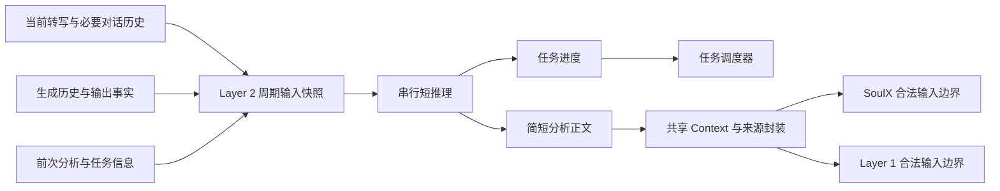

# Layer 2 周期输入、分析输出与发布协议

日期：2026-11-07。工作单：DCT-005。状态：协议设计，运行时和训练尚未实施。

依据：[总体架构](../../research_design/architecture.md#3-思考任务调度)、[数据构造设计](../layer1_training/data_construction.md)。Layer 2 每次读取一个确定的当前快照，完成一小步任务分析，向 SoulX-Duplug 和 Layer 1 发布同一份简短分析。两个下游分别判断话轮和组织表达。

## 1. 周期与任务

一个周期是 Layer 2 的一次短推理调用，从构造输入开始，到产生本次结果结束。周期由推理进度和新观察驱动，不固定为前端的 160ms，不要求每个音频批次都调用，也不与历史底座的 600ms 窗口绑定。实际耗时另行测量。

Layer 1 的思考请求启动一个任务；每个会话最多一个活动任务，每个任务最多一个在途调用。重复请求合并，新用户内容进入最新观察缓冲区，不打断当前调用。下一周期才读取新增观察；没有新用户内容时，只要任务仍有可继续完成的计算，也可以进入下一周期。

任务等待新观察时保留身份和必要状态，停止空转。任务正常完成后休眠，后续由 Layer 1 新请求启动任务。用户打断或播放取消不会自动清空思考任务。

## 2. 每周期接收什么

| 输入 | 内容与用途 |
| --- | --- |
| 任务目标与已知资料 | 从 Layer 1 的请求及对话取得当前要解决的问题、约束和当时可用资料；请求不预先指定澄清动作或候选问句 |
| 当前用户正文与必要对话历史 | 使用已联合提交的累计正文及必要的先前用户消息；修订后读取最新正文，不把差分识别结果直接当作新一句话 |
| Layer 1 真实生成历史 | 已经实际生成的表达，包括尚未播放或已取消的生成；明确输出身份，不纳入 Director 设想但从未生成的文本 |
| 当前交互与输出事实 | 当前已提交的 SoulX 状态、Listen／Speak 和 preparing／playing、取消与停播确认、是否已有实际播放；状态属于外部观察，不是 Layer 2 的预测目标 |
| Layer 2 自身上下文 | 前次分析、尚未解决的问题及必要续算状态；上下文／缓存是否可复用取决于后端，不能假定任意 API 自动保留未返回的推理 |
| 本次新增观察 | 与前次实际读取内容相比新增／修订的用户内容、生成与输出事实；这是输入整理，不建立新的语义判断模块 |

首轮只使用文本与结构化运行事实，不要求 Layer 2 读取原始音频。停顿、韵律和重叠仍由 SoulX 处理。常规输出事实保留事件级阶段与已播标记；没有可靠对齐时不把按时长猜测的逐字已听文本当作事实。

“必要历史”遵循总体架构：当前任务在上下文预算内的完整可用历史，首次唤醒读入，后续可以用已有上下文加最新观察避免重复拼接。前次分析不能替代原始对话，超预算必须显式记录容量限制，不静默截断或引入额外摘要器。

本次输入在开始时固定。推理期间到达的转写或播放变化可以进入缓冲区，但不能追记为本次已经使用的依据；实验账本记录输入构造时刻、用户快照位置和实际历史消费位置。

## 3. 每周期产生什么

模型语义输出只保留两个部分，具体分隔序列和 tokenizer 编码留到实现阶段确定；不要求采用 JSON，也不增加事实／缺口／建议等多级必填字段。

| 部分 | 内容 | 去向 |
| --- | --- | --- |
| `analysis` | 一段简短、语义完整的当前任务分析；没有新结论或需要澄清的变化时可为空 | 非空正文发布给两个下游 |
| `progress` | `continue`、`await_input`、`done` 三选一 | 仅供 Layer 2 任务调度 |

`analysis` 可以包含已确认事实、必要推导、信息缺口、约束依赖、部分／最终结论及变化依据。自然语言优先；只写当前任务需要的内容，不强制列出固定栏目，不输出完整探索过程或重复所有历史。

任务进度表示下次计算需要什么：

| `progress` | 调度语义 |
| --- | --- |
| `continue` | 仍有可完成的分析工作；预算允许时继续一轮，没有新用户内容也能运行 |
| `await_input` | 当前分析依赖尚未到达的信息；保留任务，等新增用户正文／修订、任务资料或新的生成／输出事实后再读最新快照 |
| `done` | 对本次读取的任务目标已完成分析，且无需继续跟踪；发布本次结果后结束任务 |

`progress` 由同一次 Layer 2 调用产生，运行时解析后记录为任务生命周期，不添加第二个判断模型。它不是“继续听／开始说／停止说”，不进入 SoulX 或 Layer 1 的控制标签，也不进入 TTS。单次 EOS 仅结束本次调用，不能代替任务的 `done`。

`await_input` 不由重复的无新增正文批次或纯静音维持空调用；分析发布及消费位置回执本身也不唤醒自身，避免循环。新增生成内容与真实输出生命周期变化是新的交互事实，可以触发一次重新分析。

如果本次返回 `done` 或 `await_input` 时，缓冲区已存在尚未读取的新观察，调度器按输入位置检测该差异，并在同一任务下先安排下一周期，不能将当前进度冒充已处理新条件。检测仅比较输入位置，不负责判定新内容的语义。

## 4. 分析正文如何更新

每次发布的是**当前任务的简短分析快照**：保留仍有用的结论，加上本次新增或修正的内容。这样慢消费者即使没有读到上一版本，也能理解当前结论；不要求它重放全部中间版本或执行文本补丁。

分析可以分多周期逐步成熟，不需要一开始就求出完整答案。后续版本不重复展开旧推导，但须包含当前结论必要的依据；修正时明确哪个条件或结论改变。没有实质新增时不发布新正文，运行时仍记录本周期及进度；不依赖额外模型做重复检查。

例如，前一版本说明“三件是上限，组合尚待核验”；下一版本可以写“三件上限可由 2A＋1B 达到，重量 20kg、费用 80 元”。新的紧凑快照同时保留上界与最终组合，不需要重述完整搜索过程。

共享 Context 的当前分析指向最新发布快照。已经注入模型的旧版本、真实生成历史和已播事实仍保留身份；更新当前分析不表示回滚旧 KV、删除旧历史或撤销已听内容。下游读取新版本时看到它是外部分析的更新，不能把两个版本当作同时成立的新事实。实际缓存重建策略与上下文容量在接入时验证。

完整探索过程与未闭合推理留在 Layer 2 自身计算中，不直接发布。只有正常闭合并完成解析的分析块可见；截断、解析失败或未完成块不能当作新结论。单步输出上限、上下文预算与任务总预算须在远端预检后配置，不以理想毫秒数或固定字数冒充已验证资源。

## 5. 最终给两个下游提供什么

两个下游获得**同一个版本、同一份分析正文及其依据标识**，不另造 SoulX 摘要和 Layer 1 回答草稿，不增加中间摘要器。

| 信息 | 产生者与用途 |
| --- | --- |
| `analysis` | Layer 2 生成的简短正文，两个下游保持一致 |
| `source`、`task_id`、`version` | 运行时赋值，标明外部来源、任务身份和发布顺序 |
| `based_on` | 输入构造时捕获的用户正文／对话与输出事实观察位置，表明本分析实际用了哪些前缀 |
| `read_at`、`published_at` | 运行时实测记录；发布时刻不等于分析观察截止点 |

以上为语义封装字段，不要求模型生成 ID、时刻、版本或序号。下游输入需实际保留来源和依据边界；完整调试时间线留在审计账本，不全量拼入模型提示。任务进度归调度器，失败或超时作为外部运行事件记录，不能混入分析正文。

| 接收方 | 在自己的输入边界读取 | 使用分析做什么 |
| --- | --- | --- |
| SoulX-Duplug，后续适配后 | 当前用户音频、权威转写、必要交互历史／输出状态，加实际可见的分析块及依据 | 判断用户状态，以及未来协议中的主动澄清；结合最新用户事实处理过期分析 |
| Layer 1 | 最新转写与 SoulX 状态、真实生成／取消／播放历史，加实际可见的同源分析块及依据 | 判断自身等待、附和或表达行为，组织普通回答、澄清、递进补充和必要纠正 |

两个消费者可能在不同时间读取不同版本；“同一份”指同一发布版本正文一致，不要求它们同步等待或强制读齐每个版本。完整记录每次真正消费的版本，未到达或在本次输入构造后发布的结果等下个合法边界再用。

SoulX 不因缺少分析而等待用户状态预测或有效打断处理；Layer 1 的普通回答仍须读到对应的有效 `user_complete`。主动澄清输出编码与独立生成边界未在本设计中冻结，不能把分析发布当成开口许可。

## 6. 三组周期示例

下例为说明性轨迹，不表示真实模型已经运行或达到某种时延。

### 6.1 倾听中的缺口更新

| 周期 | 本次读到的内容 | `analysis` | `progress` |
| --- | --- | --- | --- |
| 1 | 用户开始念学硕部分，尚未说明报考类别；通知按类别区分专属条款 | 报考类别尚未明确；类别决定学硕与专硕专属条款的适用性。 | `await_input` |
| 2 | 用户新增“我报的是专硕，直接念后面的部分” | 已明确报考专硕，用户正在转向对应部分；原类别缺口已消解，两类专属条款仍需区分。 | `await_input` |
| 3 | 用户念完专硕材料清单，要求整理为三项；资料已经完整 | 专硕需提交身份证明、成绩材料和研究计划三类资料；本次已给信息足以完成分类。 | `done` |

第三周期的三类资料仅在用户已经提供时才能出现，不能根据前两周期预知。SoulX 根据最新事实判断是否有澄清价值；Layer 1 在合法边界组织实际问题或回答，Layer 2 不写候选问句。

### 6.2 表达期间继续求解

完整任务为：容量 20kg、预算 100 元；A 为 6kg／25 元，B 为 8kg／30 元，两种至少各一件，最大化件数。

| 周期 | 新观察与分析工作 | `analysis` | `progress` |
| --- | --- | --- | --- |
| 1 | 完整任务与有效 complete；先求数量上界 | 每件至少重 6kg，四件至少 24kg，超过容量；件数上限为三件，混合组合仍待核验。 | `continue` |
| 2 | 用户内容未变；Layer 1 已开始表达可靠上界，继续检查组合 | 三件上限可由 2A＋1B 达到，重量 20kg、费用 80 元；1A＋2B 重 22kg，不可行。 | `done` |

Layer 1 可以先表达已得到的上界，再在后续输入边界利用第二版分析补充最优组合。SoulX 继续处理当前音频与交互，不因解出了组合就产生新的 complete 或播放指令。

### 6.3 晚到结果与改口

假设周期 2 已按 20kg 构造输入，用户随后改成 18kg。本次即使在修改到达后才发布，也必须保留 `based_on=旧观察`，不能声称已经考虑 18kg。两个下游结合最新正文使用结果，不能沿用 20kg 的可行组合结论。

同一活动任务在下个周期读到 18kg，更新为：“容量改为 18kg，三件且两种各至少一件时最轻组合也重 20kg，因而最多两件；A＋B 为 14kg、55 元，可行。”仍有效的重量与价格保留，原三件可行结论明确撤回。若旧任务已在修改到达前真正结束，则由 Layer 1 新请求启动后续任务。

修改条件时 Layer 1 的旧输出取消由唯一运行时执行；新分析不自行停播。是否需要口头纠正取决于真实已听内容；尚未读到新话轮有效 complete 时不生成新的普通回答。

## 7. 失败、监督与现有数据

调用超时、失败或预算耗尽由运行时记录为异常并释放任务，不伪装成模型输出的 `done`，也不自动重试。已发布分析保留真实依据，后续失败不自动使其全部有效或全部无效。下游仍依据最新观察自行完成职责。

若后续训练 Layer 2，最小目标是 `analysis` 正文与一个 `progress` 选择；用户正文、原始状态、历史、前次分析、任务 ID 和时序作为条件或元数据，不计算相应预测损失。空正文配合任务进度可表示本轮未形成新分析，不训练“我在思考”等进展填充句。

Layer 2 不监督生成用户状态、介入／停播指令、候选问句或回答草稿。向 SoulX 和 Layer 1 注入的分析与来源封装均为外部条件，在这两个模块中屏蔽预测损失；各模块只监督自身输出。

相较旧讨论，本设计细化两点：用简短完整的当前分析快照承接增量求解，降低慢读对中间版本的依赖；用一个三值进度明确下一次调用的计算需求，避免把生命周期隐藏为运行时的语义猜测。进度仍只管理 Layer 2，不扩展话轮动作集合。

现有 [pilot v1](../../../datagen/README.md) 的 Layer 2 样例只有 `analysis`，生命周期由人工模拟轨迹提供。本次保留其原始产物及远端摘要，不将其宣称为已经满足新进度监督；下次实施数据升级时再添加相应目标、因果反例和协议适配。当前未注册 special token、改写导出器、接入模型或启动训练。
