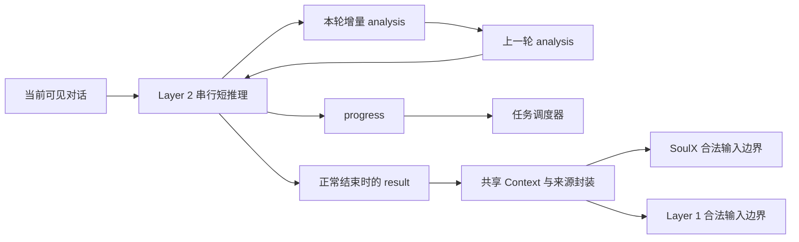

# Layer 2 周期输入、增量分析与结果发布协议

日期：2026-11-07。工作单：DCT-005；输入精简：DCT-007；增量分析与最终结果修订：DCT-008。状态：协议设计，运行时和训练尚未实施。

依据：[总体架构](../../research_design/architecture.md#3-思考任务调度)、[数据构造设计](../layer1_training/data_construction.md)。为简化输入与发布边界，Layer 2 每周期只读取对话和上一轮 `analysis`，生成本轮增量 `analysis` 与 `progress`；正常结束时另行生成 `result`，向 SoulX-Duplug 和 Layer 1 注入同一份结果。中间 `analysis` 仅供 Layer 2 续算。

## 1. 周期与任务

一个周期是 Layer 2 的一次短推理调用，从固定输入到返回本次输出。周期由计算进度和对话更新驱动，独立于前端的 160ms 音频批次，不沿用历史底座的 600ms 窗口。实际耗时另行测量。

Layer 1 的思考请求启动任务；每会话最多一个活动任务，每任务最多一个在途调用。重复请求合并，对话更新进入缓冲区，下一周期读取，不打断当前调用。没有新对话时，任务仍可继续计算；等待输入时保留任务及上一轮分析并停止空转。

正常结束并发布结果后休眠，由 Layer 1 新请求启动后续任务。用户打断或播放取消不会自动清空思考任务。

## 2. 每周期接收什么

| 输入 | 内容与来源 |
| --- | --- |
| 对话资料 | 运行时汇集已联合提交的当前用户正文和先前对话；用户文本来自 X2 转写，助手文本来自 Layer 1 实际生成，保留对话角色 |
| 上一轮 `analysis` | 同一任务上一周期明确返回的分析文本；首周期为空，每周期结束后由运行时替换为本轮分析 |

任务目标与约束直接从对话理解，Layer 1 只负责发出思考请求，不另写任务摘要或预设澄清问句。取消独立任务资料入口；资料只有实际出现在当时可见对话中，才能作为对话内容读取。

对话在上下文预算内保留完整可用历史。累计用户正文及识别修订更新同一条消息，避免把差分追加成重复发言。助手历史保留实际生成文本，不附已播、未播、取消、输出阶段或输出标识；取消也不删除已生成文本。Director 设想但从未生成的文本不进入历史。

Layer 2 不读取原始音频、SoulX 状态或播放／取消状态。运行时继续保存输出执行记录，Layer 1 据此判断是否需要口头纠正。

每周期只提供上一轮分析，不拼入更早分析、额外续算记录或未返回的内部推理。缓存复用必须保持这一输入范围，不能通过旧 KV 隐含保留历次分析。对话缓存可以复用；后端无法保持等价输入时须重建，超出容量显式记录。

输入在调用开始时固定。期间到达的对话更新只进入缓冲区，下一周期再读；实验账本记录对话读取位置及构造时刻。

## 3. 每周期产生什么

具体分隔序列和 tokenizer 编码在实现阶段确定，不要求 JSON。

| 字段 | 内容 | 去向 |
| --- | --- | --- |
| `analysis` | 本轮新增推导、验证、修正或信息缺口；无新增分析时可为空，不重复整理完整历史 | 留在 Layer 2，作为下一周期的上一轮分析 |
| `progress` | `continue`、`await_input`、`done` 三选一 | 仅供任务调度 |
| `result` | 仅在 `done` 时产生的一份可独立理解的任务分析结果，包含必要结论与依据 | 正常结束时同源注入 SoulX-Duplug 和 Layer 1 |

普通周期只产生 `analysis` 与 `progress`；结束周期在同次调用中额外产生 `result`，不增加结果汇总模型或第二次调用。`result` 不是最后一段增量分析的直接改名，也不要求运行时拼接历次分析。

| `progress` | 调度语义 |
| --- | --- |
| `continue` | 仍有分析工作；预算允许时继续一轮，没有新对话也能运行 |
| `await_input` | 当前计算依赖尚未到达的对话信息；保留任务与本轮分析，等待对话更新，不产生 `result` |
| `done` | 当前思考任务已形成可交付结果；同次返回 `result`，通过输入位置检查后发布并结束任务 |

思考任务可以只分析一个信息缺口或子问题。`done` 表示本次思考结束，不要求整个用户问题已经解决；“类别未知且会影响条款适用性”也可以是一项完整结果，由下游判断是否澄清。`progress` 不映射继续听、开始说或停止说，单次 EOS 也不能代替 `done`。

`await_input` 只由对话文本更新唤醒；重复批次、纯静音、控制／播放状态变化、结果发布与消费回执均不唤醒自身。新增助手生成文本属于对话更新。

返回 `done` 或 `await_input` 时，若缓冲区已有本轮未读取的对话更新，先在同一任务下安排下一周期。此时本轮 `result` 只留在审计记录，不注入下游；下轮仍只读最新对话与本轮 `analysis`。检测只比较对话更新位置，不判断语义，仅音频批次或状态位置推进不算新对话。

## 4. 增量分析与最终结果

`analysis` 只记录本轮分析进展，不维护累计分析快照。例如第一周期得到“三件是数量上界，组合待核验”；第二周期新增“2A＋1B 重 20kg、费用 80 元，可行”。第二周期无须重复第一周期的上界推导。

每轮用新分析替换上一轮分析，更早周期可以留在审计账本，但不作为后续模型输入。旧结论若未出现在当前对话或上一轮分析中，就不能作为已保存的续算状态使用，需要时重新推导。此设计只提供相邻周期的分析衔接，不保证保留任意早期的中间结论。

`result` 汇集当前可见依据下已经成立的必要结论，使两个下游无需读取中间分析即可使用。上述示例的结果可写为：“最多三件；2A＋1B 重 20kg、费用 80 元，两种均至少一件且满足预算；四件至少重 24kg，超过容量。”

结果可以描述事实、缺口、条件依赖、推导结论与变化依据，不包含话轮指令、候选问句或回答草稿。完整探索过程留在 Layer 2；只有正常结束且解析完整的 `result` 可发布，截断、解析失败或缺少 `result` 的 `done` 不算有效交付。

## 5. 最终给两个下游提供什么

两个下游只获得同一份 `result` 及其来源与依据，不接收中间 `analysis` 或 `progress`，不另造 SoulX 摘要和 Layer 1 回答草稿。

| 信息 | 产生者与用途 |
| --- | --- |
| `result` | Layer 2 正常结束时生成的任务分析结果，两个下游正文一致 |
| `source`、`task_id`、`version` | 运行时赋值，标明来源、任务身份和结果发布顺序 |
| `based_on` | 本次实际读取的对话位置，包含用户正文与真实生成历史，不包含独立资料或播放／取消状态依据 |
| `read_at`、`published_at` | 运行时实测记录；发布时刻不等于结果的观察截止点 |

ID、版本和时刻由运行时记录，不要求模型生成；完整调试时间线留在审计账本。中间分析及暂未发布的候选结果不能被当作下游已经可见的条件。

| 接收方 | 在自己的输入边界读取 | 使用结果做什么 |
| --- | --- | --- |
| SoulX-Duplug，后续适配后 | 用户音频、权威转写、必要交互历史／输出状态，加实际可见的 `result` 及依据 | 判断用户状态及未来协议中的主动澄清，结合最新用户事实处理过期结果 |
| Layer 1 | 最新转写与 SoulX 状态、真实生成／取消／播放历史，加同源 `result` 及依据 | 决定自身表达行为，组织回答、澄清、补充或必要纠正 |

两个消费者各自在合法输入边界读取，不要求同步等待。记录各自实际消费的结果版本；在本次输入构造后发布的结果等下个边界再用。跨任务的新结果不回滚旧 KV、真实生成历史或已听内容。

SoulX 不等待结果才处理用户状态或有效打断。Layer 1 在结果到达前仍可依靠自身能力工作，普通回答仍须读取有效 `user_complete`；后续主动澄清的独立生成边界另行设计。`result` 发布不等于开口许可，也不直接启动、取消或中断播放。

## 6. 三组周期示例

以下为说明性轨迹，不表示模型已经运行或达到某种时延。“—”表示不产生 `result`。

### 6.1 倾听中的信息缺口

用户正在念复试通知，已说明通知区分学硕和专硕，但尚未说明自己的报考类别。

| 周期 | `analysis` | `progress` | `result` |
| --- | --- | --- | --- |
| 1 | 当前对话未提供报考类别，需核对类别与通知条款的关系。 | `continue` | — |
| 2 | 类别决定两类专属条款的适用性，因此该缺口会影响后续整理。 | `done` | 报考类别尚未明确；类别决定学硕与专硕专属条款的适用性，当前不能确定哪些专属条款适用于用户。 |

第二周期完成的是缺口分析，可以在用户话轮结束前发布结果。SoulX 结合最新音频和正文判断是否值得澄清，Layer 1 在合法边界组织问题。若类别已在本轮计算期间到达，先读取更新再结束；若结果发布后才到达，则由 Layer 1 后续请求启动新任务。

### 6.2 表达期间继续求解

完整用户任务：容量 20kg、预算 100 元；A 为 6kg／25 元，B 为 8kg／30 元，两种至少各一件，最大化件数。

| 周期 | `analysis` | `progress` | `result` |
| --- | --- | --- | --- |
| 1 | 每件至少重 6kg，四件至少 24kg，超过容量；件数上限为三件，混合组合待核验。 | `continue` | — |
| 2 | 2A＋1B 重 20kg、费用 80 元，可行；1A＋2B 重 22kg，不可行。 | `done` | 最多三件；2A＋1B 为 20kg、80 元，两种均至少一件且满足预算，达到数量上界。 |

第二周期只需对话与第一周期分析，无新对话也可续算。Layer 1 读到有效 complete 后，可以自行从对话推得可靠上界并先表达；它不能读取或引用第一周期的内部分析。随后 `result` 到达，在后续输入边界用于补充组合。机制验证须确认思考确实发生在表达期间；若完整求解后才开口，不算边说边想的机制证据。

### 6.3 晚到结果与改口

若第二周期按 20kg 构造输入，期间用户改为 18kg，则本轮结果仍只依据旧对话。运行时发现未读对话更新，保留本轮分析作为下一轮输入，不发布候选 `result`，同一任务继续读取 18kg。

下一周期可得到增量分析：“三件且两种各至少一件时最轻组合也重 20kg，超过新容量。”结束结果则写明：“容量为 18kg 时最多两件；A＋B 重 14kg、费用 55 元，可行；三件混合组合至少重 20kg，不可行。”不能只发布“改为两件”而依赖下游读过中间分析。

若改口在旧结果真正发布并结束任务后才到达，旧结果保留原 `based_on`，下游结合最新对话使用，并由 Layer 1 新请求启动后续任务。旧输出取消由唯一运行时执行，口头纠正由 Layer 1 根据真实已听内容组织。

## 7. 失败、监督与现有数据

超时、失败或预算耗尽由运行时记录并释放任务，不伪装成 `done`，不自动重试，也不从中间分析补造 `result`。此前任务已发布的结果保留实际依据，不因新任务失败就被自动更新或删除。单步输出上限、上下文与任务预算须经远端预检后配置。

若训练 Layer 2，每周期监督增量 `analysis` 与三值 `progress`，正常结束周期另监督 `result`。条件仅为当时可见对话与上一轮分析；首周期无前次分析，第三周期起也不读取更早分析，训练与推理保持一致。任务标识、读取位置和时序作为运行时元数据记录。

注入 SoulX 与 Layer 1 的 `result` 及来源封装为外部条件，屏蔽其预测损失；各模块只监督自身输出。Layer 2 不监督生成用户状态、介入／停播指令、候选问句或回答草稿。

现有 [pilot v1](../../../datagen/README.md) 只有分析正文目标，生命周期来自人工模拟轨迹，旧输入仍含独立资料、状态和事件信息；其早期分析发布方式也不同于本协议。本次保留原始产物及远端摘要，后续升级须一起调整输入、增量分析、进度和最终结果目标，不能将旧数据宣称为已经适配。当前未修改导出器、接入模型或启动训练。
