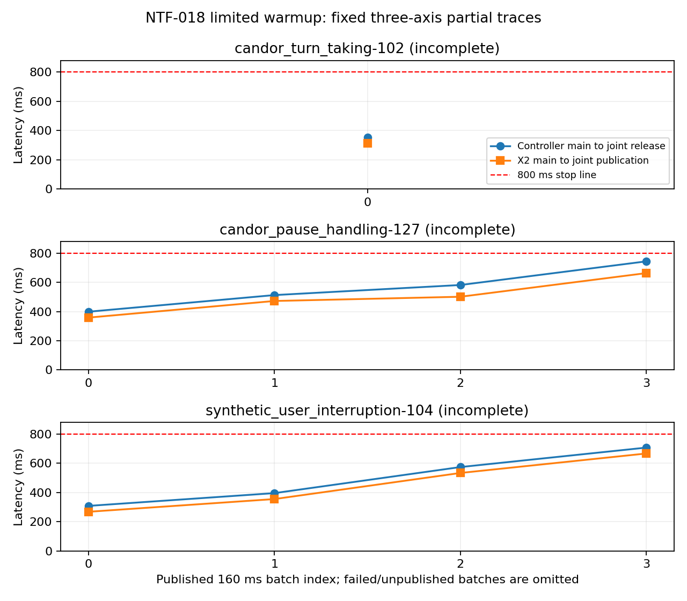

# NTF-018：远端验收与调度修正记录

日期：2026-11-03。最终状态：r3并发双路完整预热、真实权重对照和在线三轴3/3及独立审计全部通过，018已完成并归档，019按用户指令启动。前面的r1／r2失败记录保留。本轮使用了018原定2次提交额度，没有训练、接入下游或切换现役Agent。

## r1验收结论

双路有限预热的固定三轴均触发800ms保护。双路／单路完整预热各完成两轮真实语音处理及实际路径的原生权重对照，但均没有文字修订和有效complete覆盖，按冻结门槛拒绝启动在线三轴。**完整预热后的在线实时性仍未验证，不能据此认定预热已解决或未解决全部积压。**

| 条件 | 加载 | 预热及对照 | 固定三轴 | 条件退出码 |
| --- | --- | --- | --- | --- |
| 双路有限预热 | 177.60秒 | 20.75秒；X2两轮真实语音非空 | 实际执行3条、完整0/3，均800ms触限 | 1 |
| 双路完整预热 | 107.56秒 | 52.94秒；两轮各59批次，覆盖不足 | 未启动；不能记为3条已完成或在线失败 | 1 |
| 单路完整预热 | 59.32秒 | 41.26秒；两轮各59批次，覆盖不足 | 未启动 | 1 |

完整两臂均有实际转写、五种长度识别、reset、清理证据，reset随机缓冲摘要一致。双路额外覆盖WAIT、多token真实EOS及无新字联合提交，两个完成顺序均执行。未覆盖项为文字修订、有效native complete及双路complete联合提交；没有通过伪造状态、重识别全文或额外等待补齐。

未插桩官方process和封装在同权重、同9.4秒输入、种子42下的实际音频token、ASR、LLM输入／logits、服务及缓冲摘要逐项一致。此结论只覆盖实际走到的路径，不能把未触发的修订／complete分支记为真实权重验证通过。源码和每臂的21份官方源码、16份SoulX、5份SenseVoice资产摘要复核一致。

## 输入准备问题与归因边界

本次预热准备沿用了历史FLEURS原幅度，这是遗漏。固定语音RMS为0.00049777、峰值0.00316072，整个波形低于原生远场阈值0.02。每轮状态均为48次idle、10次nonidle、1次backchannel，10次nonidle全部被far_field拒绝；speech_detected不能由这些调用建立，因此无法覆盖有效complete。两轮控制支路各残留7040真实采样，按预热清理记录保存，不能作为全文完成证据。

直接长度探针使用float32，但原生随机缓冲与拼接后的SenseVoice输入是float64；相同长度不等于同一路径已热。双路首轮原生SenseVoice最长5479.4ms，单路首轮5983.1ms；第二轮分别降至66.4／66.1ms。长尾集中于原生识别调用，支持继续排查首遇路径，但dtype、内部预处理和运行时缓存没有隔离对照，不能把全部耗时直接归因于某一个机制。

| 完整预热条件／轮次 | 控制调用P50／P95／max | 原生SenseVoice P50／P95／max |
| --- | --- | --- |
| 双路第1轮 | 89.0／184.3／5571.2ms | 66.9／679.8／5479.4ms |
| 双路第2轮 | 88.2／158.0／159.5ms | 65.3／66.2／66.4ms |
| 单路第1轮 | 86.5／226.3／6071.2ms | 67.3／660.8／5983.1ms |
| 单路第2轮 | 85.5／156.4／183.2ms | 64.4／66.1／66.1ms |

以上是**不按实时到达供音的预热计算耗时**，不能代替在线延迟。分阶段计时、真实dtype／长度、首次路径、两侧等待及清理见[audit.json](audit.json)；ASR阶段包含SenseVoice，不能重复相加。

## 有限预热在线失败轨迹

| 固定样本 | 已联合提交／应有批次 | 已提交控制主块延迟P50／P95／max | 失败证据 |
| --- | --- | --- | --- |
| candor_turn_taking-102 | 1／74 | 353.2／353.2／353.2ms | 首次非静音原生SenseVoice 1922.7ms，生产者未读PCM触限 |
| candor_pause_handling-127 | 4／62 | 547.0／719.0／743.2ms | 后续控制计算期间在线进度超过800ms |
| synthetic_user_interruption-104 | 4／176 | 485.0／687.4／707.4ms | 后续控制计算期间未读PCM触限 |

已提交9批次的独立EOS／前缀、来源、覆盖和屏障时序检查未发现新错误，但固定三轴完整性仍为0/3。失败批次没有发布，取消后的异常不覆盖前面的完整快照；其已结束的SenseVoice阶段单独保留，不能从P95中悄悄删去1.92秒长尾。样本127和104已有多帧积压上升，但缺少完整预热在线参考，不能据此判断稳定吞吐是否足够。

图中仅画已成功提交的批次，失败后的未发布批次没有补点；X2和控制延迟各以本路主块截止计算，不把两路实际观察范围当成相同。完整两臂未启动在线时钟，没有对应在线曲线。

## 调度、资源与证据

远端登录节点d6-hpc-debuggpu-001；启动前队列为空，账户存储186.70GiB／1TiB、空闲约838GiB，既有两套conda、官方checkout及输入摘要核验通过。原模型与环境复用；官方加载时出现既有embed_tokens_func权重兼容重试，以及离线FunASR依赖安装失败提示，随后模型正常加载并执行。日志保留，不据此宣称新依赖已安装。

| 作业 | 调度ID及时间（CST） | 结果 |
| --- | --- | --- |
| ntf018-dual-20261103-r1 | job-179366944517283504744-xuan-zhang；09:30:51—09:30:54 | 调度器将NTF_SCHEDULER_JOB中的JOB替换成1；启动脚本前失败，无run目录或模型计算 |
| ntf018-matrix-20261103-r1 | job-179366959357546756322-xuan-zhang；09:40:29—09:48:42 | 在剩余作业中依次执行三个固定新进程，各条件只运行一次；退出1 |

矩阵源码固定1167791990b61518c3c20c323e0501f278c509f0，推理行为沿用7d7e28f，修订仅为调度标记及编排。显存峰值14612MiB（约14.27GiB）、进程组RSS峰值10304052KiB（约9.83GiB）；run最终4404KiB（约4.30MiB），没有资源停止。两作业实际GPU占用合计约496秒；2次提交额度已用完。结束及证据回收时队列为空，没有追加第三作业。

原FDB30 SHA256为403be34448e0b011fa0b6a26216c0390ea3ed46ce77335e4bbe7a20cde4f3c07；预热原文件为d733a878fbb3393dac0349cfa1293e4fad9a8bd5ec1f58ce6adc019de4b94f32。远端run位于~/parathink-soulx-duplug/runs/ntf018-matrix-20261103-r1。已通过SFTP回收并校验618KiB证据包，SHA256为ce3ba90a50659ecd873c861107941f1245c4dbb5e7b168ee82c917b411c8e540；本地原始证据在artifacts/soulx/20261103-ntf018/，不纳入Git。

## 已完成修正与下一步限制

待复测版本保持同一FLEURS文件、9.4秒输入、两轮、五种识别长度及固定三轴；预热语音先按FDB相同的确定性RMS0.05／峰值0.9增益处理，再做PCM16往返量化。两双路条件的X2使用相同修正波形；直接长度探针改用原生float64并记录dtype。原生阈值、服务、reset和正式FDB输入均不改，不强制产生complete或修订；若仍未覆盖则继续失败。

修正后固定预热增益为100.44869175，PCM16处理后语音RMS约0.04999、峰值0.31747；含原定静音尾部的150400采样SHA256为e4f1fbb00e547eadba7f9d14e1644ba089f97522dc2a20ce56a15ebb378bb145，已在本地核验原文件摘要后生成，不代表GPU覆盖已通过。

本地已有interclarify-dev conda完整回归156项通过、退出0、无跳过；新增检查验证增益／量化／峰值／静音拒绝、预热隔离、清理、IPC、EOF、EOS及证据审计。[实现说明](../../../scripts/remote/native_frontend_probe.md)、[跨conda执行器](../../../scripts/remote/native_frontend_worker.md)、[审计工具](../../../scripts/analysis/analyze_native_frontend.md)及[测试说明](../../../tests/test_native_frontend_probe.md)已同步。日志在artifacts/ntf018-local/。

**修正后的GPU行为尚未验证。** 018原次数边界已由用户撤销，直接继续相同资源限制的矩阵复测，累计2 GPU小时／512MiB、单卡4090／4CPU／32GiB、每作业1800秒／128MiB、显存22GiB及在线800ms不变，不挪用019额度。只有真实完整预热覆盖、等价性及三轴3/3全部通过才归档018并启动019。

## 后续指令

2026-11-03 10:08，用户明确撤销所有提交次数限制。上文“额度用完／需授权”仅记录此前停点，现已被新指令取代；018继续使用已修正输入复测，019仍以018验收通过为前提，不再询问提交次数。单并发与其他资源／实时保护保持。

修正后r2已提交：job-179367188556065100725-xuan-zhang，冻结源码e81cc4c，运行结果待回收。

## r2完整预热通过、串行在线2/3

r2修正了增益／float64路径，两轮各59批次均触发全部必需分支，真实原生对照通过。在线102在21批次后触发控制进度800ms，127／104分别62／176批次完整；失败调用SenseVoice 204.6ms，先前已有排队。本轮不能再用预热覆盖缺失解释该失败。接下来同一160ms内并发两个单worker模型，双路两条件使用相同新调度；联合提交及下一步屏障保持。默认串行接口不变，新增并发启动、未齐不得发布和失败等待收尾检查，全量158项通过。

## r3最终验收通过与归档

并发矩阵run ntf018-matrix-20261103-r3，源码09b7736，作业job-179367296116502985492-xuan-zhang于10:29:24—10:37:38运行。双路完整预热两轮全覆盖、reset清理及真实权重轨迹一致；固定三轴102／127／104分别完成74／62／176批次，共312批，双路条件退出0，无800ms触发。逐批EOS／前缀、来源、真实覆盖、联合提交及屏障时序独立审计通过，验收门槛true。控制主块最大联合发布延迟分别454.2／397.3／563.6ms，X2主块最大225.3／234.3／363.2ms。

有限预热参考完整1/3（102、127触限），原生单路参考实际运行全部三条，但102因75次调用与74次名义批次计数误判，保留原退出1；该单路计数问题已在b779f41修正并由本地真实时钟reset检查验证，不追溯覆盖原始结果。018的正式进入门槛是双路完整预热3/3及协议／资源通过，不要求有限臂或单路参考虚构成功。019将使用修正的单路计数。

本轮显存14752MiB、RSS10161588KiB、监测结果峰值14120KiB，无资源停止；结束队列为空。r3证据包SHA256为9da54f8820507398d97a46907b7ed9081db2e23284edc4fc1c9d821dd3b723d0，本地保存在artifacts/soulx/20261103-ntf018-r3/，原始证据及历史失败不删除。见[最终审计](acceptance.json)。完整预热确实消除了本次有限臂的首遇长尾，但r2证明预热本身不足以让串行双路通过；r3还改变了调度，不能把r2→r3改善全归因于预热。

018工作单移入本地docs/issue/archive/，按约定不进Git；交付包括完整预热、同批并发、受限脚本、失败归因、逐批审计及同路径中文说明，本地全量159项通过。后续继续019固定FDB30，不切换下游。
