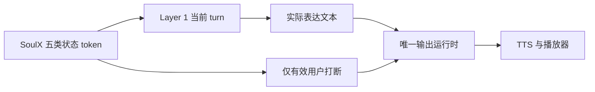

# Agent 架构设计

更新：2026-10-29。[研究背景与参考文章](../research_design.md) · [边听边想](listening.md) · [边说边想](speaking.md)。

当前已确认：话轮控制器采用 **SoulX-Duplug**；依据[低延迟适配调研](../dev/SoulX-Duplug/asr_adapter_assessment.md)，ASR 优先采用现有 Nemotron EN160，适配失败或组合实测不满足后续确认要求时回退 SenseVoiceSmall。Nemotron 路径并行接收同一音频，在线转写先写 Shared Context，再按实际解码完成事件、观察边界与文本版本衔接 SoulX。160ms 分块不作为实际文本或动作延迟承诺，无 ASR 新增文本不等于声学静音；回退时也只保留一个权威转写来源。

本轮继续分步修订：用户已确认保留 CoT 条件下的话轮控制目标，后续由 SoulX 联合读取音频 token、转写文本 token 和 CoT token；当前不实现。五类用户状态 token 均送给 Layer 1，由 LLM 决定自身行为；普通回答在当前 turn 看到 `user_complete` 后开始生成。只有有效用户打断额外进入唯一输出执行点直接停止，其他状态不进入输出运行时，不存在五状态到 start/keep/stop 的运行时映射，详见第 2.2 节。后续 CoT 阶段是否扩展输出及 Layer 3 定位仍待讨论；讨论期间遵守 AGENTS.md 的 Layer 3 修订边界。共享上下文、单一仲裁执行点、单一 TTS 播放所有权及已听内容不可撤销的共同边界继续保持。

下方旧记录与尚未迁移段落中的 XTurnix／TextTurn 专属输入、触发、动作及训练约定不作为 SoulX 已确认或已实现的合同。当前只保留打断直接停止的执行路径，旧 start 驱动 LLM、用户状态映射 keep 等路径均不属于当前设计。CoT 机制以第 2.5 节为准，具体序列及训练编码仍待设计。

以下日期记录保留为迁移参考，尚未切换运行时或启动远端作业。

2026-10-24—27 旧控制器合同历史

2026-10-27用户确认准备开播期间的控制合同：Speak作为控制模式表示已有活动输出，涵盖准备与播放；播放阶段另记preparing／playing，准备阶段已播正文为空、合法动作keep／stop，不重复start。有效stop也可取消尚未开播的输出；真实播放仍以playback_started及播放游标为准。这替代旧“实际开播才回传Speak”的控制编码，保持三动作、唯一执行点及单一播放所有权。模拟时序和其他已确认参数见[配置记录](../dev/TextTurn/dataset_repair_configuration.md)，尚未实现。

2026-10-27普通控制训练补充：按用户指令，TT-010合成数据以UltraChat句末点号／问号／叹号作为完成及让轮的弱代理，普通Listen接话至少等一个空观察，首个合格空观察start。句读仅参与离线边界识别，模型输入沿用去末尾句读；这不是额外运行时规则模型或新输入字段，不保证真实用户整轮说完。stop、finish和后续CoT控制职责保持不变，详见[配置讨论](../dev/TextTurn/dataset_repair_configuration.md)。尚未实施或替换现役路径。

2026-10-24 最新选型覆盖说明：用户已指令启动 **Nemotron EN160＋Qwen3-0.6B 文本控制器**路线，具体输入、训练及门槛见 [TextTurn 方案](../dev/TextTurn/training_plan.md)。Nemotron 转写持续写入 Shared Context，按用户2026-10-25修订，旧TT-001／003合同聚合三个名义160ms解码形成480ms观察窗；TT-010新默认改为单步160ms，处理窗内累计新增文字或no-voice，聚合等待单独计入延迟；无新增 ASR 文本直接作为带延迟的静音，不增加 VAD、词稳定等待或延迟补偿。首阶段训练 keep/start/stop，stop 仅用于用户打断；正常说完由生成／播放完成事件驱动运行时结束，后续再加入 CoT。此合同覆盖下文旧 XTurnix 的固定输入、触发及 VAD 约定；原模型名称、专属 token 和图示只作历史候选参考。此前 SoulX 方案保留，当前不推进。层级职责、共享 Context、唯一输出执行点和已听内容不可撤销的共同边界继续适用；尚未切换现役运行时。

2026-10-25最新合同见[TT-010](../issue/TextTurn/tt_010_asr_update_yield_dataset.md)：旧实现回退后按用户授权重建，控制默认160ms，每个真实解码完成后形成输入，不再等三步聚合；历史480ms任务须显式指定。用户附和及歧义keep，首可判定非附和更新stop；finish仍由唯一输出执行点在播放完成后发布，专用输入ID151673且屏蔽损失，不是预测动作。新数据补齐随机句中停顿、陈述比例与用户末尾标点处理，未训练或接入实际播放器；详见[重建合同](../dev/TextTurn/tt_010_rebuild.md)。

本文统一两项能力的模块职责、异步时序、结果合同、实验与训练约定。系统保留 DuplexCascade 运行底座，目标前端采用 Nemotron 流式 ASR 与 SoulX-Duplug；用户状态进入 Layer 1 的正常输入，普通正式回答由模型读取 `user_complete` 后在当前 turn 内生成，输出运行时统一管理提交、合成、播放及用户打断。CoT 条件化控制保留为后续目标，新控制模式尚未完成接入；工程阶段见[实施计划](../engineering_implementation.md)。

[架构图 PDF](../../figures/parathink_method_preview.pdf)与[图示说明](../figures/parathink_method.md)保留旧 XTurnix 标签和直接控制调度，待图示统一修订。共享 Context、Layer 0/1 提交 Text FIFO、输出运行时统一执行以及单一 TTS/播放器回传实际状态的共同结构继续保留；当前状态 token 送 Layer 1、仅打断直接执行的路径以第 2.2 节为准，不能从旧图推断其他状态进入输出运行时。

本次按用户确认的打断方案同步图文：将唯一仲裁执行点明确放在输出运行时，不再单列独立 Arbiter；补充旧输出取消、在途结果失效和停播确认。原因是仅停止 Layer 1 或清空文本 FIFO，无法阻止已经进入 TTS、音频缓冲及在途任务的旧内容继续播放。此调整不启动完整链路实施或新增工作单。

按用户确认的分工，Layer 2 只向共享 Context 发布 CoT（内部思维链），不输出话轮动作或状态转移建议；后续由适配和训练后的 SoulX 联合音频、转写与 CoT 形成话轮判断并交给 Layer 1。Layer 1 根据可见状态 token、对话与分析决定自己的生成行为，负责思考请求和实际措辞；唯一输出运行时管理实际输出与直接打断，不解释其他用户状态，Layer 0 仍只预测系统附和时机。

Layer 3 定位待统一，本轮不新增实现；Layer 2 不产生候选表达文本，CoT 不直接播放。发布版本只用于分析片段的顺序和追溯，不是文本替换协议。

## 1. Thinking 流与表达流

thinking 流指与表达流分工的内部任务分析过程，在当前信息和预算内分步推理，将 CoT 按语义完整的片段增量发布到共享上下文，供控制和表达使用。“独立”表示调度与职责分开，不要求两者使用不同权重，也不要求一直运行。CoT 对内部模块可见，不向用户公开；thinking 流不是把事先算好的答案按时间切块播放。

- **边听边想**：用户仍持有话轮时处理已到达信息，持续更新任务状态，并在有依据时提出主动澄清。
- **边说边想**：系统已经开始表达时继续进行尚未完成的任务分析，使后续表达得到实质补充或必要修正。仅在 TTS 播放前算好全部答案，不属于该能力的机制证据。

持续思考允许等待新观察，也允许在没有新输入时继续求解已有任务。回答递进指正确且相关的信息逐步增加，不要求固定话术或唯一顺序。已听到的错误只能通过后续明确纠正修复，不能从播放历史中删除。

## 2. 模块与动作边界

| 模块 | 职责 | 输出 |
| --- | --- | --- |
| Nemotron ASR | 提供真实在线转写，保留会话、前缀版本及观察截止点 | 累计文本、增量与实际到达时间 |
| SoulX-Duplug 控制器 | 当前结合音频和转写预测用户状态；后续加入 CoT token，联合判断等待与介入，当前不实现扩展 | 当前保留原生五类用户状态；CoT 阶段的输出编码另行设计 |
| Layer 0 | 小型预测器，仅判断当前是否适合发出系统 backchannel；通过专项训练获得时机预测能力 | 发出系统附和或继续等待的决策 |
| Layer 1 | 持续读取用户转写与 SoulX 状态，请求思考并利用结果组织表达；当前普通正式回答在看到 `user_complete` 后于当前 turn 开始生成 | 待表达文本与思考请求 special token |
| Layer 2 | 倾听期间分析事实、缺口、条件依赖及影响；表达期间继续求解、检查约束和更新结论 | 仅发布 CoT 正文，附带运行时追溯元数据，不包含话轮建议 |
| 共享 Context | 保存当前可用转写、真实生成历史、分析结果、控制决策及运行状态，供各模块在输入边界读取 | 带来源、版本和事件顺序的可见上下文 |
| Text FIFO | 按运行时提交规则接收 Layer 0 路径的系统附和与 Layer 1 表达，保持有效片段的提交顺序 | 带 output_id、chunk_id 和用途的待播文本块 |
| 输出运行时（唯一仲裁执行点） | 接收实际表达输出，统一管理入队、合成与播放资格，并直接执行有效用户打断；不消费其他 SoulX 状态 token | 输出生命周期、停止与取消执行及真实播放状态 |
| TTS 与播放 | 流式合成并播放已提交内容，回传实际播放状态 | 用户可听音频 |

SoulX 当前保留 `user_idle`、`user_nonidle`、`user_backchannel`、`user_complete`、`user_incomplete` 五类预测，均作为状态 token 随实际可见的转写与上下文送入 Layer 1；LLM 据此决定自身行为，包括当前 turn 内普通正式回答的生成边界。有效用户打断额外走直接停止路径，其余状态 token 不送给输出运行时，也不转换成 start 或 keep 指令。上游服务的 idle/nonidle/speak 返回分支与原生五类预测分别记录。Layer 1 不重复预测用户状态，Layer 0 仍仅负责系统附和时机。Layer 2 的结果进入上下文后，由 Layer 1 在上述生成边界内正常自回归表达，不增加独立的任务语义复核或否决层。

表达和 thinking 请求保留 DuplexCascade 协议。SoulX 状态预测写入 Context，在 Layer 1 正常输入边界可见；只有有效用户打断另行提交给唯一输出执行点。状态对模型的具体封装与 token 编码待实现时冻结。新控制模式不同时执行旧 DuplexCascade 控制 token，历史 token 保留为真实生成记录。Layer 0 系统附和编码在实现时冻结，不复用用户附和 token 表达相反方向。

Layer 0/1 的发声路径直接连接 Text FIFO，Context 不向队列提交文本。Layer 0 只预测系统附和时机，附和正文由表达路径提供；图中 Layer 0 到 FIFO 的箭头表示该类输出的提交路径，不把措辞生成增加为 Layer 0 职责。具体字段、token、短语和编码尚未确定，不引入 backchannel cue 协议。Layer 2 发布的 CoT 写入共享 Context，后续同时供 SoulX 和 Layer 1 在各自实际输入边界读取；不增加介入意图、开口就绪或动作建议字段。CoT 输入方向已确认，格式和训练后续明确。实施顺序见[工程计划](../engineering_implementation.md)。

系统保持单一仲裁执行点与单一 TTS 播放所有权；图中将该执行点合并在输出运行时，覆盖 FIFO 的提交检查、TTS 和播放器，不增设独立模型或语义否决层。控制和思考请求 token 均为内部信息，不直接送入 TTS；Nemotron、SoulX、Layer 0 和 Layer 2 不独立播放音频。用户已听到的内容不可撤销。Layer 3 定位待统一，本轮不新增修订或回滚实现，并遵守 AGENTS.md 的未提交片段修订边界。Layer 2 只提供任务分析结果，Layer 1 基于真实生成历史继续表达。系统 backchannel 保留在总计划，当前步骤不训练或接入。

### 2.1 共享上下文与事件驱动控制

Context 保存截至当前实际可用的用户转写及前缀版本、Layer 1 生成历史和输出、Layer 2 已发布结果、SoulX 原生状态及其对 Layer 1 的可见顺序、Layer 0 时机建议，以及实际输出阶段和打断事件。该存储不意味着输出运行时订阅全部状态；用户状态输入与打断执行记录分开。生成、提交、取消与实际播放分别记录，不能把已生成内容直接视为用户已听内容；同一份生成文本不重复注入模型输入。

Nemotron 每次在线文本更新先按稳定的用户 `turn_id` 写入 Shared Context，再供 SoulX 和 Layer 1/2 在各自输入边界读取；不等待完成判断，不把音频块或 micro-turn 当成新用户消息。Context 暴露最新话轮快照和有序版本读取接口，保留来源、ASR 前缀版本、实际观察截止点及可见时间；关闭记录与语义完成、EOF 排空分别处理。版本和读取原则见[接口设计](../dev/SoulX-Duplug/shared_context_interface.md)，SoulX 的衔接尚未实现。

SoulX 持续读取到达的音频，不能沿用旧文本控制器“只有 ASR 文字变化才判断”的调度，也不能因无新增文字而跳过真实音频或静音观察。ASR 文本按版本衔接，后续 CoT 在合法输入边界注入；CoT 更新是否独立触发控制请求仍待设计。Layer 1 和 Layer 2 只在各自明确的输入边界消费新增观察，已经构造的输入不因结果到达而自动重算。

输出运行时及时消费有效控制事件。stop 绕过 Text FIFO，不等待排队文本、TTS 完成或 Layer 1 当前推理结束；提交检查、取消与播放检查属于同一个执行域，不能由不同模块各自执行一次。

### 2.2 前端状态与系统附和

Nemotron 只输出转写及流式生命周期信息，系统准备和播放期间仍持续接收用户输入。SoulX 的五类状态 token 全部送入 Layer 1，由 LLM 决定自身行为；只有有效用户打断额外送入唯一输出执行点。Listen/Speak 描述实际输出生命周期：Layer 1 开始正式回答并登记活动输出后进入 Speak，播放阶段先记 preparing；真实开播事件到达再记 playing。`user_complete` 到达、模型读取状态、开始生成、建立输出、提交和实际开播分别记录，状态到达本身不等于已生成回答或进入 Speak。准备期间也能取消输出；停止请求先阻断旧输出，关闭确认后再回传 Listen。生成、实际播放及其游标独立记录，不由 ASR 停顿或模型推测冒充。

普通轮后回答的生成规则由用户确认如下：

| Layer 1 在当前 turn 的可见状态 | 正式回答行为 |
| --- | --- |
| 尚未看到对应用户话轮的 `user_complete` | 持续读取转写和状态，不生成正式回答正文；也不预生成正文再仅延迟送入 TTS |
| 在正常输入边界看到有效 `user_complete` | 在当前 turn、现有会话与生成流程内开始正式回答，运行时接收其输出并管理播放 |

此处“当前 turn”指 Layer 1 当前的推理与生成上下文，不因完成状态新建 LLM 会话、清空历史或创建一次独立回答调用，也不把每个音频块、状态预测或 micro-turn 当作新的逻辑用户话轮。状态已到达 Context 但尚未被本次模型输入读取时，仍不算 LLM 已看到；不要求向已经构造的在途推理输入中途插入 token。

该限制是 Layer 1 当前普通正式回答的生成合同，不通过运行时拦截预生成正文实现；Layer 1 仍可在倾听期间处理输入、发出内部思考请求，内部控制和 CoT 不直接播放。Layer 0 系统附和保持原有职责。后续 CoT 主动澄清的独立生成边界仍需设计，不能用伪造 `user_complete` 绕过。当前其余四类用户状态及长静音本身不替代 `user_complete`；官方服务的 `speak`／`wait_fallback` 可保留诊断，但不作为输出运行时的接话指令。

状态输入与执行路径如下，当前不新增运行时五状态动作表：

当系统已有活动输出且观察到有效 `user_nonidle` 时，额外直接提交打断事件：playing 阶段立即请求 stop 并取消未播放的旧内容，preparing 阶段取消尚未开播输出，阻止其后续开播。`user_nonidle` 同时对 Layer 1 可见，供模型处理后续输入。

`user_backchannel` 以及其他状态 token 仅作为 LLM 输入，不向输出运行时发送 keep、开始、停止或状态维持指令。用户已确认短附和时保持播放的目标行为，由 LLM 根据状态与上下文继续组织自己的表达；该状态本身不直接改变播放器。实际输出的正常完成仍按生成与播放生命周期处理。

“立即”指收到与当前状态及输出生命周期匹配的有效 `user_nonidle` 后，运行时不再增加连续多帧确认、固定停止词、后续 ASR 增量或 CoT 等待；不表示识别、传输或播放器停止耗时为零。停止请求与实际停播／输出取消确认分别记录，确认后才回传 Listen。stop 一旦生效，后续 `user_backchannel` 不恢复已取消输出；旧标识的迟到内容仍禁止播放。具体执行与幂等规则沿用第 2.3、2.4 节。

停顿不等于用户让轮，不能由文件 EOF 或离线最后 token 锚点伪造在线完成依据；不继承 XTurnix 的 `<|pause|>` 专属输入。后续 SoulX 的 CoT 联合控制需要对应训练与验证，不能把 CoT 发布、任务缺口存在或原生 `user_complete` 直接等同于合理的轮内主动介入。本轮只更新文档，不实现状态输入或启动生成、播放测试。

Layer 0 仍只预测用户持有话轮时是否适合简短附和。输入可结合当前声学信息、转写、SoulX 状态、必要历史及真实播放记录；特征与模型后续确定，不能将系统继续播放直接当作系统附和正例。

系统附和训练是总计划中后续明确要做的工作，不以控制器能力不足为触发条件，也不阻塞当前前端接入。当前不采集或训练 Layer 0；后续数据需标注系统听者附和的有效事件窗口与继续等待，区分机会与实际发声，保留无需回应、即将交接和已有输出冲突等负例。训练、开发与测试按原对话分组；FDB 测试不参与训练或阈值选择。具体数据来源、规模、标注和模型参数在实施前细化，与两篇能力文档中的 thinking 流专项数据分别计数。

既有 XTurnix 的 FLEURS 测试保留在历史工作单中，不因本次选型恢复。SoulX 的[公开英文集验证设计](../dev/SoulX-Duplug/quality_test.md)仍待重新确认执行，其 Listen 影子观察不能承担完整打断合同的验收。后续 Layer 0 实现后，若另行开展系统附和评测，可参考 FDB v1.0 ICC 的频率与时机分布指标并检查误抢话；用户附和/打断可参考 v1.5 相应子集。只凭频率不能证明附和合理，需独立事件集和人工抽查。这些基础工程评测与两组 thinking 流 benchmark 分开报告。

所有控制决策与系统附和建议保留外部来源、输入截止点和版本，不冒充 Layer 1 实际生成的历史 token。输出运行时协调同一时刻的附和、普通回答、主动澄清与停止请求，实际用户打断时能停止当前附和。已被用户听到的附和不能撤销或从历史删除。

### 2.3 输出标识与提交规则

每次连续输出使用唯一 `output_id`，其下文本块、TTS 请求和音频块携带该标识及 `chunk_id`，同时记录普通回答、主动澄清或系统附和等用途。输出标识描述一次可取消的输出生命周期，与 ASR 前缀版本、Layer 2 任务和结果版本分别管理。

运行时在登记实际活动输出时建立有效输出标识。普通回答由 Layer 1 读取 `user_complete` 后在当前 turn 内开始生成，运行时为这次实际输出登记新标识，而非先由控制状态创建 start 调用来启动 LLM；系统附和仍按其既有动作边界由同一运行时执行，不另建播放器。FIFO 只接收当前有效标识的文本，TTS 返回与实际播放前再次检查资格。输出关闭后，来自旧标识的迟到文本或音频记录为取消，不重新标成新输出，也不因队列变空自动恢复。

控制事件保留请求关联标识、输入前缀版本、运行状态版本及关联的输出标识。若动作返回时所属状态或输出生命周期已经改变，该动作不能直接执行；若所依据的观察已被新输入修订，保留原依据并由后续更新事件触发基于最新 Context 的决策。同一会话保持有界缓冲和单个在途控制请求，不通过无限并发提高控制频率。运行时对同一输出的停止保持幂等，同一批执行中停止先于普通文本消费。

### 2.4 用户打断与恢复流程

图中底部时序条展开有效 stop 的执行顺序。用户音频与在线转写送入 SoulX，五类状态 token 送入 Layer 1；当系统已有活动输出时，有效 `user_nonidle` 额外直接触发唯一执行点停止。准备阶段取消尚未开播的输出，播放阶段立即请求停播；`user_backchannel` 等其他状态不进入输出运行时。

1. **关闭旧输出**：有效 stop 到达唯一执行点后，关闭旧 `output_id` 的提交入口，阻止后续旧文本入队。该步骤与提交、消费检查按同一顺序执行，避免清队列期间又写入旧内容。
2. **停止与取消**：立即请求播放器停止当前音频，取消旧标识下 FIFO 待播文本、待合成任务及尚未播放的音频缓冲。尽力取消在途生成与合成；不能及时取消的结果返回后仍按失效标识阻止播放。停止无需等待模型调用结束，已经生成的历史仍保留。
3. **确认输出关闭**：已开播时记录播放器停止确认和最后实际播放位置，再发布Listen与打断事件；准备阶段则记录尚未开播输出的取消确认。设备已经发出的残余声音计入实际播放，准备阶段取消不能记成用户已经听到内容。不能用stop返回时间替代播放或关闭确认，停止未确认时不接受新的播放启动。
4. **消费新增输入**：Layer 1 在下一输入边界读取用户新输入、打断事件和可用分析，结束旧表达方向并组织后续内容。首版只要求事件级状态，不把精确播放位置或逐字已听文本对齐作为 Layer 1 常规输入；生成、提交、取消和播放记录在运行时分别保留。恢复回答使用能独立理解的完整表达，已听到的错误由 Layer 1 后续明确纠正。
5. **重新获得话轮**：活动 Layer 2 任务在自己的短推理边界纳入新观察，不因停播自动清空或重启；旧结果仍标明实际依据，不能冒充已考虑新条件。用户继续表达时保持 Listen，Layer 1 不生成正式回答。Layer 1 在正常输入边界看到后续对应话轮的有效 `user_complete` 后，在当前 turn 内开始新的正式回答；运行时登记新的 `output_id` 并进入 Speak／preparing，旧队列不自动续播，真实开播后单独更新 playing。

旧图中第 4、5 步的 start 表述待更新；当前恢复规则是 Layer 1 读取对应 `user_complete` 后在当前 turn 内开始正式回答，运行时随后登记新输出。停止请求先作为控制事件可见，实际停播后追加确认事件；Layer 1/2 对新输入的处理可以与停播过程并行，不要求等确认后才开始思考。打断事件作为外部运行记录追加到 Context，既有生成、提交和播放历史不删除，也不把取消当作文本替换或已听内容撤销。

### 2.5 SoulX 的 CoT 条件化控制

用户已确认该目标保留，当前不实现：后续让同一个 SoulX-Duplug 控制器同时利用音频 token、权威 ASR 转写文本 token 和 Layer 2 已发布的 CoT token，综合形成话轮与主动澄清判断，并通过控制器输出供 Layer 1 决定自身行为。当前先建立五状态 token 到 Layer 1 的输入路径及独立的直接打断路径；不能据此断言五状态已足以表达全部 CoT 主动介入目标，后续是否扩展输出另行设计。

| 输入 | 来源与用途 |
| --- | --- |
| 音频 token | 同一在线用户音频的编码表示，保留声学与时序信息；不因 ASR 没有新增文字而停止观察 |
| 转写文本 token | 唯一权威 ASR 的当前可见转写，提供用户表达内容；原文与版本保存在 Shared Context |
| CoT token | Layer 2 向 Shared Context 发布的分析正文，经控制器输入适配后参与联合决策，提供任务事实、缺口、推导与条件依赖 |

这里的 CoT token 表示分析正文在控制器中的 token 输入，不表示本轮新增一种专用词表、special token 或独立模型。三类输入的顺序与交织方式、来源边界标记、位置及缓存管理仍待设计，图示中的并列关系不固定其序列排列。

Layer 2 继续只发布分析，不输出开始、停止或建议介入等话轮指令；SoulX 利用这些分析形成控制判断并提供给 Layer 1，Layer 1 根据状态与同一份分析决定生成行为、组织实际表达。CoT 不直接进入 Text FIFO 或 TTS，其发布也不直接启动、取消或中断播放；输出运行时仅管理实际表达与直接打断，不把 CoT 或非打断状态解释成播放指令。

仅已发布且在当时实际可见的 CoT 可以进入后续合法控制输入边界；记录来源、任务标识、发布版本、分析观察截止点与实际注入顺序。CoT 与用户转写分开，不冒充用户消息或 Layer 1 生成历史。音频、转写和 CoT 不要求同步产生；CoT 更新是否独立触发一次控制请求以及如何与音频步骤合并仍待确定。无 CoT 或 CoT 过期时仍须保持普通话轮响应，不等待思考才处理用户打断。

当前不增加注入接口、特殊 token、模型参数、训练数据或训练任务。后续需通过对应训练与验证建立联合决策能力，不把拼入 CoT 文本等同于原版权重已能正确使用；CoT 作为外部条件的损失边界见第 7.1 节。

## 3. 思考任务调度

Layer 1 长期保留会话历史与可复用状态，随正常输入窗口和事件执行推理。Nemotron 转写与 SoulX 用户状态持续送达；Layer 1 在自己的合法输入边界读取状态，普通正式回答在当前 turn 看到 `user_complete` 后开始，看到之前不生成正文，不采用接话事件额外调度一次回答调用。正在执行的推理在明确边界消费后续观察，不能因每帧状态取消重算。有效用户打断按[第 2.4 节](#24-用户打断与恢复流程)执行：先撤销旧输出的播放资格，再尽力停止旧解码，在明确输入边界恢复，生成历史和可复用会话状态保留。用户持续表达时，Layer 1 仍可处理新增信息并请求思考；Layer 0 的附和建议不是 Layer 1 处理输入的唯一条件。没有新增信息且没有待生成内容时可以等待后续输入，不要求持续空解码。Layer 2 结果到达后的处理遵循[第 4 节](#4-结果回写与真实历史)的正常边界注入规则。

Layer 1 通过独立 special token 请求异步思考，倾听或表达时均可调用，无需先开口或伴随口头回应。运行时识别该 token 并启动 Layer 2，Layer 1 继续接收输入和生成表达。

每个会话最多一个活动思考任务。同一逻辑任务可以包含多次串行短推理调用。任务活动期间，重复请求合并到现有任务，不创建并行任务或重启；新增 micro-turn 自动进入任务输入缓冲区，无需再次唤醒。

### 3.1 持续输入与分步推理

Layer 2 唤醒时，在模型上下文预算内读取截至当前的完整可用对话历史，包括用户表达、系统实际生成与已播放记录及可用任务信息。活动期间在短推理边界读取新增观察，更新信息缺口、条件依赖或回答分析，并发布相应 CoT。输入已有全部条件时，也可以继续完成尚未解决的推理，无需等待新的用户内容。Layer 2 维护自己的上下文与缓存，任务状态辅助分析，不替代原始历史。

处理期间累积的多个窗口可以合并读取，原始事件历史仍完整保留。推理只使用实际已到达的信息，ASR 修订按版本处理；结果记录实际依据的观察位置。输入已进入缓冲区不代表当前模型调用已经使用该输入。历史超出上下文预算时不得静默截断。

Layer 2 的处理窗口时长可配置，独立于 Layer 1 当前的 600ms micro-turn、音频传输和 ASR 分块时长。接收每个 micro-turn 不要求每个窗口都单独完成一次推理。

| 任务状态 | 行为 |
| --- | --- |
| 继续观察或推理 | 保留活动任务与状态，等待新观察或继续求解；尚无可用结果时无需回写 |
| 发布 CoT 并继续 | 当前已有语义完整的分析片段，发布新版本并保留活动任务；发布不等于结束或允许开口 |
| 结束思考任务 | 当前分析完成或无需继续跟踪，可发布最后的 CoT 片段，结束任务并休眠；结束不表示继续倾听、发起澄清或转移话轮 |

任务休眠后由新的请求 token 再次唤醒。信息变化及其对任务的影响由 Layer 2 持续分析；增量发布不要求在每个窗口产生，也不允许建立多个并行思考任务。思考任务生命周期与 Listen/Speak 状态分别记录，不能把前者解释为话轮建议。

### 3.2 唤醒覆盖与介入频率

采用“唤醒覆盖优先、澄清介入从严”的策略。Layer 1 根据可能影响任务的信息缺口或复杂判断需求请求思考，无需先完成完整的介入价值推理。Layer 2 分析当前事实、未知条件及其影响，SoulX-Duplug 结合这些 CoT、最新用户输入和真实交互状态，独立判断现在开口还是继续等待。

介入频率及插话成本由 SoulX-Duplug 的策略训练处理，不再通过 Layer 2 的 system prompt 产生澄清建议来间接控制。控制训练覆盖用户正在自行补充、缺口已消解、CoT 过期、已有介入及无需介入的对照。表达期间根据任务未解决部分请求或继续思考，不以持续输出进展话术作为唤醒理由。本阶段不设置运行时硬性冷却时间、次数上限或频率限流。

唤醒、思考开销、CoT 发布、SoulX-Duplug 决策与实际发声分别记录。倾听任务按[倾听文档](listening.md#5-benchmark-评分与优势判定)评价，表达任务按[表达文档](speaking.md#2-信息标注与实际可听评分)评价；两者共享[第 6 节](#6-共同实验协议)的对照。失败、计算开销与各阶段实际时延同时用于覆盖统计和机制分析，不等同于用户交互成本。CoT、控制动作与实际可听内容分别标识。

## 4. 结果回写与真实历史

Layer 2 发布正文仅包含 CoT，可涵盖已确认事实、推导、信息缺口、条件依赖、当前结论及变化依据。倾听与表达采用同一发布合同，不再区分“继续倾听”“建议澄清”等决策型结果，也不附加 start/keep/stop、介入意图或开口就绪标签。CoT 按语义完整的片段增量发布，不要求逐 token 暴露尚未完成的推理；不新增摘要器或第二个语义判断模块。

来源、任务标识、发布版本、实际观察截止点和任务生命周期由运行时单独封装记录，不作为 CoT 正文中的话轮建议。一次短推理输出结束不等于整个任务结束，任务结束也不等于用户让轮。当前不新增 CoT 返回 special token；后续 SoulX 注入是否需要专用边界编码仍待设计，不能把当前未实现当作未来禁止扩展。发布块不冒充 Layer 1 自己生成的返回事件，版本只用于顺序和追溯。

后续 SoulX 在合法输入边界联合读取音频、转写文本和已经可见的 CoT，独立进行话轮判断；Layer 1 读取同一 CoT 生成实际措辞。两者都必须区分分析的观察截止点与最新输入，不能将旧分析当作已考虑新条件。CoT 更新纳入后续控制，但是否额外触发独立请求仍待确定；发布本身不启动播放、不取消生成，也不直接映射为接话动作。

结果到达后先暂存，在 Layer 1 下一次实际构造 micro-turn 推理输入时，与该边界可用的对话信息一起注入。若本次输入已构造，则等待后续推理边界。结果到达本身不取消当前生成、不触发重算，也不中断当前播放。回写保留既有对话与真实生成历史。

Layer 1 基于包含状态 token 与分析结果的上下文，在相应生成边界内继续自回归。Layer 1 表达和 Layer 0 路径的附和提交同一 Text FIFO，输出运行时按实际输出生命周期、标识有效性和直接打断事件管理提交与播放资格，再由单一 TTS/播放器消费；它不读取其他 SoulX 状态作动作映射。普通回答、系统附和和后续主动澄清分别记录，后续澄清的生成边界另行设计。Layer 0 不承担澄清价值判断。

后续结果使原判断变化时，Layer 1 根据真实生成历史继续组织后续表达，必要时明确纠正已说出的错误。Layer 2 不生成、替换或撤销候选表达文本；结果版本是分析结果的版本，不是文本修订补丁。Layer 3 定位待统一，本轮不新增实现，不回滚生成历史、已提交片段的记录或已播放内容。用户有效打断可以取消已提交但尚未播放内容的后续播放资格，原文本及其提交、取消状态仍保留；Layer 2 结果到达不触发这种取消。尚未发声的文本错误不计已听错误，也不因此赋予运行时新的文本修改动作。

## 5. 预算与失败处理

单次 Layer 2 任务受计算预算约束。调用失败、超时或总预算耗尽后，记录原因并释放活动任务，不自动重试；Layer 1 继续正常运行。后续允许由 Layer 1 新生成的请求 token 再次唤醒。

失败和超时与正常结束分别记录，不作为模型已判断无需澄清或回答完成的结论。仅明确发布的结果版本可供 Layer 1 使用；未发布的中间推理不能冒充正式结果。后续失败不删除已发布结果或已播放内容，其有效性仍按当时依据及最终表现评分。评测保留失败与超时覆盖情况。计算资源预算与介入频率约束分别处理。

打断时若播放器未能在约定时限内确认停止，旧输出标识继续失效，记录停止失败并阻止新播放启动；不能提前发布已进入 Listen 或停播成功。停止确认接口、超时和缓冲上限在完整链路实施前冻结。

## 6. 共同实验协议

| 对照 | 用途 |
| --- | --- |
| 直接流式响应，不启用独立 thinking 流 | 建立不额外思考时的质量与时延起点 |
| 延后思考 | 倾听任务在当前观察点需要作决策时才启动，表达任务在完整思考后开口；区分计算重叠带来的收益 |
| 完整框架 | 倾听与表达期间均可运行 thinking 流，按真实到达的结果更新表达 |
| 分阶段消融 | 分别关闭倾听期间或表达期间的思考，其他条件尽量一致，定位两种能力各自的贡献 |

倾听任务另报告等用户让出话轮才思考和澄清的轮后策略，作为覆盖范围的参照；它无法在轮内介入，不能单凭该参照的轮内遗漏证明框架优越。消融时明确既有结果是否保留、活动任务何时停止，避免把此前计算的结果误算为当前阶段的思考。

优先采用相同基础模型、前端、TTS、语速、输入时序与输出长度预算，并在可比较的总计算预算下报告多档质量与时延结果。不同模型或额外硬件的比较另列；同时报告输入/输出 token、调用次数、硬件、并发及实测运行时间，不能把增加计算资源直接归因为架构收益。

按同一样本配对比较，正式测试前冻结评分协议和时间预算，报告不确定性及任务分组结果，不以单个演示或一个综合分数下结论。所有系统只读取当时可用的信息；记录观察截止、计算完成、结果送达、注入、提交与实际播放时间，分别验证行为收益与真实的计算重叠。

后续完整链路若另行开展打断验证，记录用户打断起点、ASR 可见、直接打断事件、运行时执行、停播确认、最后旧音频及恢复发声时间；重点检查实际停止延迟、用户附和时误停、旧标识文本/音频泄漏，以及恢复表达是否采用新条件。停止请求不等于实际停播，LLM 读取 `user_complete`、开始生成及可听回复也分别记录。该验证属于运行协议诊断，不将用户中途新增信息混入边说边想主 benchmark 的持续推理收益，也不恢复已取消的 FDB 测试。

无独立 thinking 流的对照仍允许 Layer 1 持续观察并生成表达，保留同一个 SoulX 状态来源以及状态 token 输入，由 Layer 1 决定自身生成行为，普通回答采用相同的 `user_complete` 可见边界；不以移除输入或禁用表达制造差异。表达期间关闭 Layer 2 也不等于禁止 Layer 1 正常生成和推理。两篇能力文档分别说明检查点、保留上下文及思考关闭边界，避免用金标时机启动对照。

## 7. 共同训练与数据约定

### 7.1 训练对象与损失边界

研究包含大规模对话数据构造与实际训练。原型可冻结 Layer 2 权重，用于验证协议、采集异步轨迹和建立未专项训练的起点；正式研究不限定为 prompt 调用。

| 模块 | 两项能力共用的训练约定 |
| --- | --- |
| Layer 1 | 训练依据外部状态 token 决定自身生成行为，包括看到对应 `user_complete` 前不生成普通正文，以及思考请求、结果利用、可靠的早期表达、递进回答与口头纠正 |
| Layer 2 | 若训练，仅监督基于当前信息的 CoT、任务分析和增量更新，不监督话轮动作或状态转移建议；是否更新权重在试标和模型选型后确定 |
| SoulX-Duplug | 后续训练音频、转写文本与 CoT 的联合条件化控制，覆盖普通接话、主动澄清、合理等待及用户打断；输出标签与训练参数另行设计，当前不训练 |
| Layer 0、Nemotron | 保持系统附和时机与转写分工，附和专项另行规划 |

后续先对审核后的轨迹开展监督训练。Layer 2 发布的 CoT 是 Layer 1 与 SoulX 的外部输入，在这两个模块的训练中屏蔽该输入块的预测损失，不要求控制器生成 CoT。Layer 1 的请求和后续正文参与监督；SoulX 的控制标签依据当时可见音频、转写、CoT 和运行状态独立审核，不从 Layer 2 建议字段复制，具体输出编码另行设计。若训练 Layer 2，则另计 CoT 生成损失，不监督其生成候选表达文本或话轮建议。本段为后续研究合同，本轮不构造数据或更新参数。

训练需要目标输出文本，不能拿 judge 分数代替自回归目标；教师可基于当前可见前缀、用户状态及实际已到达 CoT 生成表达与控制目标，再分别审核。Layer 2 的候选 CoT 也必须只依据当前可见信息，不以推理长度为质量目标，不要求冗长链条。未设置人工参考问句不等于无需表达目标；没有 CoT 返回时，SoulX 仍需依据音频与转写提供用户状态 token，由 Layer 1 读取并决定自身行为，有效用户打断直接执行，不能等待思考才响应。

不奖励思考调用、推理长度或改口次数。先验证监督训练，其他优化方法、是否更新 Layer 2、参数更新方式、损失权重及批次规模待试验确定。未确定的训练细节在两项能力中采用相同状态，不能一篇默认冻结、另一篇默认已完成联合训练。

### 7.2 共享轨迹记录与数据隔离

每条轨迹保留场景/对话/分支标识、当前可见前缀、ASR 版本、思考请求、CoT 正文、任务与发布版本、观察截止点，以及分别对 Layer 1 和 SoulX-Duplug 可见的顺序。另记 SoulX 输入快照与状态预测、状态 token 实际进入 Layer 1 的顺序、模型开始正式回答的位置，以及真实生成、提交和播放记录。涉及打断时另记 `output_id`、`chunk_id`、状态版本、直接打断事件、取消与停播确认；不要求将精确播放位置作为模型常规输入。CoT、用户状态、直接打断与表达字段分开，不生成虚构的五状态运行时映射记录。

教师生成和被测系统均不得读取未来用户续说或隐藏评测答案。输入进入缓冲区、被调用读取、结果生成、结果注入和实际可听是不同事件；生成监督不得把它们合成理想的同步时刻。

两组 benchmark 各自建立试标、开发与正式测试集，和训练集分别统计。场景、共享前缀、任务模板、资料来源及其派生改写按组隔离并去重；同一推理题换数字不能分散到训练和测试。正式测试不用于教师筛选、prompt 调整、阈值选择或训练数据生成。

分别报告独立任务场景、对话、分支轨迹、有效音频时长和 token；窗口切片、重叠视图与多次采样不计作新的独立场景。总目标是大规模语料；旧澄清专项预算不是总量上限，两项数据规模、配比、生成预算与人工审核数量仍待试标确定。

### 7.3 生成审核、语音实现与联合训练

两项能力分别构造任务和目标、通过教师与框架生成因果可行的轨迹，再进行可核验检查、自动筛选和分层人工抽检。抽检同时覆盖正负例、难度、审核通过和拒绝的样本，记录通过率、错误类别与分歧；生成模型与 judge 相互认同不能代替核验。

先明确语义事件与调度，再确定语音采集或合成、ASR 可见输入及对齐方式。标明教师、合成语音和模拟延迟来源；训练可以采用明确标注且因果可行的模拟调度，正式 benchmark 必须实测推理、传输和播放时序，不能提前注入教师结果冒充在线收益。

除单项轨迹外，训练集可包含先倾听澄清、再回答并继续分析的组合对话，以验证状态衔接。组合对话的后续用户回答只有实际到达后才能供思考与表达使用；两组首版 benchmark 仍按各自独立协议评分，不要求用户模拟器。

训练实验比较未专项训练、仅倾听数据、仅表达数据及联合训练，在资源允许时增加数据规模实验。联合对话只计一次独立对话，同时标明其中两种行为；不能在汇总规模时重复相加。两篇能力文档具体说明各自训练轨迹和验收目标。

### 7.4 实施边界

本地和远端统一使用 conda。正式训练和集群测试在远端执行，实施前明确最大工作数、CPU/GPU 内存、磁盘、日志和检查点预算。文档拆分不启动数据生成、训练或集群作业；工作单依用户明确指令建立，代码与对应中文实现文档同步维护。

## 8. 待确定参数

| 范围 | 待确定内容 |
| --- | --- |
| Nemotron/SoulX-Duplug | 音频与转写配对、五状态 token 对 Layer 1 的输入编码和可见顺序、直接打断事件封装、后续 CoT token 序列与边界标记、缓存管理、输出是否扩展及训练配置 |
| Layer 0 | 系统附和时机预测模型、参数规模、输入特征、训练数据/窗口、输出编码及阈值 |
| Layer 1 | 请求 token 名称与序列位置、外部控制输入格式、结果利用与修正表达的监督方式及训练参数 |
| Layer 2 | 原型与训练模型选型、system prompt、CoT 发布粒度和长度预算、任务生命周期封装、处理窗口及计算预算 |
| 运行协议 | ASR/CoT 更新事件调度、上下文超限处理、缓存适配、输出/状态版本编码、显式取消与任务清理接口、播放器停止确认及缓冲上限、失败状态回写方式 |
| 数据与评测 | 大规模语料目标与验收规模、两组 benchmark 样本数、训练配比、人工审核预算及冻结评分规则 |

上述参数在原型实现和远端实测中确定。两篇能力文档另列各自待定的数据规模与评分参数；未确定不表示已经存在冲突，也不能在实施时自行补成研究结论。
