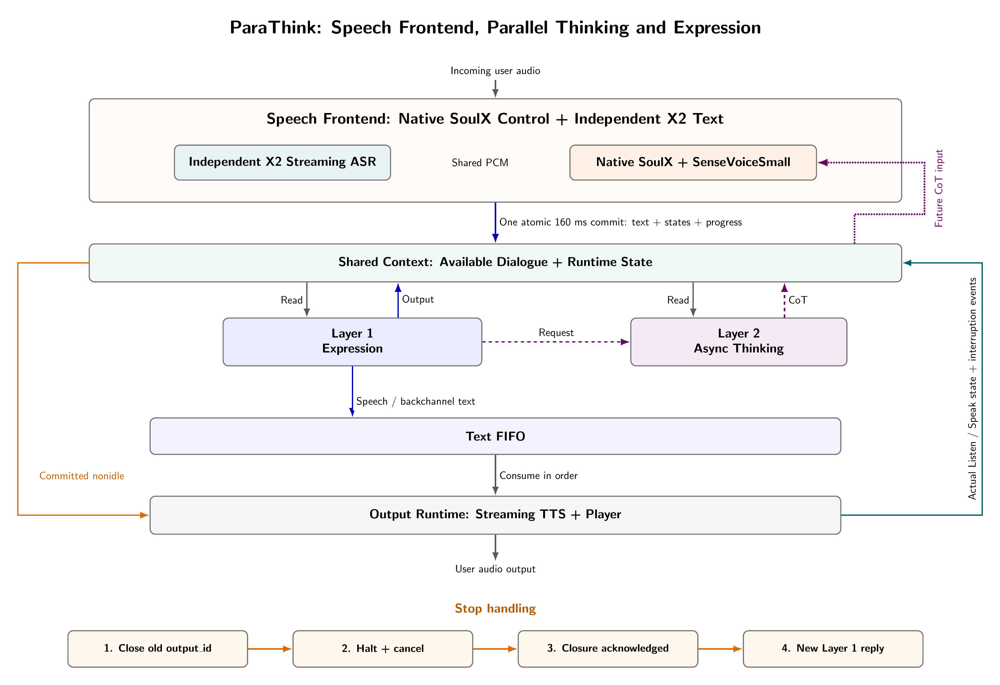
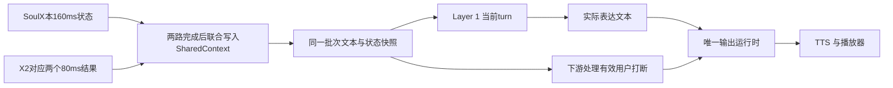

# Agent 架构设计

更新：2026-11-03。[研究背景与参考文章](../research_design.md) · [边听边想](listening.md) · [边说边想](speaking.md)。

NTF-015／016／017已完成本地交付；018真实权重预检通过，019已由用户审核通过并归档，原29/30、退出1和缺失对照保留。NTF-030取消800ms时长停止条件，保留容量与作业资源保护。后续LLM接入暂缓，031—035草案未实施归档；当前进度见[工作单](../issue/README.md)。

当前采用**原生SoulX控制＋独立X2整词正文**架构：保留内部SenseVoice教师，由同一160ms批次联合提交正文、状态及进度，已提交的有效complete携当前正文直接供下游使用，不再增加独立交接条件。NTF-017以共同快照向下游提供五状态；普通回答边界、CoT研究目标与唯一输出所有权保持。

2026-11-03 用户已确认将 Layer 0 系统附和能力并入 Layer 1，原因是统一附和时机、措辞和表达调度，减少独立模型与协调。下文已同步职责；训练目标、数据与监督思路见[训练设计](layer1_training.md)。此决定尚未实施，原架构图保留合并前的 Layer 0 拆分，当前下游分工以文字合同为准。

[架构图 PDF](../../figures/parathink_method_preview.pdf) · [图示说明](../figures/parathink_method.md)。预览已同步双路联合提交和停止旁路撤回，当前流程见[方案图](../dev/SoulX-Duplug/independent_streaming_frontend.md#2-音频与两路职责)；图源与本地存储验收见[NTF-017交付](../reports/soulx/20261102-ntf017-joint-publication/README.md)，不表示真实模型或下游已接入。

## 1. Thinking 流与表达流

thinking 流指与表达流分工的内部任务分析过程，在当前对话和预算内分步推理。Layer 2 每周期生成增量 `analysis` 与计算进度，正常结束时另生成 `result` 写入共享上下文，供控制和表达使用。本文下游可见的 CoT 指 `result`，中间 `analysis` 只用于 Layer 2 相邻周期续算。“独立”表示调度与职责分开，不要求不同权重或一直运行；结果不向用户直接公开或播放。

- **边听边想**：用户仍持有话轮时处理已到达信息，持续更新任务状态，并在有依据时提出主动澄清。
- **边说边想**：系统已经开始表达时继续进行尚未完成的任务分析，使后续表达得到实质补充或必要修正。仅在 TTS 播放前算好全部答案，不属于该能力的机制证据。

持续思考允许等待新观察，也允许在没有新输入时继续求解已有任务。回答递进指正确且相关的信息逐步增加，不要求固定话术或唯一顺序。已听到的错误只能通过后续明确纠正修复，不能从播放历史中删除。

## 2. 模块与动作边界

以下前端联合提交已实现并完成本地契约与远端真实模型验证，019按用户决定审核收口；下游尚未接入，当前开展训练方案研究。前端包含SoulX原生控制链路与独立流式ASR：前者产生五状态，后者产生下游正文。每160ms批次等待SoulX本次原生调用与X2两个80ms原生步都完成，再一次向SharedContext写入正文、状态token和实际进度；成功后才允许下一周期推进。先完成结果只在内部暂存，无前端停止旁路；当前X2组内子词连续解至真实EOS，WAIT也算步完成。下游保留Layer 1表达与Layer 2思考，原Layer 0系统附和能力并入Layer 1，本项目不设Layer 3。前端与下游并发，不等待整轮识别或完成判断。后续CoT经Context反馈至前端，在合法输入边界参与状态判断，条件化适配与训练尚未实现。

| 模块 | 职责 | 输出 |
| --- | --- | --- |
| 语音前端：Online ASR 与文本整理 | 独立X2Streaming-ASR原生80ms流式解码，EOS闭合后按完整词追加正文，不受SoulX文字门控或reset影响 | 已闭合组累计正文及其观察上界、实际闭合可用与发布时间；不含子词草稿 |
| 语音前端：SoulX-Duplug 状态模型 | 保留内部SenseVoice教师及原生门控、修订、状态反馈和reset，独立预测；后续CoT扩展尚未实现 | 原生五类状态及其音频范围、可用与发布时间；CoT阶段输出另行设计 |
| Layer 1（含原 Layer 0 能力） | 持续读取整词正文与用户状态，学习等待、系统附和 token 的触发时机；普通回答在实际读到有效complete及当前正文后于当前turn生成；消费去重由后续下游接入处理 | 单个系统附和 token 或正式表达文本、内部行为边界与思考请求special token；具体编码待定 |
| Layer 2 | 冻结模型通过提示词分析事实、缺口及依赖；表达期间继续求解和检查约束 | 每周期内部产生增量 `analysis` 与 `progress`，正常结束时发布 `result`；不包含话轮建议 |
| 共享 Context | 保存当前可用转写、真实生成历史、分析结果、控制决策及运行状态，供各模块在输入边界读取 | 最新用户全文与状态，以及真实生成、思考和输出上下文 |
| Text FIFO | 按运行时提交规则接收 Layer 1 的实际表达正文，保持有效片段顺序；系统附和 token 不作为文本入队 | 带 output_id、chunk_id 和用途的待播文本块 |
| 输出运行时（唯一仲裁执行点） | 接收实际表达输出，统一管理入队、合成与播放资格，并直接执行有效用户打断；不消费其他 SoulX 状态 token | 输出生命周期、停止与取消执行及真实播放状态 |
| TTS 与播放 | 流式合成并播放已提交内容，回传实际播放状态 | 用户可听音频 |

SoulX保留原生五类预测及内部反馈。五状态随本160ms批次正文联合提交后向Layer 1交付；已提交的有效complete携当前正文作为可回答状态输入，不再等待第二层ready。尚未提交的原始complete不能绕过联合同步。有效用户打断也从同一已提交快照消费，由既有输出执行点处理，其余状态不进入输出运行时，不映射start／keep；服务idle/nonidle/speak与原生状态分别记录。Layer 1不重复预测用户状态，同时判断系统附和 token 的触发时机，当前不生成附和内容。不增加额外数据等待、任务语义复核或否决模型。

Layer 1 从官方 Qwen2.5-7B-Instruct 或选定的 Qwen3 后训练权重开展协议适配；表达和 thinking 请求编码依据该模型的 tokenizer 与 chat template 设计，不依赖旧 DuplexCascade 词表或 adapter。SoulX 状态预测写入 Context，在 Layer 1 正常输入边界可见；前端不设置单独停止钩子；下游读取共同快照后处理有效打断，停止仍只由唯一输出执行点执行。状态封装、等待、系统附和、正式表达与思考请求的具体 token 编码待实现时冻结，不复用用户附和 token 表达相反方向。旧模型生成 token 仅保留为历史记录，不作为新协议的执行指令。

Layer 1 的系统附和当前只生成一个专用 token，保留在自身 Context 并记录事件，不生成附和正文或提交 TTS；实际表达正文由运行时提交 Text FIFO。原图 Layer 0 路径对应的附和时机判断现归 Layer 1，不新增独立 backchannel cue 模型。系统附和的具体 token 字符串和 ID 待确定，内容与发声暂不设计。Layer 2 发布的 CoT 写入共享 Context，后续同时供 SoulX 和 Layer 1 在各自实际输入边界读取；不增加介入意图、开口就绪或动作建议字段。CoT 输入方向已确认，格式和训练后续明确。实施顺序见[工程计划](../engineering_implementation.md)。

系统保持单一仲裁执行点与单一 TTS 播放所有权；图中将该执行点合并在输出运行时，覆盖 FIFO 的提交检查、TTS 和播放器，不增设独立模型或语义否决层。控制和思考请求 token 均为内部信息，不直接送入 TTS；语音前端和 Layer 2 不独立播放音频。用户已听到的内容不可撤销。本轮不新增修订或回滚实现，保持已提交记录与已听历史。Layer 2 只提供任务分析结果，Layer 1 基于真实生成历史继续表达。系统 backchannel 纳入 Layer 1 后续训练，当前只研究数据与预算。

### 2.1 共享上下文与事件驱动控制

前端 SharedContext 当前仍只提供最新联合快照。后续按 [Layer 1 周期协议](../dev/layer1/protocol.md)建立持久 token Context：联合发布后逐批交付新增转写与新状态，在合法输入边界读入，Layer 1 继续解码并将实际生成 token 保留在同一 Context。逐批输入需要有界缓冲、消费位置与去重，不能仅靠轮询最新快照；这些能力尚未实施。原始状态不绕过联合提交，唯一停止执行点保持。

Layer 1 输出为一条 token 流，思考请求与系统附和分别使用专用 special token，具体字符串和 ID 待 tokenizer 接入时冻结。运行时解析行为标记并提交实际正文；模型生成 token 已进入 Context 后，不再复制成第二份助手历史。用户状态与结果封装属于外部输入，和 Layer 1 自身生成分开记录。

Context 保存当前实际可用的用户全文和当前 SoulX 状态，不保留历史正文版本；另保存 Layer 1 真实生成历史及附和／正式输出、Layer 2 已发布结果，以及实际输出阶段和打断事件。该存储不意味着输出运行时订阅全部状态；用户状态输入与打断执行记录分开。生成、提交、取消与实际播放分别记录，不能把已生成内容直接视为用户已听内容；同一份生成文本不重复注入模型输入。

官方提前 complete 的取消与上下文处理案例见[运行时分析](../dev/SoulX-Duplug/completion_runtime_analysis.md#4-取消后怎样处理-context)。完整系统可通过首音前取消抵消可听后果，但不能据此把前端状态当作准确结束；按播放时长估计助手字符前缀也不能代替真实生成／已播账本。该分析细化当前合同的实现与验收依据，不新增等待条件或改变输出所有权。

每160ms两路实际完成后，正文、五状态及ASR进度由NTF-017一次联合更新，无新字WAIT也提交，未完成时仍读取上一完整快照。当前冻结采样映射下X2实际处理截止覆盖SoulX观察截止，已有DECODE实际闭合且正文已同次提交，因此已提交的有效complete携当前正文直接供下游使用。Context只保存当前联合快照与话轮开闭状态；消费去重及慢读遗漏留待下游接入。真实采样范围与尾词覆盖分别核验，不将同步完成解释为全文齐备，详见[接口设计](../dev/SoulX-Duplug/shared_context_interface.md)。

SoulX 持续读取到达的音频，不能沿用旧文本控制器“只有 ASR 文字变化才判断”的调度，也不能因无新增文字而跳过真实音频或静音观察。ASR 正文在下游输入边界采用最新值，识别修订不自动改变在途模型输入，后续 CoT 在合法输入边界注入；CoT 更新是否独立触发控制请求仍待设计。Layer 1 和 Layer 2 只在各自明确的输入边界消费新增观察，已经构造的输入不因结果到达而自动重算。

输出运行时及时消费有效控制事件。stop 绕过 Text FIFO，不等待排队文本、TTS 完成或 Layer 1 当前推理结束；提交检查、取消与播放检查属于同一个执行域，不能由不同模块各自执行一次。

### 2.2 前端状态与系统附和

语音前端在系统准备和播放期间仍持续接收用户输入。ASR负责转写，SoulX负责原生用户状态，原始可用与联合发布时间分别记录；五状态随本批次正文联合提交后交付，已提交的有效complete直接编码进入Layer 1，供LLM在既定边界内表达。不设置前端专用停止旁路；下游从同一批次快照处理有效打断。Listen/Speak描述实际输出生命周期：Layer 1开始正式回答并登记输出后进入Speak，先记preparing，真实开播再记playing。原始complete、联合发布、模型读取、生成、提交及实际播放分别记录；准备期间也可取消，停止关闭确认后回传Listen。

普通轮后回答的生成规则由用户确认如下：

| Layer 1 在当前 turn 的可见状态 | 正式回答行为 |
| --- | --- |
| 尚未在正常输入边界读到当前话轮已联合提交的有效complete | 持续处理可用输入，不生成正式回答正文，也不预生成正文再仅延迟送TTS；未提交状态只作内部诊断 |
| 在正常输入边界读到已联合提交的有效complete及当前正文 | 可在当前turn、现有会话与生成流程内开始正式回答，不再等待额外交接；消费去重由后续下游接入设计，运行时管理实际输出 |

此处当前turn仍指Layer 1的推理与生成上下文，不因complete新建LLM会话、清空历史或另建回答调用。原始预测、联合发布、模型实际读取分别记录；提交前的内部complete不算下游可见，已提交也不等于模型已读取。不要求向已构造的在途输入插token，读取后发生续说则走既有取消／停止路径。慢消费者可能跳过中间批次，消费去重和complete遗漏问题仍须后续下游接入处理，本次不新增锁存、历史队列或ack。

该限制是 Layer 1 当前普通正式回答的生成合同，不通过运行时拦截预生成正文实现；Layer 1 仍可在倾听期间处理输入、发出内部思考请求，内部控制和 CoT 不直接播放。并入 Layer 1 的系统附和单独标记用途，不借附和通道提前生成正式回答。后续 CoT 主动澄清的独立生成边界仍需设计，不能用伪造 `user_complete` 绕过。当前其余四类用户状态及长静音本身不替代 `user_complete`；官方服务的 `speak`／`wait_fallback` 可保留诊断，但不作为输出运行时的接话指令。

状态输入与执行路径如下，当前不新增运行时五状态动作表：

当系统已有活动输出，且下游从已联合提交快照读到有效`user_nonidle`时，由既有唯一执行点处理打断：playing 阶段立即请求 stop 并取消未播放的旧内容，preparing 阶段取消尚未开播输出，阻止其后续开播。`user_nonidle` 同时对 Layer 1 可见，供模型处理后续输入。

2026-11-03用户确认，取消后的用户内容按该回复首段音频是否已经开始实际播放分组：同一`output_id`取消回执确认已播采样为0时，保留complete前的用户正文并续接后文，作为同一完整用户片段；已有实际播出采样时，保留此前用户内容及助手实际已播历史，将后续用户内容作为当前新片段处理，优先响应新增输入。首段部分播出即算已播放，不要求整段结束；仅生成、合成完成、音频入队或登记播放开始均不足以替代实际已播记录。取消与首帧并发时按播放器最终确认的已播采样判定。用户消息分组与ASR会话、SoulX内部reset／generation分开；complete本身不永久切断用户正文。本段为后续下游接入合同，当前尚未实现该分组层。

`user_backchannel` 以及其他状态 token 仅作为 LLM 输入，不向输出运行时发送 keep、开始、停止或状态维持指令。用户已确认短附和时保持播放的目标行为，由 LLM 根据状态与上下文继续组织自己的表达；该状态本身不直接改变播放器。实际输出的正常完成仍按生成与播放生命周期处理。

“立即”以本160ms批次联合提交、下游取得与输出生命周期匹配的有效`user_nonidle`为起点；前端不设置早于该批次提交的停止钩子。取得共同快照后，运行时不再增加连续多帧确认、固定停止词、后续 ASR 增量或 CoT 等待；不表示识别、传输或播放器停止耗时为零。停止请求与实际停播／输出取消确认分别记录，确认后才回传 Listen。stop 一旦生效，后续 `user_backchannel` 不恢复已取消输出；旧标识的迟到内容仍禁止播放。具体执行与幂等规则沿用第 2.3、2.4 节。

停顿不等于用户让轮，不能由文件 EOF 或离线最后 token 锚点伪造在线完成依据。后续 SoulX 的 CoT 联合控制需要对应训练与验证，不能把 CoT 发布、任务缺口存在或原生 `user_complete` 直接等同于合理的轮内主动介入。本轮只更新文档，不实现状态输入或启动生成、播放测试。

Layer 1 学习用户持有话轮时是否输出单个系统附和 token；当前不生成或监督附和措辞。输入采用当前转写、SoulX 状态、必要历史及执行事实，系统继续播放不等同于系统附和正例。

系统附和 token 的选择与时机训练归 Layer 1，不改变已完成的前端验收。后续数据标注有效事件窗口和继续等待，区分机会与实际 token 触发，保留无需回应、即将交接和输出冲突等负例，不编写附和正文。训练、开发与测试按原对话分组，FDB 测试不用于训练或阈值选择。[基础交互训练](layer1_training.md)与 thinking 流专项数据分别计数，当前不启动训练。

当前系统附和只评价 token 的机会覆盖、触发时机、误触发和重复，不评价措辞、音色或实际发声。后续若研究可听附和，需另定发声与评测合同；不能把 token 事件计为已经播放的声音。附和事件评价与两组 thinking 流 benchmark 分开报告。

SoulX 控制决策保留外部来源、输入截止点和版本，不冒充 Layer 1 自身生成。系统附和 token 按真实生成记录，不创建可播输出标识，不向 FIFO 或 TTS 补造短语；其发声实现留待后续。输出运行时继续统一处理实际表达与有效打断，已听内容不可撤销。

外部用户附和状态与 Layer 1 生成的系统附和 token 分别记来源。当前只定义单 token 事件，不定义附和音频的播放或取消生命周期，也不把该 token 当成开口或停播指令。附和标注原则见[训练设计](layer1_training.md#3-数据与监督)。

### 2.3 输出标识与提交规则

每次连续的实际表达输出使用唯一 `output_id`，其下文本块、TTS 请求和音频块携带该标识及 `chunk_id`，记录普通回答或后续主动澄清等用途。系统附和单 token 不创建该输出生命周期。输出标识与 ASR 转写、Layer 2 任务和结果版本分别管理。

运行时登记实际活动输出时建立有效标识。普通回答由Layer 1读取已联合提交的有效complete及当前正文后在当前turn生成，再为实际输出登记新标识；不能由未提交的内部complete提前创建start调用或启动LLM。消费去重仍由后续下游接入明确，不依赖已取消的交接状态机。系统附和token仅作事件记录。FIFO只接收当前有效标识，TTS返回及播放前复核资格；关闭后旧标识迟到内容记录取消，不重标为新输出，也不因队列变空自动恢复。

控制事件保留请求关联标识、输入转写版本、运行状态版本及关联的输出标识。若动作返回时所属状态或输出生命周期已经改变，该动作不能直接执行；若所依据的观察已被新输入修订，保留原依据并由后续更新事件触发基于最新 Context 的决策。同一会话保持有界缓冲和单个在途控制请求，不通过无限并发提高控制频率。运行时对同一输出的停止保持幂等，同一批执行中停止先于普通文本消费。

### 2.4 用户打断与恢复流程

图底部时序条已由NTF-017同步；实际输出执行仍为后续接入目标，complete不再设置额外数据等待。当前合同为：SoulX原生控制与独立X2均完成当前160ms批次后，将正文和五状态token共同写入Context；下游从同一快照读取有效nonidle，再由唯一执行点处理活动输出停止。准备阶段取消尚未开播的输出，播放阶段立即请求停播；`user_backchannel` 等其他状态不进入输出运行时。

1. **关闭旧输出**：有效 stop 到达唯一执行点后，关闭旧 `output_id` 的提交入口，阻止后续旧文本入队。该步骤与提交、消费检查按同一顺序执行，避免清队列期间又写入旧内容。
2. **停止与取消**：立即请求播放器停止当前音频，取消旧标识下 FIFO 待播文本、待合成任务及尚未播放的音频缓冲。尽力取消在途生成与合成；不能及时取消的结果返回后仍按失效标识阻止播放。停止无需等待模型调用结束，已经生成的历史仍保留。
3. **确认输出关闭**：已开播时记录播放器停止确认和最后实际播放位置，再发布Listen与打断事件；准备阶段则记录尚未开播输出的取消确认。设备已经发出的残余声音计入实际播放，准备阶段取消不能记成用户已经听到内容。不能用stop返回时间替代播放或关闭确认，停止未确认时不接受新的播放启动。
4. **消费新增输入**：Layer 1 在下一输入边界读取用户新输入、打断事件和可用分析，结束旧表达方向并组织后续内容。首版只要求事件级状态，不把精确播放位置或逐字已听文本对齐作为 Layer 1 常规输入；生成、提交、取消和播放记录在运行时分别保留。恢复回答使用能独立理解的完整表达，已听到的错误由 Layer 1 后续明确纠正。
5. **重新获得话轮**：活动 Layer 2 任务在自己的短推理边界纳入新观察，不因停播自动清空或重启；旧结果仍标明实际依据，不能冒充已考虑新条件。用户继续表达时保持 Listen，Layer 1 不生成正式回答。Layer 1 在正常输入边界看到后续对应话轮的有效 `user_complete` 后，在当前 turn 内开始新的正式回答；运行时登记新的 `output_id` 并进入 Speak／preparing，旧队列不自动续播，真实开播后单独更新 playing。

恢复规则与图中一致：Layer 1 读取对应 `user_complete` 后开始新回答，运行时随后登记新输出。停止请求先作为控制事件可见，实际停播后追加确认事件；Layer 1/2 对新输入的处理可以与停播过程并行，不要求等确认后才开始思考。打断事件作为外部运行记录追加到 Context，既有生成、提交和播放历史不删除，也不把取消当作文本替换或已听内容撤销。

### 2.5 SoulX 的 CoT 条件化控制

用户已确认该目标保留，当前不实现：后续让同一个 SoulX-Duplug 控制器同时利用音频 token、权威 ASR 转写文本 token 和 Layer 2 已发布的 CoT token，综合形成话轮与主动澄清判断，并通过控制器输出供 Layer 1 决定自身行为。当前先建立160ms批次正文／五状态token联合写入及下游统一消费路径，不设置前端专用打断钩子；不能据此断言五状态已足以表达全部 CoT 主动介入目标，后续是否扩展输出另行设计。

| 输入 | 来源与用途 |
| --- | --- |
| 音频 token | 同一在线用户音频的编码表示，保留声学与时序信息；不因 ASR 没有新增文字而停止观察 |
| 转写文本 token | 唯一权威 ASR 的当前可见转写，提供用户表达内容；原文与版本保存在 Shared Context |
| CoT token | Layer 2 正常结束时向 Shared Context 发布的 `result`，经控制器输入适配后参与联合决策，提供任务事实、缺口、结论与条件依赖；不读取中间 `analysis` |

这里的 CoT token 表示分析正文在控制器中的 token 输入，不表示本轮新增一种专用词表、special token 或独立模型。三类输入的顺序与交织方式、来源边界标记、位置及缓存管理仍待设计，图示中的并列关系不固定其序列排列。

Layer 2 继续只发布分析，不输出开始、停止或建议介入等话轮指令；SoulX 利用这些分析形成控制判断并提供给 Layer 1，Layer 1 根据状态与同一份分析决定生成行为、组织实际表达。CoT 不直接进入 Text FIFO 或 TTS，其发布也不直接启动、取消或中断播放；输出运行时仅管理实际表达与直接打断，不把 CoT 或非打断状态解释成播放指令。

仅已发布且在当时实际可见的 CoT 可以进入后续合法控制输入边界；记录来源、任务标识、发布版本、分析观察截止点与实际注入顺序。CoT 与用户转写分开，不冒充用户消息或 Layer 1 生成历史。音频、转写和 CoT 不要求同步产生；CoT 更新是否独立触发一次控制请求以及如何与音频步骤合并仍待确定。无 CoT 或 CoT 过期时仍须保持普通话轮响应，不等待思考才处理用户打断。

当前不增加注入接口、特殊 token、模型参数、训练数据或训练任务。后续需通过对应训练与验证建立联合决策能力，不把拼入 CoT 文本等同于原版权重已能正确使用；CoT 作为外部条件的损失边界见第 7.1 节。

## 3. 思考任务调度

Layer 1 首轮以 Qwen2.5-7B-Instruct 进行协议适配训练，再逐步训练恢复与附和，Qwen3 保留为后续底座候选；训练思路见[专项设计](layer1_training.md)。通用权重不自动具备外部状态与动作协议能力。首轮常规周期选三拍 480ms，解码片段预算、上下文容量与持续吞吐待远端验证；输出停止执行仍按每个 160ms 已提交观察处理，不等待 Layer 1 常规边界。

Layer 1 保留持续推进的模型 Context。前端每 160ms 联合发布，运行时按批交付新增正文与状态；Layer 1 首轮每组三批、即 480ms 覆盖范围读入一次，再生成短 token 片段并保留在同一 Context。组内三批保持文本／状态交错顺序，保留短暂 complete 及后续变化；不只取最后状态，不让已失效 complete 重新取得回答资格。前端不等待 Layer 1，480ms 也不是已验证的计算耗时。普通回答仍须在当前 turn 实际读取有效 complete；周期结束不清空会话或复制历史。有效打断由唯一输出执行点逐批处理，不等三拍或解码结束。最终 result 在后续常规边界作为外部块写入，Layer 2 自身调度不绑定该周期。

Layer 1 通过独立 special token 请求异步思考，倾听或表达时均可调用，无需先开口或伴随口头回应。运行时识别该 token 并启动 Layer 2，Layer 1 继续接收输入和生成表达。

每个会话最多一个活动思考任务。同一逻辑任务可以包含多次串行短推理调用。任务活动期间，重复请求合并到现有任务，不创建并行任务或重启；新增 micro-turn 自动进入任务输入缓冲区，无需再次唤醒。

### 3.1 持续输入与分步推理

Layer 2 每周期只读取当时可见的完整对话与同一任务上一周期的 `analysis`；首周期前次分析为空。对话由运行时汇集用户转写和助手实际生成文本，保留角色，助手文本不附输出状态或输出标识；取消独立任务资料入口。资料须实际进入可见对话才能被读取，目标与约束直接从对话理解。

当前将 Layer 2 固定为可插拔的冻结思考模型，不训练或适配其参数。提示词约定分析与结果格式，运行时维护输入和任务调度；实时对话在下一短推理边界读取，不在在途调用中插入。模型选型与提示词效果须实测，不预设已有权重自动满足协议。

`analysis` 记录本周期新增推导、验证或修正，替换上一周期分析；更早分析、独立续算记录与未返回推理不进入模型输入，缓存复用也不能隐含保留它们。旧中间结论若不在当前对话或上一轮分析中，需要时重新推导。输入已有全部条件时仍可继续计算，无需等待新对话。

为简化任务分析输入，SoulX 状态及播放／取消状态不进入 Layer 2，也不单独唤醒等待中的任务。输出运行时仍保存完整执行记录，Layer 1 结合实际已听内容决定是否口头纠正。

处理期间的多次用户输入更新直接覆盖，下一输入边界读取最新值，不依赖历史正文版本或完整状态事件流。推理只使用实际已到达的信息；实验轨迹可在 SharedContext 之外记录实际读取的观察位置，不将诊断历史作为在线存储要求。输入已进入缓冲区不代表当前模型调用已经使用该输入。历史超出上下文预算时不得静默截断。

Layer 2 的一个周期为一次串行短推理调用，独立于前端 160ms、音频传输和 ASR 分块；不沿用历史底座的 600ms 固定周期。输入在调用开始时固定，后续观察在下一周期读取。每周期输入、分析输出、任务进度与双下游消费详见 [Layer 2 周期协议](../dev/layer2/protocol.md)。

| 任务状态 | 行为 |
| --- | --- |
| 继续推理 | 保存本轮增量分析作为下轮输入，继续计算，不向下游发布中间分析 |
| 等待对话 | 保留任务与上一轮分析，等待对话文本更新，不发布结果 |
| 结束思考任务 | 同次生成独立 `result`，通过未读对话更新检查后发布并休眠；结束不表示用户让轮或允许开口 |

每次调用返回增量 `analysis` 和一个 `progress`：`continue` 继续求解、`await_input` 等待对话更新、`done` 完成本次思考并另行返回 `result`。进度只供任务调度。若返回时存在尚未读取的对话更新，先在同一任务下读取新对话与本轮分析，不发布本轮候选结果。思考任务可以只解决一个信息缺口或子问题，完成不要求整个用户问题已经解决。

任务休眠后由新的请求 token 再次唤醒。信息变化及其对任务的影响由 Layer 2 分周期分析，最终结果按任务发布，不允许建立多个并行思考任务。思考任务生命周期与 Listen/Speak 状态分别记录，不能把前者解释为话轮建议。

### 3.2 唤醒覆盖与介入频率

采用“唤醒覆盖优先、澄清介入从严”的策略。Layer 1 根据可能影响任务的信息缺口或复杂判断需求请求思考，无需先完成完整的介入价值推理。Layer 2 分析当前事实、未知条件及其影响，后续适配的 SoulX-Duplug 结合 CoT、最新用户输入和真实交互状态提供介入判断，Layer 1 据此决定生成行为；主动澄清的输出编码与生成边界仍待设计。

介入频率及插话成本由 SoulX-Duplug 的策略训练处理，不再通过 Layer 2 的 system prompt 产生澄清建议来间接控制。控制训练覆盖用户正在自行补充、缺口已消解、CoT 过期、已有介入及无需介入的对照。表达期间根据任务未解决部分请求或继续思考，不以持续输出进展话术作为唤醒理由。本阶段不设置运行时硬性冷却时间、次数上限或频率限流。

唤醒、思考开销、CoT 发布、SoulX-Duplug 决策与实际发声分别记录。倾听任务按[倾听文档](listening.md#5-benchmark-评分与优势判定)评价，表达任务按[表达文档](speaking.md#2-信息标注与实际可听评分)评价；两者共享[第 6 节](#6-共同实验协议)的对照。失败、计算开销与各阶段实际时延同时用于覆盖统计和机制分析，不等同于用户交互成本。CoT、控制动作与实际可听内容分别标识。

## 4. 结果回写与真实历史

Layer 2 每周期的 `analysis` 仅供自身续算，正常结束时另生成可独立理解的 `result`，涵盖必要事实、缺口、条件依赖、结论及依据。倾听与表达采用同一发布合同，不附话轮动作、候选问句或表达草稿；结果由同一次结束调用产生，不新增摘要器。两个下游读取相同结果，无需读取中间增量分析。跨任务结果更新不删除已注入历史或回滚 KV。

来源、任务标识、发布版本、对话观察截止点和任务生命周期由运行时封装。模型每周期生成 `analysis` 与三值进度，仅 `done` 周期额外生成 `result`；两个下游只读取结果及来源，不读取中间分析或任务进度。一次调用输出结束不等于整个任务结束，任务结束也不等于用户让轮。具体分隔与 token 编码待实现时确定；发布块保留外部来源，不冒充 Layer 1 自身生成。

后续 SoulX 在合法输入边界联合读取音频、转写文本和已经可见的 CoT，独立进行话轮判断；Layer 1 读取同一 CoT 生成实际措辞。两者都必须区分分析的观察截止点与最新输入，不能将旧分析当作已考虑新条件。CoT 更新纳入后续控制，但是否额外触发独立请求仍待确定；发布本身不启动播放、不取消生成，也不直接映射为接话动作。

结果到达后先暂存，在 Layer 1 下一次合法解码输入边界，作为外部结果块写入持久 Context。若当前片段输入已确定，则等待后续边界；结果到达不取消生成、不触发重算，也不中断播放。既有输入和真实生成历史保留，不重新复制整份对话。

Layer 1 基于状态与最终结果继续自回归。实际表达正文提交 Text FIFO，由唯一输出运行时管理标识、取消和播放资格，再由单一 TTS／播放器消费；不把其他 SoulX 状态映射为播放动作。系统附和只保留 token 事件，不生成可播正文，也不替代澄清判断；后续主动澄清的生成边界另行设计。

后续结果使原判断变化时，Layer 1 根据真实生成历史继续组织后续表达，必要时明确纠正已说出的错误。Layer 2 不生成、替换或撤销候选表达文本；结果版本是分析结果的版本，不是文本修订补丁。尚未发声的文本错误不计已听错误，也不因此赋予运行时新的文本修改动作。

## 5. 预算与失败处理

单次 Layer 2 任务受计算预算约束。调用失败、超时或总预算耗尽后，记录原因并释放活动任务，不自动重试；Layer 1 继续正常运行。后续允许由 Layer 1 新生成的请求 token 再次唤醒。

失败和超时与正常结束分别记录，不作为模型已判断无需澄清或回答完成的结论。仅明确发布的结果版本可供 Layer 1 使用；未发布的中间推理不能冒充正式结果。后续失败不删除已发布结果或已播放内容，其有效性仍按当时依据及最终表现评分。评测保留失败与超时覆盖情况。计算资源预算与介入频率约束分别处理。

打断时若播放器未能在约定时限内确认停止，旧输出标识继续失效，记录停止失败并阻止新播放启动；不能提前发布已进入 Listen 或停播成功。停止确认接口、超时和缓冲上限在完整链路实施前冻结。

## 6. 共同实验协议

| 对照 | 用途 |
| --- | --- |
| 直接流式响应，不启用独立 thinking 流 | 建立不额外思考时的质量与时延起点 |
| 延后思考 | 倾听任务在当前观察点需要作决策时才启动，表达任务在完整思考后开口；区分计算重叠带来的收益 |
| 完整框架 | 倾听与表达期间均可运行 thinking 流，按真实到达的结果更新表达 |
| 分阶段消融 | 分别关闭倾听期间或表达期间的思考，其他条件尽量一致，定位两种能力各自的贡献 |

倾听任务另报告等用户让出话轮才思考和澄清的轮后策略，作为覆盖范围的参照；它无法在轮内介入，不能单凭该参照的轮内遗漏证明框架优越。消融时明确既有结果是否保留、活动任务何时停止，避免把此前计算的结果误算为当前阶段的思考。

优先采用相同基础模型、前端、TTS、语速、输入时序与输出长度预算，并在可比较的总计算预算下报告多档质量与时延结果。不同模型或额外硬件的比较另列；同时报告输入/输出 token、调用次数、硬件、并发及实测运行时间，不能把增加计算资源直接归因为架构收益。

按同一样本配对比较，正式测试前冻结评分协议和时间预算，报告不确定性及任务分组结果，不以单个演示或一个综合分数下结论。所有系统只读取当时可用的信息；记录观察截止、计算完成、结果送达、注入、提交与实际播放时间，分别验证行为收益与真实的计算重叠。

后续完整链路若另行开展打断验证，记录用户打断起点、两侧结果可用、160ms联合提交、下游读取及运行时执行、停播确认、最后旧音频及恢复发声时间；重点检查实际停止延迟、用户附和时误停、旧标识文本/音频泄漏，以及恢复表达是否采用新条件。停止请求不等于实际停播，LLM 读取 `user_complete`、开始生成及可听回复也分别记录。该验证属于运行协议诊断，不将用户中途新增信息混入边说边想主 benchmark 的持续推理收益，也不恢复已取消的 FDB 测试。

无独立 thinking 流的对照仍允许 Layer 1 持续观察并生成表达，保留同一个 SoulX 状态来源以及状态 token 输入，由 Layer 1 决定自身生成行为，普通回答采用相同的 `user_complete` 可见边界；不以移除输入或禁用表达制造差异。表达期间关闭 Layer 2 也不等于禁止 Layer 1 正常生成和推理。两篇能力文档分别说明检查点、保留上下文及思考关闭边界，避免用金标时机启动对照。

## 7. 共同训练与数据约定

### 7.1 训练对象与损失边界

研究包含大规模对话数据构造与实际训练，训练对象为 Layer 1 和后续 CoT 条件化的 SoulX-Duplug。Layer 2 采用已有权重与提示词，保持冻结，不建立专项训练、参数适配或后续自动转入训练的分支。

| 模块 | 两项能力共用的训练约定 |
| --- | --- |
| Layer 1 | 训练依据外部状态 token 决定等待、系统附和和正式表达；看到对应 `user_complete` 前不生成普通正文；基础阶段覆盖含噪控制与取消恢复，后续加入思考请求、结果利用、可靠的早期表达、递进回答与口头纠正 |
| Layer 2 | 不训练；仅按周期协议推理，记录对话与上一轮分析、增量 `analysis`、进度及最终 `result`，用于协议诊断、下游结果利用数据和评测 |
| SoulX-Duplug | 后续训练音频、转写文本与 CoT 的联合条件化控制，覆盖普通接话、主动澄清、合理等待及用户打断；输出标签与训练参数另行设计，当前不训练 |
| 前端 ASR | 当前独立 X2 提供正文、SenseVoice 服务 SoulX 内部教师；本次不训练 ASR，原 Layer 0 系统附和训练纳入 Layer 1 |

后续对审核后的轨迹训练 Layer 1 与 SoulX。冻结 Layer 2 发布的 `result` 是外部输入，在两个下游中屏蔽其预测损失；Layer 1 的请求和表达、SoulX 的控制标签分别参与监督，控制目标按实际可见音频、转写、结果和运行状态独立审核。Layer 2 不计算专项训练损失，中间分析不进入下游，进度不作为话轮状态转移目标。本段为后续研究合同，本轮不构造数据或更新参数。

训练需要目标输出文本，不能拿 judge 分数代替自回归目标；教师可基于当前可见前缀、用户状态及实际已到达 CoT 生成表达与控制目标，再分别审核。Layer 2 的候选 CoT 也必须只依据当前可见信息，不以推理长度为质量目标，不要求冗长链条。未设置人工参考问句不等于无需表达目标；没有 CoT 返回时，SoulX 仍需依据音频与转写提供用户状态 token，由 Layer 1 读取并决定自身行为，有效用户打断在共同快照可见后处理，不额外等待思考。

不奖励思考调用、推理长度或改口次数。先验证两个下游的监督训练，参数更新方式、损失权重及批次规模待试验确定；两项能力共用冻结的 Layer 2，并在比较中固定其模型、提示词与预算，单独报告相关消融。

### 7.2 共享轨迹记录与数据隔离

每条轨迹保留场景/对话/分支标识、当前可见前缀、ASR 版本、思考请求、CoT 正文、任务与发布版本、观察截止点，以及分别对 Layer 1 和 SoulX-Duplug 可见的顺序。另记 SoulX 输入快照与状态预测、状态 token 实际进入 Layer 1 的顺序、模型开始正式回答的位置，以及真实生成、提交和播放记录。涉及打断时另记 `output_id`、`chunk_id`、状态版本、直接打断事件、取消与停播确认；不要求将精确播放位置作为模型常规输入。CoT、用户状态、直接打断与表达字段分开，不生成虚构的五状态运行时映射记录。

教师生成和被测系统均不得读取未来用户续说或隐藏评测答案。输入进入缓冲区、被调用读取、结果生成、结果注入和实际可听是不同事件；生成监督不得把它们合成理想的同步时刻。

两组 benchmark 各自建立试标、开发与正式测试集，和训练集分别统计。场景、共享前缀、任务模板、资料来源及其派生改写按组隔离并去重；同一推理题换数字不能分散到训练和测试。正式测试不用于教师筛选、prompt 调整、阈值选择或训练数据生成。

分别报告独立任务场景、对话、分支轨迹、有效音频时长和 token；窗口切片、重叠视图与多次采样不计作新的独立场景。总目标是大规模语料；旧澄清专项预算不是总量上限，两项数据规模、配比、生成预算与人工审核数量仍待试标确定。

### 7.3 生成审核、语音实现与联合训练

两项能力分别构造任务和目标、通过教师与框架生成因果可行的轨迹，再进行可核验检查、自动筛选和分层人工抽检。抽检同时覆盖正负例、难度、审核通过和拒绝的样本，记录通过率、错误类别与分歧；生成模型与 judge 相互认同不能代替核验。

先明确语义事件与调度，再确定语音采集或合成、ASR 可见输入及对齐方式。标明教师、合成语音和模拟延迟来源；训练可以采用明确标注且因果可行的模拟调度，正式 benchmark 必须实测推理、传输和播放时序，不能提前注入教师结果冒充在线收益。

除单项轨迹外，训练集可包含先倾听澄清、再回答并继续分析的组合对话，以验证状态衔接。组合对话的后续用户回答只有实际到达后才能供思考与表达使用；两组首版 benchmark 仍按各自独立协议评分，不要求用户模拟器。

训练实验比较未专项训练、仅倾听数据、仅表达数据及联合训练，在资源允许时增加数据规模实验。联合对话只计一次独立对话，同时标明其中两种行为；不能在汇总规模时重复相加。两篇能力文档具体说明各自训练轨迹和验收目标。

### 7.4 实施边界

本地和远端统一使用 conda。正式训练和集群测试在远端执行，实施前明确最大工作数、CPU/GPU 内存、磁盘、日志和检查点预算。文档拆分不启动数据生成、训练或集群作业；工作单依用户明确指令建立，代码与对应中文实现文档同步维护。

## 8. 待确定参数

| 范围 | 待确定内容 |
| --- | --- |
| SoulX-Duplug 语音前端 | 原生SenseVoice内部教师与reset审计、独立X2模型／源码冻结和EOS整词提交、双路各自时间边界及Context异步合并、五状态对Layer 1的输入编码、直接打断封装；后续CoT边界、缓存和训练配置另定 |
| Layer 1（含系统附和） | 持久 Context 与交错输入输出适配；专用思考请求和单个系统附和 token 的字符串与 ID；普通表达片段结束与等待编码、解码预算、缓冲容量、训练窗口及结果利用监督 |
| Layer 2 | 冻结推理模型选型、system prompt、输出分隔与长度预算、任务生命周期封装及计算预算；不含训练配置 |
| 运行协议 | ASR/CoT 更新事件调度、上下文超限处理、缓存适配、输出/状态版本编码、显式取消与任务清理接口、播放器停止确认及缓冲上限、失败状态回写方式 |
| 数据与评测 | 大规模语料目标与验收规模、两组 benchmark 样本数、训练配比、人工审核预算及冻结评分规则 |

上述参数在原型实现和远端实测中确定。两篇能力文档另列各自待定的数据规模与评分参数；未确定不表示已经存在冲突，也不能在实施时自行补成研究结论。

160ms模型推进与联合提交见[前端第2.1节](../dev/SoulX-Duplug/independent_streaming_frontend.md#21-每160ms音频步的推进屏障)，complete共同消费边界见其第4.1节。实际观察范围、初始化padding和词声学时标不得只按步号等同。NTF-017已完成本地联合事务，018／019已完成真实模型验证并归档；后续下游接入暂缓。
