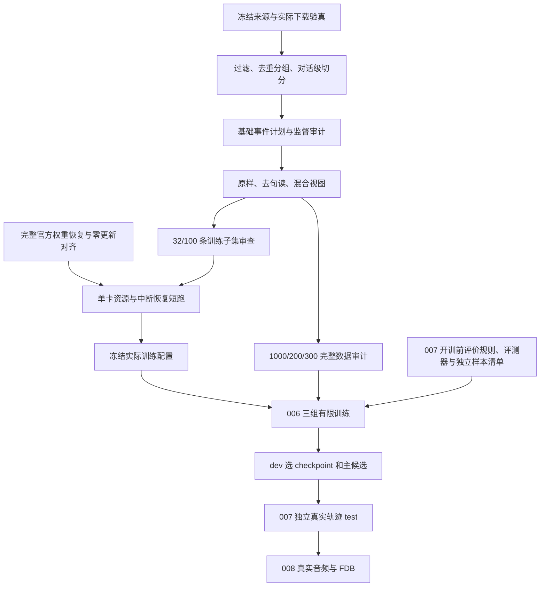

# Layer 1 有限继续训练管线设计

更新：2026-10-19。状态：设计初稿完成，实现待推进。对应 [004](issue/004_training_data_and_annotation.md)、[005](issue/005_training_runtime_and_resource_probe.md)、[006](issue/006_punctuation_robust_adaptation.md)、[007](issue/007_turn_control_evaluation.md)；本次设计工作见 [013](issue/archive/013_training_pipeline_design.md)。

## 1. 目标与范围

从完整官方 DuplexCascade checkpoint 继续训练已有 q/v LoRA，检验有限适配能否改善 Nemotron EN 160ms 输入下的接话，同时保留停顿等待、用户附和、有效插话和回答质量。固定 Kokoro 82M/af_heart、600ms micro-turn、BF16、64-token 贪心评测及现有协议执行路径。训练结果通过 007 后才能进入 008 音频/FDB 验收。

本设计细化[工程方案](engineering_implementation.md)第 4 节，研究范围沿用[研究设计](research_design.md)。不实现 Layer 2/3，不新增控制 token、系统附和、仲裁器或播放通道。当前没有生成器、训练器或训练放行证据；本文所有新增文件和类均为拟实现接口。`configs/layer1_adaptation_protocol.yaml` 继续保持 `training_released: false`。

## 2. 管线与门禁

005 的加载和零更新可先做；真实梯度及恢复短跑依赖 004 最小审计集。短跑只证明可训练，不替代完整数据审计或放行 006。007 的规则、评测器和独立样本清单在正式训练前冻结；候选的最终 test 验收在训练资产交付后执行，避免循环依赖。

放行记录必须引用证据路径、摘要、检查器版本和结果，逐项验证文件及内容；不得只读取手改的布尔值。缺文件、摘要不符、未冻结参数或失败项都退出。来源下载/环境准备作业的当前状态以远端回执为准，本文未重新查询，不把任务单中的“已提交/排队”当成完成。

## 3. 模块职责与目录

首轮采用正常 Python 模块和薄命令入口，不重建通用训练框架。公共模块放在现有 `scripts/training/`；命令入口通过明确的模块搜索路径导入，避免另起已退役的 `src/interclarify` 骨架。

| 拟实现文件 | 整体作用、主要类与核心方法 | issue |
| --- | --- | --- |
| `scripts/training/layer1_data.py` | `SourceReader.iter_dialogues` 流式读源；`SplitBuilder.build` 过滤/去重/切分；`MicroTurnPlanner.plan` 生成事件；`PunctuationViews.transform` 生成句读视图；`SequenceEncoder.encode` 生成 IDs、mask 和位置映射 | 004 |
| `scripts/training/build_layer1_dataset.py` | 薄入口 `main`，按阶段构建数据，原子提交 manifest；可从已验真阶段恢复 | 004 |
| `scripts/training/audit_layer1_dataset.py` | `DatasetAuditor.audit` 检查泄漏、监督、协议、增强一致性、覆盖与摘要；输出机器报告和人审清单 | 004 |
| `scripts/training/layer1_model.py` | `load_official_model` 完整恢复权重；`audit_trainable_parameters` 核对更新白名单；`verify_zero_update` 对照独立参考 | 005 |
| `scripts/training/layer1_trainer.py` | `Layer1Trainer.train_step` 计算监督损失；`save_state/resume` 保存恢复训练与采样状态；`run_probe` 测量资源 | 005 |
| `scripts/training/train_layer1.py` | 薄入口 `main`，区分 `zero-update`、`probe`、`train`、`resume` 模式及其门禁 | 005/006 |
| `scripts/remote/run_layer1_training.sh` | 读取调度分配，锁定 conda/源码/资源，调用训练入口，保存退出码与信号；不实现模型逻辑 | 005/006 |
| `scripts/evaluation/evaluate_layer1.py` | `Layer1Evaluator.replay` 自由回放；`summarize` 汇总配对计数、分组区间和失败；复用唯一推理服务与 X-Talk 协议路径 | 007 |
| `configs/layer1_data.yaml` | 来源、过滤/去重、切分、事件采样、句读规则、种子和审计版本 | 004 |
| `configs/layer1_training.yaml` | 资产、更新白名单、优化器、长度/batch/累积、预算和保存策略；未冻结项用 null 并拒绝正式训练 | 005/006 |
| `configs/layer1_acceptance.yaml` | 引用协议已登记阈值、独立样本清单、选择规则与评审方法，避免维护两份冲突阈值 | 007 |

已有 `fetch_layer1_sources.py` 继续负责来源下载验真。模型加载优先将 `duplex_model_service.py` 的资产恢复和 prompt 构造提取为公共函数，服务继续调用公共实现；迁移时同步更新服务测试与说明，重验受影响的 001 对照。训练器不导入 FastAPI 服务生命周期，也不复制第二套参数映射。

每个新增或修改的代码文件都提供 `docs/` 下同路径中文说明及必要测试，例如 `scripts/training/layer1_data.py` 对应 `docs/scripts/training/layer1_data.md`。本文只定义接口，单文件说明在相应实现时交付。

## 4. 数据与产物契约

所有清单使用 `schema_version`，以 UTF-8 JSON/JSONL 保存结构化数据；实际文件字节 SHA256 用于验真。用于分组或稳定 ID 的文本归一化规则独立版本化，不能用归一化摘要替代原文件摘要。

| 产物 | 必须字段与约束 |
| --- | --- |
| `download_manifest.json` | 现有下载器输出；固定 dataset/revision、来源清单摘要、每 shard 字节数/SHA256，完整通过后才允许读入 |
| `split_manifest.jsonl` | `source_type=synthetic_ultrachat`、原始 ID、shard/行号、原文摘要、去重组、split、排除/补选原因；train/dev/test 为 1000/200/300 条合格原始对话 |
| `event_plans.jsonl` | `dialogue_id`、split、epoch、计划种子/版本、`event_id`、用户原文跨度、assistant 目标来源、控制类别、合成拍号、插话/附和来源；不存伪造真实到达时刻 |
| `view_assignments.jsonl` | 对话/epoch/训练臂、original 或 unpunctuated、基础计划摘要；T3 每轮 500/500，每条对话只曝光一个视图 |
| `sequences.jsonl` | 序列/对话/事件 ID、视图、`input_ids`、`labels`、`attention_mask`、目标跨度、上下文跨度、长度与有效监督数；labels 忽略位置为 -100 |
| `audit.json` | 全部输入摘要、审计器版本、各项通过/失败、排除计数、跨集合重复、类别覆盖、人审状态、对话/序列/拍/有效 token 数；机器检查与人审分别记录 |

按固定来源遍历顺序读取，检测重复 ID、空串、不成对 user/assistant 轮次、控制标记注入和无效编码；拒收或排除原因必须可追溯。英文筛选和长度上下限在第一次正式切分前登记，语言检测方法及依赖一并锁定，不能按候选表现过滤。

先构建精确/近重复组再切分：精确组使用规范化全文摘要；近重复拟采用词 5-gram、固定种子 MinHash 候选及精确 Jaccard 复核，阈值初值 0.85。传递关联取连通组；参数先在人审小样本上检查，再在候选结果出现前冻结。该检查只证明本规则下无跨集合近重复，不保证任意语义改写都被识别。按稳定哈希排序选样，同组全部归属同一 split，明确记录未入选成员；不够数量时按既定顺序补选，不复制凑数。

32/100 条最小集是 train 的确定性子集，不另取 dev/test。完整 FDB、FLEURS 100 条及历史五例不得进入训练/选择；可识别的外部 ID/文本摘要用于排除并记录检查边界。官方作者 50k 清单未知，文本 dev/test 只称未参与本次继续训练。

## 5. 基础事件、采样与控制监督

基础事件计划先于句读增强产生。使用发布 tokenizer 在原样用户文本上采样 1–7 token 微轮、assistant 每拍最多 10 个内容 token；10-token 文本片段与控制/消息边界分开记账，不能把 64-token 推理预算当成训练分拍长度。

以下参数继承 004 的计划，尚不声称已独立复现论文实现。004 编码前须对照其固定论文版本登记采样单位、触发顺序和微轮拼接示例；无法确认的部分标为本项目实现选择，并先更新配置说明。

| 事件 | 拟执行采样单位与顺序 | 监督约束 |
| --- | --- | --- |
| 自然停顿 | 非末尾用户微轮之后，以 0.10 概率插入 1–5 个空拍 | 保持用户未结束，不以空拍直接推导 finish |
| 正常结束与接话 | 原始用户长轮结束后进入 assistant 回答计划 | 监督 finish 和合法回答片段，标记真实来源边界与模拟边界 |
| 有效插话 | 每个可使用后续用户轮的系统长轮以 0.30 概率触发一次，在合法微轮边界选位置 | 后续 UltraChat 用户轮作为插话来源，停止旧正文目标并转入新请求；没有合法后续轮就记录不可采样，不虚构回答 |
| 用户附和 | 系统微轮以 0.01 概率插入，和有效插话同拍冲突时优先执行已登记插话 | 使用冻结的短附和词表并记录来源，控制为 backchannel，继续旧回答；不增加系统附和目标 |
| 回答后思考 | 完成回答后采样 1–20 个空拍 | thinking，不能额外生成无来源回答 |

先固定原始长轮及可用后续轮，再抽取插话，再分拍与插入自然停顿，再抽用户附和，最后追加回答后思考。插话消耗的后续用户轮不得在普通对话流程再次曝光；旧回答未输出尾部不再监督为已说出。插话时刻、用户续说与新回答开始的控制序列须经协议实例审查后冻结，不能只拼接两段文本。

控制名与 wire ID 以现有盘点为依据，运行时重新编码核对，不按自然语言名字猜测：

| 控制 | wire token | ID |
| --- | --- | --- |
| 继续说话 | `<\|user is talking\|>` | 151647 |
| 结束说话 | `<\|user finish talking\|>` | 151648 |
| 思考 | `<\|user is thinking\|>` | 151649 |
| 有效插话 | `<\|user interruption\|>` | 151650 |
| 用户附和 | `<\|user backchannel\|>` | 151651 |

no-voice 为 151646，im_end 为 151645，BOS 为 null。自然停顿中 talking/thinking 的具体转移，以及控制 token 后可否带当前回答片段，由冻结的协议实例表明确列出；这些是 004 最小集交付前必须解决的设计细节，不能将本文表格当成完整语法。控制目标来自事件计划和人审，不抄 B0 的持续等待输出。

合成标签可以使用原始长轮结束与后续文本来构建离线监督，但当前拍 `input_ids` 只能包含已调度到该拍的用户跨度和历史 assistant 目标。后续内容、事件类型和标签原因不得进入 prompt。真实 ASR 轨迹使用独立 source_type 和真实到达时间，禁止与合成拍号混用。

## 6. 句读视图、序列化与损失

T1 使用原样用户跨度，T2 删除用户普通句读，T3 按对话/epoch 固定种子平衡分配。所有组共用同一原始对话顺序、基础事件计划与控制/assistant 目标；增强后只对相同跨度重新编码，不重新选择微轮边界。去句读后为空的普通跨度保留该拍并按冻结规则编码 no-voice，记录此类变化，不偷偷并拍。

删除规则用显式字符集合和上下文保护实现：保护控制 token、词内直/弯撇号、连字符、小数点及 HH:MM 等时间格式，保留 assistant 句读和原始文本。特殊 token 注入在读源时拒收。保护规则必须有反例测试，不能用一条“删除全部标点”正则替代。

`SequenceEncoder` 按现有 `build_prompt_ids` 的原始 ChatML ID 拼接方式编码，不直接调用会自动插入默认 system prompt 的 chat template。assistant 历史保留完整目标 ID 序列；结束 ID 和换行的归属以已审计实例为准，不能随意补 EOS 或把解码文本重新分词作为历史。

首轮使用 teacher forcing 的因果语言模型损失，只监督当前目标区间内的 assistant 控制、正文及合法结束 token。user、消息头、padding、重复携带的历史上下文全部 mask 为 -100；causal shift 后逐位置核对，避免一位偏移。默认不加控制类别权重，不以 loss 大小作为候选通过依据。有效 token 计数采用实际参加 loss 的位置。

首轮不跨对话 packing。长对话按完整 micro-turn 边界构造带上下文窗口，重叠上下文只作输入，不重复监督；每个事件的目标只计一次。三视图以最大长度约束共同确定窗口，去句读导致 token 长度改变时记录差异。单个合法目标即超限时拒收/补选或调整经短跑冻结的长度，不能截断后伪造结束。训练语料的回答长度和 64-token 在线生成截断分开报告。

训练事件种子由全局种子、split、对话 ID、epoch 和用途经稳定摘要派生，不依赖 Python 内置 hash 或 worker 调度。基础事件可逐 epoch 确定性重建；首轮只一 epoch。dev/test 事件和视图提前物化冻结；首轮训练也冻结事件计划与顺序，便于三个训练臂比较和中断恢复。

## 7. 权重加载、零更新与训练循环

加载完整官方 tokenizer、模型配置、基础依赖、发布 embedding/head 和 q/v LoRA，沿用 strict 参数映射；审计 missing/unexpected/shape 差异为零，已登记等价映射另列。资产摘要引用现有 inventory，实际使用前复核。保持发布的 r=16、alpha=32、dropout=0.05，不另加 adapter 或量化条件。

首先冻结全部参数，再按实际完整名称开放已有 q_proj/v_proj LoRA A/B；禁止仅按含有 `lora` 的模糊名字放行。记录白名单、参数数量、dtype 和初始摘要，确认 embedding/head（包括 PEFT modules_to_save 副本）冻结。训练前后检查冻结参数不变、允许参数确有更新、loss/梯度有限。

零更新比较在 eval 模式关闭 dropout，使用 001 固定的独立官方参考、相同 prompt IDs、BF16 与贪心设置；logits 沿用 atol=0.02、rtol=0.01，生成 IDs/控制必须一致。比较位置和张量摘要写报告；同一公共加载器的两次输出不能代替独立参考。零更新失败不得进入梯度短跑。

训练采用 AdamW；学习率、weight decay、warmup、梯度裁剪、实际 batch/累积、序列长度和总步数在 005 短跑后冻结，正式模式不接受 null。默认按有效监督 token 归一化损失，梯度累积和最后不足一个累积窗口时使用窗口实际监督数，避免短序列或尾 batch 获得额外权重。记录 optimizer 与 scheduler 的推进单位，三个训练臂相同；不丢弃数据尾部以凑整数步。

train 模式保留官方 LoRA dropout，启用 gradient checkpointing、关闭训练 KV cache；确认冻结 embedding 时 LoRA 仍有有效梯度。无监督 batch、NaN/Inf 或白名单外参数改变均失败退出。dev 自由回放使用 eval 模式，各模型生成自己的历史；teacher-forced loss 只作辅助诊断。

## 8. checkpoint 与恢复

首次训练从官方模型权重新建 optimizer/scheduler/RNG，并注明原发布资产未提供作者训练状态。中断后恢复的是本次实验状态，不能声称逐步续接作者训练。

在 optimizer step 完整结束且梯度已清空时保存，首轮不保存半个累积窗口。每份恢复包包含：更新的 LoRA、固定资产引用与摘要、optimizer/scheduler、Python/NumPy/Torch CPU/CUDA RNG、epoch、global step、已消费对话/序列/有效 token、下一个样本游标、事件计划及视图分配摘要、完整配置和依赖版本。预取样本以实际已消费游标为准；首轮数据 worker 为 0，降低恢复歧义。

临时目录写完并校验后原子发布完成标记；不完整目录不能被当作可恢复 checkpoint。收到终止信号时只在允许的时间内保存完整 step，来不及则保留上一份；记录未保存步数和退出码。更改数据、配置、设备拓扑或白名单后不得伪装为同一 run 的严格续跑。

005 在同一硬件/软件和固定 004 最小集上比较连续运行 N 步与 K 步保存、干净进程恢复再运行 N-K 步。核对样本顺序、视图、有效 token、step、LR、optimizer/RNG 及参数；数值容忍在执行前登记。若不能位级一致，定位非确定算子并说明误差，不把“能读回文件”当作恢复通过。

交付推理候选只需更新参数和完整固定资产引用、token 映射、摘要；恢复包另含优化器等状态。必须由干净进程重建完整模型并复现 dev 结果，再交给 007。

## 9. 远端资源与执行单

训练根沿用任务单登记的 `/hpc_stor03/sjtu_home/xuan.zhang/interclarify-layer1-training-20261019/`，独立 conda prefix 为其 `envs/training`。环境存在和依赖可用须实际验证；不修改历史服务环境。已有 checkpoint/base 只读复用，禁止每个 run 复制整套权重。

| 阶段 | 初始申请与并发约束 | 输出及停止条件 |
| --- | --- | --- |
| 来源/生成/审计 | CPU 作业最多 1 个，4 CPU、32 GiB 主存；流式处理，去重索引落盘 | 原始 shard 验真、切分/事件/审计；不足资源时失败并登记调整，禁止整库载入 RAM |
| 零更新/资源/恢复 | 同时最多 1 个 GPU 作业；先 1×4090 24GB、4 CPU、64 GiB 主存，数据 worker=0 | 零更新、实际梯度、保存恢复；单次短跑最多 1 GPU 小时，累计 005 初始预算 4 GPU 小时 |
| 006 正式训练 | 首轮三臂串行；每臂使用 005 冻结拓扑，总 GPU 数不超过 8 | 每臂每轮最多 1 epoch；首轮每臂 8 GPU 小时，第二轮 16，总上限 72 GPU 小时 |

005 上述限额是拟申请的作业上限，不表示配额已批准或单卡已可运行；调度器不能满足时记录实际申请。005 消耗单独记账，不侵占或暗增 006 的已登记预算。

短跑先用 batch=1，按实际合法序列长度从短到长探测，例如 512/1024/2048/4096 token 桶；不足该长度不拼凑虚假样本。记录真实长度分布、有效 token、峰值 allocated/reserved 显存、CPU RSS、step time、数据等待、tokens/s、保存时间/大小。显存保留约 10% 余量；先调整长度/batch/累积和 checkpointing，仍不可行再登记多卡/分片方案并重验恢复，不预先默认单卡或 DDP 一定能装下。

训练根新增数据/日志/checkpoint 初始磁盘上限 100 GiB，依赖环境另计，公共只读模型不重复计费；执行前核验来源清单字节总量、现有占用、配额及剩余空间。每个 run 默认保留 latest 和 dev-selected 两份完整恢复包，原子保存期间预留第三份空间；所需空间超限时停止，不删除历史证据或公用资产。轮询写盘量、主存和 GPU 时间，接近上限时在完整 step 边界退出；墙钟上限由 GPU 数与 GPU 小时预算换算并计入加载/保存开销。

每次运行生成独立 `run_id`，产物放 `runs/<run_id>/`：manifest、冻结配置、源码/依赖/资产摘要、资源日志、metrics、audit、checkpoints 和 exit_code。仓库只回收紧凑报告、摘要、必要小示例；模型和大日志保留远端。

实施时交付可执行的远端任务单和脚本，按以下顺序运行：来源验真 → 32 条生成/全量人审 → 零更新 → 100 条长度/梯度/恢复短跑 → 完整数据审计 → 007 开训前冻结 → 006。当前入口尚未实现，因此本文不提供可直接提交的训练命令。

## 10. 三组公平比较与候选选择

B0 是同一完整官方初始化；T1/T2/T3 各自重新从 B0 开始，不能串行继承上一臂权重。共享原始对话、对话顺序、基础事件种子、训练超参数和 epoch 数。T3 首轮恰好 500/500；所有组分别报告实际有效 token、optimizer steps 和 GPU 小时，句读造成的长度差异不通过补曝光偷偷弥平。

007 从已有协议读取覆盖、误抢/误停、内容质量和严重日期/否定错误阈值。开训前登记候选保存间隔、dev 选择顺序及无合格项时的 stop/revise 规则；质量约束满足后再按预登记覆盖与等待指标比较，禁止只选训练 loss 最低点。真实独立 dev/test 的最小数和说话人隔离沿用协议，不用现有单条录音变体补足数量。

各组在文本 dev 和独立真实 dev 上自由生成，test 在 checkpoint 与主候选冻结后开启；所有模型/条件的失败、漏答保留分母。test/FDB 不能用于阈值或第二轮调参。第一轮有稳定收益且明确需要补数据时，才能使用唯一一次有误差依据的调整机会；第二轮最多 3000 条。两轮无稳定收益即停止扩训。

## 11. 实现顺序与验收

1. **004 数据核心**：实现读取、过滤、分组切分、事件计划、增强、编码和审计；交付 32 条全审最小集，再交付 100 条短跑集与完整集。重点测试确定性/恢复、未来泄漏、五类协议、mask、保护字符、三视图同事件及 T3 平衡。
2. **005 加载与训练核心**：提取公共加载逻辑、完成 strict 审计和独立零更新，再验证允许参数更新及中断恢复；所有真实权重/GPU 验证只在远端执行。
3. **007 开训前工作**：落实独立样本清单、评价器、盲评和候选选择规则；这一步与 004/005 的实现可交错推进，不宣称最终验收已完成。
4. **006 配置冻结与有限训练**：以上证据齐全后冻结实际长度/batch/步数/优化器/预算并检查门禁，运行三臂，交付候选及 dev 报告。
5. **007/008 后验收**：完成独立真实轨迹 test，再做音频/FDB。候选不合格就记录 revise/stop，不通过改 ASR/TTS、放宽阈值或实现 Layer 2 绕过。

尚待实施阶段解决：论文参数的逐项采样核对、完整控制转移实例、过滤/去重参数小样本校准、零更新全 logits 的比较位置、优化器数值与实际调度配额。它们都有上述 issue 归属；未解决前不能将设计交付误记为数据/训练/评测完成。
