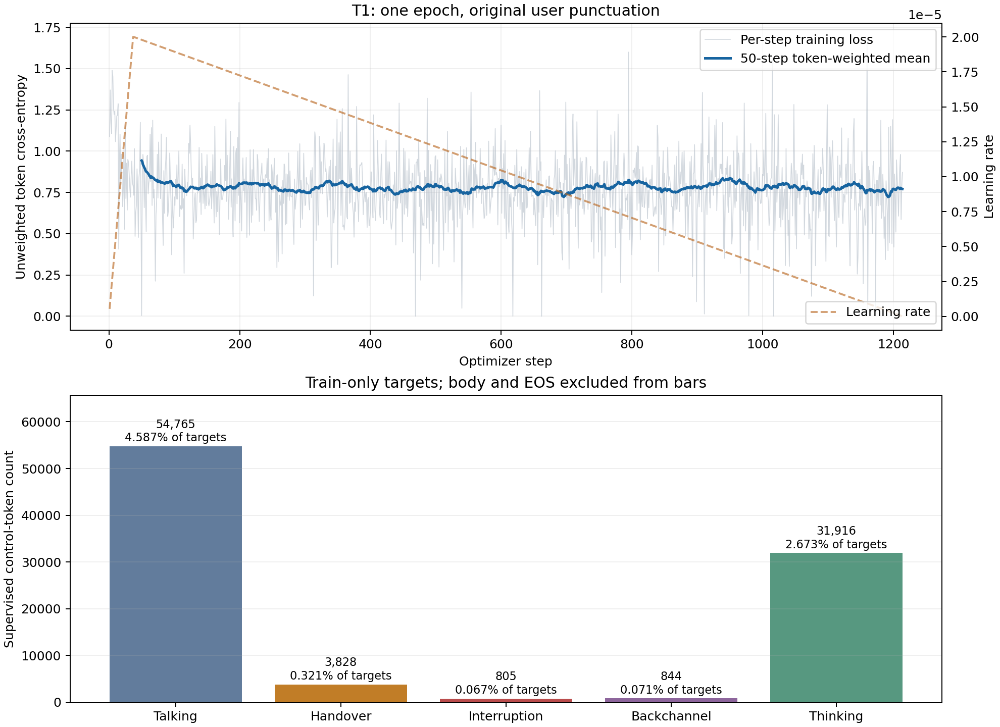

# T1损失变化与控制类别加权分析

结论：T1已完成，训练稳定，总训练loss有下降信号。类别加权有明确的数据分布依据，值得作为后续单独条件验证，但不能凭总loss认定稀有控制没有学好。当前T2/T3应保持相同未加权目标，不能中途改动破坏首轮对照。

## 来源与执行状态

数据回收时间2026-10-20北京时间13:45:59，原始观测见[输入记录](../t1_loss_observation.json)。T1于13:38:41完成1,214步/2,428序列，遍历1,000条训练对话，退出0，最终summary通过。112个既有LoRA张量发生变化，冻结参数摘要不变；训练循环1,814.85秒，总耗时1,976.54秒。检查时T2完成213步、T3等待，不代表本文阅读时的实时进度。

远端仅进行一次单CPU/nice10读取，2GiB虚拟地址和64MiB单文件硬限，外层120秒，不启用GPU。逐份校验1,000条train产物摘要及split，统计基础事件一次；4.440秒完成，RSS峰值103,856KiB。统计总监督token1,193,875与实际训练索引、全量逐步曝光计数一致，不包含dev/test或重复历史。

分析使用`scripts/training/analyze_layer1_loss.py`和已有本地conda `ml-hw1`；[汇总](summary.json)、[逐步CSV](steps.csv)、[PNG曲线](loss_curve.png)及[PDF曲线](loss_curve.pdf)均由真实记录生成。检查包括连续1,214步、有限loss/梯度、累计监督数、最终summary和退出码。

## loss如何变化

| 区间 | 每步loss算术均值 | 按有效监督token加权均值 |
| --- | ---: | ---: |
| 前100步 | 0.8475 | 0.8705 |
| 第201–300步 | — | 0.7643 |
| 第601–700步 | — | 0.7486 |
| 第901–1000步 | — | 0.7966 |
| 后100步 | 0.7419 | 0.7706 |
| 全部1,214步 | 0.7680 | 0.7864 |

首尾100步的token加权均值相差约-11.47%。下降主要发生在早期；中后段固定100步窗口大多在0.75–0.80之间波动，未持续单调下降。最后一步loss为0.8717，不能据这一点判断反弹或过拟合；不同批次的输入、目标和难度不同。50步token加权滑动曲线更适合观察趋势。

全部loss和梯度有限，没有NaN/Inf或OOM。前100步平均裁剪前梯度范数2.573、后100步0.946；本轮持续使用1.0梯度裁剪。早期到后期没有观察到梯度发散。学习率在37步warmup后持续衰减，末步约1.70e-8；后段平台也受到学习率退火影响，不能据此断定需要扩大epoch。

这些窗口不是固定样本的训练前后配对比较；目前只有训练loss，没有新增dev评测或按类别模型NLL。因此下降与学习一致，但不能量化未见数据改善、排除过拟合或证明接话/插话控制提高。

## 监督频数与目标的重要性

| 目标 | token数 | 全部监督token占比 | 论文控制权重候选 |
| --- | ---: | ---: | ---: |
| 正文 | 920,770 | 77.124% | 1 |
| EOS | 180,947 | 15.156% | 1 |
| speaking／继续等待 | 54,765 | 4.587% | 1 |
| thinking／回答后等待 | 31,916 | 2.673% | 1 |
| finish／接话 | 3,828 | 0.321% | 10 |
| interruption／有效插话 | 805 | 0.067% | 5 |
| backchannel／用户附和 | 844 | 0.071% | 2 |

五类控制合计92,158个，占全部监督7.719%；其中speaking与thinking占控制token约94.06%。普通CE让每个监督token同权，而接话/插话/附和是我们重点关心的行为，出现频数较少。总loss下降可能主要体现正文或常见控制的变化，无法从现有日志拆解原因。

上述候选控制权重来自[DuplexCascade论文§4.1](https://arxiv.org/html/2603.09180v1#S4.SS1)的类别不平衡处理；本项目关闭系统附和，故不引入system-backchannel类别。正文/EOS权重1是本项目候选实现约定，论文没有在该段逐项展开普通token/EOS处理。

在保持全部监督、按加权token总和归一化的前提下，采用这些权重后，名义目标权重总量从1,193,875变为1,232,391；接话占比约0.321%→3.106%，插话0.067%→0.327%，附和0.071%→0.137%，五类控制合计约10.603%。这些是加权目标的名义权重占比，**不是实际loss、梯度贡献或行为召回率**。

## 是否引入

建议将控制类别加权作为后续一次调整的优先候选，而不是因本条曲线平台立即改动当前T2/T3或扩大训练规模。理由是监督频数与控制任务重要性不对等，而不是T1优化失败。

首轮继续保留T1/T2/T3相同未加权目标，固定最终checkpoint，在同一历史FDB小子集进行B0及候选对照和人工检查。若实际仍持续等待、漏接或漏停，而停顿负例稳定，则10/5/2类别权重是有依据的后续试验起点；若当前配置已满足本轮实用目标，则不能仅因论文用了加权就认定必须重训。

加权可能同时提高过早接话或误停概率，需要结合暂停、附和负例解释；不能通过提高接话频率单独宣称成功。现在缺少按类别模型NLL/召回率和B0/T1配对行为结果，故不能断言稀有类别确实学不好，也不能保证加权有效。FDB每子集仅5例，结果只作首轮回归与失败定位。

后续实施时，加权应仅作用于目标ID对应的五类控制token，正文/EOS保持1，不将整段回答乘以控制权重；两次累积micro-batch应按共同权重总和归一化。届时保留普通CE诊断，以免把定义已改变的加权loss直接与本轮数值比较，并作为新条件登记；本项没有实现或启动该训练变更。
