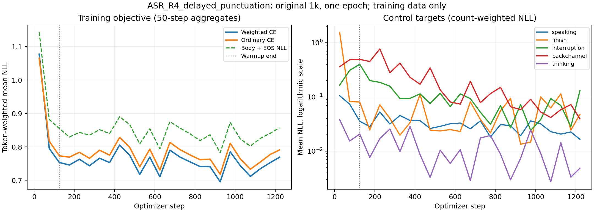

# 原1k延后句读训练的loss反馈

2026-10-21，Issue 080。训练执行正常，控制目标在训练数据上的拟合明显改善，尤其是交接finish；后期总loss下降趋缓。现有证据支持转入固定条件能力评测，尚不足以据此追加epoch或声称FDB接话率已经提高。

## 汇总口径与总体变化

读取完整1240步`steps.jsonl`，按真实有效监督token聚合普通CE、按目标权重和聚合加权CE；控制NLL按该类目标数量聚合，均使用自然对数。图每50步聚合一次，最后一组40步。所有值是在训练过程中、当前批次上的teacher-forcing目标损失，不是把训练结束后的模型重新评估在固定样本集上的结果。

| 指标 | 前100步（1–100） | 最后100步（1141–1240） | 降幅 |
| --- | ---: | ---: | ---: |
| 加权CE | 0.9334 | 0.7566 | 18.95% |
| 普通CE | 0.9384 | 0.7798 | 16.90% |
| 正文加EOS平均NLL | 1.0097 | 0.8454 | 16.27% |

全程token加权CE为0.7667、普通CE为0.7875。四个连续四分之一训练区间的加权CE为0.8116、0.7585、0.7520、0.7449，主要改善出现在前段，后段继续小幅改善。50步分组在后期仍于约0.70–0.79间波动；最后一组0.7690，高于前一组0.7534，不能描述为逐步单调下降或最后一步最低。

最后一步loss为0.9744，并不与最后100步0.7566矛盾：不同批次长度和目标构成不同。单步loss中位数0.7470、P95为1.1060，最大1.7375出现在第721步，该步只有64个有效目标；第1202步也有1.5868的孤立高值。未出现非有限值或持续发散，但仅凭这些日志不能确定每次尖峰的内容原因。

[SVG独立文件](loss_curve.svg)可用于导出。左图为各类token加权聚合，右图为控制类别计数加权NLL、对数纵轴；warmup结束为第124步。曲线只含训练数据，不存在验证集曲线。

## 五类控制目标

| 目标 | 全epoch目标数 | 前100步目标数 | 前100步NLL | 最后100步目标数 | 最后100步NLL |
| --- | ---: | ---: | ---: | ---: | ---: |
| talking：继续倾听 | 58593 | 4582 | 0.08801 | 4930 | 0.02054 |
| finish：交接启动 | 3828 | 326 | 0.83831 | 316 | 0.03148 |
| interruption：用户打断 | 805 | 64 | 0.24161 | 74 | 0.06671 |
| user backchannel：附和时续答 | 844 | 71 | 0.40967 | 69 | 0.05553 |
| thinking：回答后等待 | 31916 | 2707 | 0.02738 | 2501 | 0.00398 |

finish下降约96.24%，幅度最大；前50步为1.5581，随后50步已降至0.0823，说明交接监督在早段迅速得到拟合。后段各50步仍有波动，不能认为finish已经在所有场景可靠。interruption下降约72.39%，最后100步NLL仍高于finish；但前后仅64/74个目标、样本不同，不能由此比较两个行为的真实成功率。

talking、thinking及backchannel的训练目标拟合也改善。这里的backchannel为用户附和控制，系统backchannel仍未启用。每类NLL较低只说明给定真实历史/标签前缀时，正确控制token的损失较低，不是自主回放的分类准确率，不检查回答是否相关、何时真正发声或是否误抢话。

## 总loss与稳定性应如何理解

全epoch约99.19%的加权NLL分子来自“非五类控制token”，日志只能将这些token作为正文加EOS合并，不能单独拆成正文和EOS。最后100步该贡献为99.69%；五类控制已相对容易，总loss主要反映这部分剩余目标。加权CE低于普通CE也不矛盾：容易的控制token增加了权重分母，不能简单把两者数值大小当作目标优劣。

裁剪前梯度范数最大39.71（第5步），中位数0.945、P95为5.191；563/1240步（45.40%）超过1，由既定max_grad_norm=1裁剪。前100步98步需要裁剪、梯度中位数3.655，末100步30步、中位数0.813。早期finish损失较高的批次也有较大梯度，后期梯度整体变小；没有NaN、Inf、零梯度或冻结参数变化，不属于训练发散的证据。梯度裁剪频率本身不能说明应提高裁剪阈值。

## 训练反馈与下一步

本轮已完成预定单epoch，所有1000对话、2480序列及1201531个有效监督token完整曝光；加权目标重算、完整权重和干净进程生成ID一致。可以使用最终候选进入能力评测，训练执行没有显示需要恢复或重跑的异常。

建议下一步先在新候选上沿用与旧T2相同的完整FDB319例、ASR/TTS、生成策略和官方评分口径，重点看Smooth接话率、漏答、过早接话、有效接话延迟与User Interruption。原对照为59/119（49.58%）和160/200（80.00%），这些数字来自旧模型，不能套用到本轮。GPT相关性仍沿原决定待补。

本轮没有dev/test loss，也没有新FDB结果，所以不能判断泛化、排除过拟合或确认标点策略改善实际接话。旧040逐步日志已清理，本轮不虚构两轮完整loss对照。前后区间样本不同、源数据和控制时序是合成的，训练目标易拟合也不能排除自然ASR迁移差距。保留当前最终epoch，先做行为验证，再决定扩到3k或修改其他训练参数。

## 证据与执行

统计见[loss_analysis.json](loss_analysis.json)，完整来源SHA256随文件保存；[collection.json](collection.json)核对回收内容摘要。分析源码冻结`c920c37`，远端独立worktree`source/issue080-c920c37`，输出为训练根目录`data/runs/issue080-asr-loss-analysis-r1/loss_analysis.json`，分析退出0。只读取已有日志和59MiB级checkpoint计算摘要，不运行新模型或分配GPU；现役conda、4GiB地址空间、线程1、5分钟超时。训练资源和最终checkpoint见[训练报告](README.md)。
